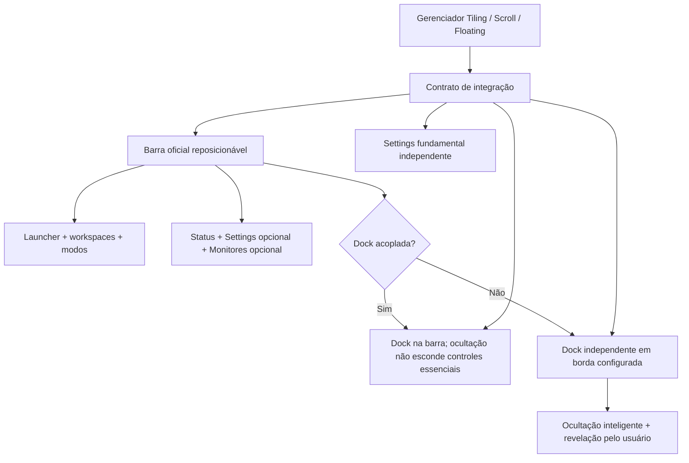

# Interface padrão da futura suíte Arch — Especificação funcional e registro de decisões

**Versão de trabalho:** 3.13  
**Data:** 28/10/2026  
**Situação:** documento vivo; **regra normativa mais recente: D-45 (seção 49, focar pela dock janela temporariamente ocultada); D-44 (seção 48), com restauração automática ao mapear nova janela elegível no workspace revelado;** a **seção 45 registra a decisão D-42 e o contrato consolidado de Visão Geral/foco/restauração**. A **seção 44** registra a D-41 e o aprofundamento dos estados de foco e da função Mostrar área de trabalho. A seção 43 registra a decisão D-40 e as alternativas de superfície P-14/P-15; a seção 42 registra D-39 e a origem da proposta P-13; a seção 40 registra a decisão D-38; a seção 39 registra as necessidades D-36/D-37, preservando os detalhes de interação em aberto; reúne decisões da conversa e propostas para revisão. A **seção 18** reúne a dock consolidada; as **seções 19–21** preservam o histórico de elaboração do launcher; a **seção 22** registra a D-22 e a consolidação funcional; a **seção 23** registra as propostas iniciais do Settings; a **seção 24** contém a decisão D-23 e o detalhamento de Janelas, Workspaces e Monitores; a **seção 25** registra a D-24 e especifica padrões de workspace, perfis de monitores, atalhos e diagnóstico; a **seção 26** registra a D-25 e propõe a ampliação do Settings para energia e serviços transversais; a **seção 27** registra a D-26 e estabelece a regra aprovada de delegação do gerenciamento de inatividade; a **seção 28** registra a D-27, a solução de fallback e a consolidação arquitetural do Settings; a **seção 29** inicia o design system, cuja direção V-B foi aprovada (D-28); a **seção 30** preserva a proposta histórica de barra modular; a **seção 31** aprova o layout de três ilhas (D-29) e registra o refinamento visual; a **seção 32** registra o tema automático baseado no wallpaper (D-30); a **seção 33** registra o tema global derivado do wallpaper principal (D-31) e mantém a alternativa por monitor no backlog F-01. O documento independente `LAUNCHER_HIBRIDO_ESPECIFICACAO_CONSOLIDADA_v1.0.md` é a referência de uso do launcher, prevalecendo sobre propostas antigas conflitantes. Seções anteriores permanecem para rastreabilidade.  
**Nome do produto:** em aberto. `Kwinish` é apenas um identificador de trabalho citado anteriormente; não é identidade aprovada.  
**Âmbito:** design funcional da interface padrão (rice oficial) e fronteiras com a futura loja de rices. **Não é especificação de implementação aprovada**, nem relatório do código.

### Complemento de decisões — 28/10/2026

| ID | Intenção expressa pelo usuário | Estado |
|---|---|---|
| **D-36** | Incorporar à barra do rice oficial um **ícone para Mostrar área de trabalho**, com alternância reversível de visibilidade das janelas, sem destruir o estado dos modos e layouts. | **Necessidade solicitada pelo usuário.** Posição exata, ícone, atalho, escopo multimonitor e estratégia técnica não aprovados. |
| **D-37** | Disponibilizar **Visão Geral** para os workspaces e/ou para as janelas de um workspace, facilitando navegação visual. | **Necessidade solicitada pelo usuário.** Sistema com níveis Todos / Atual; o padrão de entrada em Todos está aprovado pela D-38. Gestos e tecnologia ainda em discussão. |
| **D-38** | Ao abrir **Visão Geral**, apresentar inicialmente **Todos os workspaces**, com acesso secundário ao workspace atual. | **APROVADA.** Não memorizar o último nível como abertura padrão; detalhes de interação e backend continuam em análise. |
| **D-39** | Na Visão Geral, **clique no cartão abre o detalhe das janelas**; botão separado **Ir para workspace** ativa o workspace diretamente. | **APROVADA expressamente em 28/10/2026**. |
| **D-40** | Na Visão Geral, **todos os workspaces são exibidos agrupados por monitor**, com **filtros opcionais** para restringir a visualização a um monitor. | **APROVADA expressamente em 28/10/2026**. |
| **D-41** | Na Visão Geral multimonitor, usar **uma única superfície no monitor em foco**, mostrando workspaces de **todos os monitores agrupados por monitor**. | **APROVADA expressamente em 28/10/2026**. Resolvida a escolha entre P-14 e P-15: P-14 adotada; P-15 não entra na primeira versão. |

## 1. Visão

Uma suíte opcional para Arch Linux, montada sobre Hyprland, com gerenciador independente de janelas (Tiling, Scroll e Floating), interface oficial e, futuramente, instalação/ativação de rices completos. A interface oficial pode reorganizar seus componentes; **isso não implica modularidade entre rices de terceiros**.

## 2. Registro das escolhas

### 2.1 Decisões expressamente tomadas pelo usuário

| ID | Decisão | Estado |
|---|---|---|
| D-01 | Interface visual concebida como **rice padrão da futura suíte Arch** | Aprovada |
| D-02 | **Barra e dock** são conceitos distintos; a dock pode ficar **integrada à barra ou desacoplada**, com possibilidade de posicionamento separado (inferior, lateral etc.) | Diretriz adotada; detalhes a definir |
| D-03 | **Ocultação inteligente** para a dock | Aprovada; casos de borda a especificar |
| D-04 | Workspaces apresentam **indicador de modo integrado**, em vez de seletor completamente separado | Aprovada |
| D-05 | **Configurações** e **monitores** devem estar entre os módulos **opcionais** da área de status da barra | Aprovada |
| D-06 | Na primeira versão da Rice Store, **selecionar e ativar um rice completo como conjunto**; não misturar componentes de rices diferentes | Aprovada |
| D-07 | **Dashboard fora do escopo por enquanto** | Aprovada |
| D-08 | Gerenciador de janelas e configurações fundamentais não devem depender do rice ativo | Direção arquitetural consolidada na conversa |
| D-09 | O nome público do projeto **ainda não está decidido** | Aprovada |
| D-10 | O modo Canvas/VXWM inspirado no driftwm é **visão futura**, não parte do núcleo inicial | Aprovada |
| D-11 | **Configuração inicial do rice oficial:** barra inferior com dock integrada (opção A) | Aprovada em 28/10/2026 |
| D-12 | A capacidade de desacoplar a dock **pertence ao rice oficial**; não é exigência dos rices externos. Um rice completo com barra/taskbar integrada fixa é admissível, desde que cumpra os requisitos funcionais do Floating | Esclarecimento aprovado pela escolha de escopo; detalhes de certificação propostos |
| D-13 | **Escopo da dock oficial:** mostrar aplicativos com janelas pertencentes ao **workspace ativo**, além dos **favoritos fixados**. A mudança de workspace atualiza a lista contextual. | **Aprovada expressamente em 28/10/2026** |
| D-14 | **Clique esquerdo em aplicativo com uma única janela local, no modo Floating:** alternar entre minimizar (quando já está focada) e restaurar (quando minimizada). Se estiver aberta, mas sem foco, primeiro focá-la. | **Aprovada expressamente em 28/10/2026**; a regra de foco intermediário é esclarecimento operacional proposto |
| D-15 | **Favorito cujo aplicativo só está aberto em outro workspace:** tentar abrir **nova janela no workspace atual**, sem navegar automaticamente à janela remota. | **Aprovada expressamente em 28/10/2026**; limites técnicos e single-instance a validar |
| D-16 | **Agrupamento de janelas na dock oficial:** agrupar por aplicativo **por padrão**, oferecendo opção de **desativar o agrupamento no Settings**. | **Aprovada expressamente em 28/10/2026**; interação com grupos e apresentação sem agrupamento são propostas da seção 16 |
| D-17 | **Pré-visualizações híbridas e configuráveis:** lista textual **ou** miniaturas visuais conforme preferência do usuário, **condicionadas ao suporte técnico**; fallback textual quando miniaturas não estiverem disponíveis. | **Aprovada expressamente em 28/10/2026**; detalhes de acionamento e escolha do padrão continuam propostos na seção 17 |
| D-18 | **Favoritos e janelas separados quando o agrupamento está desativado:** os favoritos permanecem como atalhos persistentes e as janelas locais aparecem como entradas individuais distintas na área de tarefas. Aceita-se repetição visual de ícones, com papéis diferentes. | **Aprovada expressamente em 28/10/2026** (opção A); detalhes de clique no favorito permanecem sujeitos à D-14 e à proposta da seção 18 |
| **D-19** | **Launcher híbrido oficial:** combinar **pesquisa imediata por teclado** e **navegação gráfica por aplicativos** na mesma interface. | **Aprovada expressamente em 28/10/2026**. Estrutura de categorias, priorização de resultados, ações e atalhos continuam **propostas** da seção 19. |
| **D-20** | **Tela inicial do launcher híbrido em layout dividido (split):** coluna de categorias à esquerda e grade de aplicativos à direita, com pesquisa imediata no topo. | **Aprovada expressamente em 28/10/2026.** Local de abertura, ordenação, busca, ações, tamanhos e comportamento responsivo continuam **propostas** da seção 20. |
| **D-21** | **Pesquisa global no launcher:** ao digitar, pesquisar em todos os aplicativos e ações disponíveis, **independentemente da categoria visual selecionada**. | **Aprovada expressamente em 28/10/2026** (opção A); apresentação e ordenação dos resultados ainda são propostas da seção 21. |
| **D-22** | **Posição de abertura do launcher oficial:** **centralizado por padrão**, com opção de abertura **ancorada na barra** pelo Settings. | **Aprovada expressamente em 28/10/2026** (opção C); regras de fallback, monitor e foco são recomendações de UX da seção 22. |
| **D-23** | **Settings com sidebar adaptativa:** páginas fundamentais do Sistema sempre disponíveis; com rice oficial ativo exibir Barra/Dock/Launcher/Aparência; com rice externo substituí-las por `Rice ativo` e oferecer acesso às configurações próprias quando declarado e disponível. | **Aprovada expressamente em 28/10/2026** (opção A). Detalhes dos controles e fluxos seguem em especificação funcional, não aprovados automaticamente. |

| **D-24** | **Modo inicial de novos workspaces:** padrão global Tiling/Scroll/Floating com **exceção opcional por monitor**. Workspaces que já possuam modo atribuído não mudam automaticamente quando o padrão global ou a exceção de monitor é alterada. | **Aprovada expressamente em 28/10/2026** (opção C). Semântica de primeira criação, identificação do monitor e restauração são propostas operacionais deste complemento, sujeitas à revisão do código. |
| **D-25** | **Perfis de monitores híbridos:** ativação **manual por padrão**; reconhecimento e ativação **automáticos opcionais**, disponíveis somente após validação de identidade dos monitores, aplicação segura e recuperação efetiva. | **Aprovada expressamente em 28/10/2026** (opção C). Critérios técnicos e UI são propostas da seção 26. |
| **D-26** | **Responsabilidade pela política de inatividade quando um rice externo estiver ativo:** se houver controlador próprio de idle **identificado e efetivamente disponível**, delegar a ele o controle de bloqueio por inatividade, desligamento de tela e suspensão automática nas funções que ele assumir. A suíte mantém consulta ao estado e acesso às configurações do responsável; **não inicia controlador concorrente**. Sem controlador externo, usar controlador da suíte somente se estiver configurado e verificado. | **Aprovada expressamente em 28/10/2026.** Protocolo de detecção, transição, recuperação e UI são propostas de detalhamento da seção 27, não funcionalidades já implementadas. |
| **D-27** | **Fallback da suíte para inatividade e bloqueio de sessão:** quando o rice ativo não oferecer componentes compatíveis e verificáveis, a suíte fornece o controlador de inatividade e/ou bloqueador necessários; quando houver soluções próprias funcionais, delega-se a responsabilidade correspondente. Não executar políticas concorrentes nem presumir proteção após falha. | **Aprovada expressamente em 28/10/2026** (opção A). Escolha das ferramentas, handshake, recuperação e protocolos concretos continuam propostas técnicas da seção 28. |
| **D-28** | **Direção estética V-B — translúcido contido e adaptativo** para a interface oficial: sobriedade, superfícies discretamente translúcidas, blur moderado e fallback opaco; tokens, paleta, intensidade dos efeitos e tema padrão ainda não escolhidos. | **Aprovada expressamente em 28/10/2026** pela opção B. Não estende a identidade visual a rices de terceiros. |
| **D-29** | **Modo modular opcional para a barra do rice oficial:** três ilhas com âncoras lógicas à esquerda, centro e direita, contendo módulos que podem ser **reordenados dentro da respectiva ilha**. A barra contínua continua sendo a apresentação inicial. Não autoriza ilhas arbitrárias ou modularidade entre rices de terceiros. | **Aprovada expressamente em 28/10/2026** pela opção A. Detalhes de editor, limites de espaço, movimento, tokens e implementação continuam como propostas. |
| **D-30** | **Tema automático inicial orientado pelo wallpaper:** a variante Claro/Escuro do rice oficial é definida pela imagem selecionada, com possibilidade de substituição manual global. | **Aprovada expressamente em 28/10/2026**; algoritmo e extração de acento ainda pendentes. |
| **D-31** | **Tema global com wallpaper do monitor principal como referência:** mesma variante/paleta em toda a interface oficial, ainda que outros monitores tenham wallpapers diferentes. | **Aprovada expressamente em 28/10/2026** pela opção A. A alternativa de tema independente por monitor é **F-01 (ideia futura, não aprovada para MVP)**. |
| **D-32** | **Cor de acento gerada automaticamente com base no wallpaper principal**, com seleção manual opcional, independente da escolha claro/escuro. | **Aprovada** em 28/10/2026; algoritmos, tokens cromáticos e ferramenta ainda pendentes. |
| **D-33** | **Transparência leve (opção A) como material padrão do rice oficial**, preservando direção V-B; superfícies quase opacas, blur discreto/opcional. | **Aprovada expressamente** em 28/10/2026. Intervalo de 94–97% de opacidade na barra e dock é referência de prototipagem, não parâmetro final obrigatório. |

| **D-34** | **Tipografia da interface oficial acompanha a fonte configurada no sistema** (opção C); não impor Inter ou Noto Sans, respeitar fallback/acessibilidade e não alterar preferências de rices externos. | **Aprovada expressamente em 28/10/2026**. Extração técnica da fonte e escala final de tokens permanecem propostas. |

| **D-35** | **Ícones de sistema do rice oficial seguem uma família visual consistente, com pictogramas lineares/simbólicos e linguagem uniforme; os ícones originais dos aplicativos são preservados.** O Settings em GTK4 mantém integração nativa e respeita semântica/acessibilidade. | **Aprovada expressamente em 28/10/2026**. A biblioteca exata (Lucide, Adwaita simbólico etc.), tamanhos de traço, estados e variantes permanecem **propostas sujeitas a mockups e auditoria técnica**. |

### 2.2 Propostas recomendadas, mas ainda não aprovadas em detalhe

| ID | Proposta | Status |
|---|---|---|
| P-01 | **Barra inferior como configuração inicial** da interface oficial; reposicionável para cima | **Configuração inicial aprovada**; reposicionamento permanece proposta |
| P-02 | **Dock integrada à barra inferior** na instalação padrão; centralização exata a definir | **Integração aprovada**; centralização permanece proposta |
| P-03 | Barra embaixo + dock desacoplada embaixo/esquerda/direita, ou barra no topo + dock desacoplada | Proposta de configuração |
| P-04 | Sem título de janela ativa no centro por padrão **quando houver dock**, para não duplicar informações | Proposta alinhada à crítica do usuário |
| P-05 | Uma barra persistente mantém workspaces e status quando a **dock integrada** se oculta; a barra inteira não desaparece | Proposta de UX |
| P-06 | Dock independente usa sobreposição e sensor de borda na ocultação inteligente, sem redimensionar janelas a cada exibição | Proposta de UX a validar em Wayland |
| P-07 | **Agrupamento por aplicativo como padrão, com chave liga/desliga no Settings** | **Decisão aprovada D-16**; indicadores e interações permanecem propostas |
| P-08 | **Launcher híbrido: pesquisa + navegação gráfica** (D-19), com **tela inicial dividida** (D-20); primeira entrega de apps e ações da suíte; arquivos/extensões posteriores | **Formato e layout inicial aprovados**; priorização, fases e fontes de busca ainda propostas |
| P-09 | Barra por monitor, com workspaces daquele monitor; launcher abre no monitor com foco | Proposta |
| P-10 | Troca de rice preferencialmente aplicada no próximo login/sessão na primeira versão, com restauração segura | Proposta |
| **P-11** | **Histórico da proposta de barra modular opcional** com ilhas de navegação, dock e sistema. | **Conceito resolvido parcialmente por D-29:** três âncoras e reordenação interna aprovadas; editor livre, dimensões e efeitos não aprovados. |

## 3. Barra oficial — organização funcional

### Organização principal

**A barra inferior com dock integrada é a configuração inicial aprovada.** A barra pode ser reposicionável (alternativa superior ainda como proposta). Sua responsabilidade é apresentar navegação e status do sistema, **não replicar uma taskbar**.

- **Região de navegação:** botão do launcher; workspaces com número e símbolo do modo (Tiling, Scroll, Floating).
- **Região central:** área opcional para a dock **quando integrada**. Se a dock estiver desacoplada ou desativada, pode ficar vazia ou mostrar algum indicador configurável. **O título da janela não deve ser obrigatório**.
- **Região de sistema:** rede, áudio, Bluetooth, bateria se houver, notificações e relógio; atalhos opcionais de **Settings** e **Monitores**.

**Workspaces:** clicar no número ativa o workspace; clicar no ícone do modo abre seletor de Tiling/Scroll/Floating; destacar ativo, ocupação e atenção sem depender só de cor. Não presumir que todos os rices externos adotarão essa apresentação.

### Precedência de espaço

1. Preservar launcher, workspace ativo e controles essenciais.
2. Reduzir informações opcionais, especialmente título de janela, antes de esconder controles essenciais.
3. Se houver muitos workspaces/ícones, usar uma política explícita de overflow em vez de permitir sobreposição.

### Módulos opcionais da região de status

Settings (abre configurações fundamentais), Monitores (acesso a perfis e ajustes de tela), rede, volume, Bluetooth, notificações, relógio e bateria quando disponível. Exibição/ordem e presença sujeitas a configuração do usuário.

## 4. Dock oficial — acoplamento e posição

### 4.1 Estados distintos

- **Integrada:** a dock é um **módulo da barra**, geralmente centralizado. Sua posição acompanha a barra. A área de navegação e status mantém-se acessível quando o módulo é recolhido.
- **Desacoplada:** a dock vira uma superfície independente, que pode ser posicionada na parte inferior ou nas laterais. Seu alinhamento, dimensões, orientação e margem são independentes da barra.
- **Desativada:** a interface oficial pode operar sem dock; tarefas essenciais devem continuar disponíveis por launcher, atalhos ou outro mecanismo de navegação.

**Invariante:** existe uma única instância funcional de dock do rice oficial. Acoplar e desacoplar não devem duplicar favoritos, tarefas ou janelas.

### 4.2 Ocultação inteligente — decisão aprovada, semântica proposta

- **Dock desacoplada:** permanece visível quando sua área está livre; recolhe-se quando uma janela ocupa a região ou quando o estado (por exemplo, maximização) exigir; pode ser revelada temporariamente ao aproximar o cursor da borda correspondente ou pelo atalho. Não deve provocar resize contínuo de janelas só por aparecer/desaparecer.
- **Dock integrada:** ocultação inteligente afeta **somente o módulo de aplicativos**, não launcher, workspaces, relógio ou indicadores do sistema. Se a barra reservar espaço, janelas não devem ser reposicionadas continuamente pelo comportamento da dock.
- **Fullscreen real:** não mostrar inadvertidamente barra ou dock por contato com a borda durante jogos e apresentações.
- **Modo Tiling/Scroll:** dock oculta por padrão (configurável); barra permanece acessível fora de fullscreen.
- **Modo Floating:** dock disponível por padrão, segundo a política inteligente.

**Pendência UX importante:** definir se, quando a dock estiver integrada a uma barra persistente e a janela estiver maximizada, a dock deve simplesmente recolher seus ícones ou se o módulo permanece visível. A palavra “inteligente” por si só não determina essa escolha.

### 4.3 Funcionalidade mínima

Fixar/desafixar e reordenar apps; abrir instância; identificar executando/focado/minimizado; alternar e restaurar janelas; agrupar múltiplas janelas por aplicativo; menu de contexto e acessibilidade via teclado. O agrupamento por aplicativo por padrão, **configurável no Settings**, está aprovado (D-16). Os pormenores de interação e de duplicidade visual ainda não estão aprovados.

## 5. Launcher oficial

Abrir pelo botão da barra e por atalho. Campo de pesquisa recebe foco ao abrir; primeira versão prioriza **aplicativos instalados** e **ações explícitas da suíte** (ex.: alternar modo, abrir Settings, bloquear tela). Arquivos e recursos adicionais são posteriores. Não executar comandos arbitrários de texto sem confirmação e sem desenho específico de segurança.

## 6. Settings: funções permanentes e personalização

**Settings fundamental permanece disponível mesmo com rice externo ativo.** Seu escopo é o gerenciador de janelas, workspaces, monitores, atalhos principais, diagnóstico e integrações essenciais. A interface atual já é relatada como **Rust/GTK4**; não propor reescrita automática.

- **Com rice oficial ativo:** Settings pode administrar barra (posição, ordem dos módulos), dock (integrada/desacoplada, posição, ocultação, agrupamento), launcher e aparência.
- **Com rice externo ativo:** Settings mantém funções fundamentais e pode oferecer **abrir configurações do rice** (aplicativo externo próprio). Não substituir nem incorporar arbitrariamente interfaces Quickshell/GTK/QML dentro de GTK4.
- **Possível expansão futura:** páginas declarativas de configurações de rice, mediante contrato versionado. Fora do escopo inicial.

Em alterações, distinguir **preferência salva**, **aplicação confirmada**, **recarga necessária** e **falha**.

## 7. Futuro gerenciamento de rices completos

**Um rice completo ativo por vez**; sem misturar barra de A com dock de B. Instalar vários rices pode ser permitido, mas um **perfil visual** deve ser ativado como unidade.

A loja deve analisar dependências, processos/serviços, configurações que serão tocadas e conflitos com atalhos/regras do gerenciador. Ativação precisa ter backup, recuperação, diagnóstico e plano de rollback. Uma troca de rice não deve sobrescrever silenciosamente `~/.config/hypr` nem sobrepor shells simultâneos.

O rice oficial pode permitir reorganização interna de barra/dock. Isso **não** obriga terceiros a suportar essa mesma modularidade. Serviços exclusivos (ex.: servidor de notificações) precisam de um único provedor ativo quando aplicável.

**Critérios funcionais para publicação** a detalhar depois: coexistência com os três modos, meio de gerenciar e restaurar aplicativos no Floating (dock ou taskbar equivalente), acesso às configurações essenciais e instalação reversível. A estrutura estética do rice não é padronizada.

**Dashboard não será especificado agora.**

## 8. Compatibilidade com rices de terceiros que só oferecem barra/taskbar integrada

A loja **ativa um rice completo como um conjunto**. Ela não extrai nem substitui individualmente sua barra na versão inicial. Um rice externo poderá ter barra e taskbar inseparáveis, barra superior sem dock, dock lateral, ou soluções próprias. Não será obrigado a oferecer desacoplamento, posição livre ou ocultação inteligente idêntica à do rice oficial.

**Regra de conformidade (proposta):** a experiência completa do rice deve oferecer ao usuário do modo Floating um meio operacional para descobrir, focar, alternar e restaurar janelas/aplicativos (dock, taskbar ou solução funcional equivalente). Isso pode ser atendido por uma barra integrada; não se exige uma dock como superfície Wayland distinta.

**Settings central:**
- Com o **rice oficial**, exibir as configurações oficiais de barra/dock e permitir alternar acoplamento.
- Com **rice externo**, conservar ajustes essenciais de Hyprland/gerenciador e abrir, quando disponível, o configurador nativo do rice. Exibir somente os recursos do rice para os quais exista integração real.
- Se o rice não declara suporte a desacoplamento, **não apresentar esse controle como funcional**. Poderá aparecer indisponível com explicação ou ser ocultado.
- Não tentar modificar a geometria, o conteúdo interno nem os processos do shell externo apenas para reproduzir a funcionalidade do rice oficial.

**Manifesto e capacidades (proposta futura, não esquema aprovado):** a loja precisará registrar se o rice fornece gestão de janelas no Floating, se a taskbar está integrada, se existe configurador próprio, e quais posições/regras são efetivamente suportadas. Metadados descritivos não devem ser tratados como uma API de controle inexistente.

**Consequência de produto:** a configuração A **é o padrão somente para o rice oficial**. Ao ativar um rice externo, a interface visual dele prevalece; os recursos permanentes do gerenciador permanecem acessíveis por atalhos ou Settings, sem exigir que o rice reproduza exatamente a barra oficial.

**Sem dashboard nesta fase**, conforme decisão anterior.

## 9. Esquema lógico da interface oficial



## 10. Cenários a validar antes de mockups finais

| Cenário | Critério desejado |
|---|---|
| Barra inferior + dock integrada | Sem repetição obrigatória do título da janela; dock não cobre status e workspaces |
| Barra superior + dock inferior desacoplada | Independência de posição/ocultação e sem duas taskbars |
| Barra inferior + dock lateral | Layout vertical para ícones, sem colisão com barra inferior |
| Dock integrada se recolhe | Somente ícones/tarefas recolhem, controles essenciais continuam acessíveis |
| Floating → Tiling | Dock responde ao modo sem quebrar foco ou restaurar janelas indevidamente |
| Fullscreen real | Barra/dock não aparecem por acidente |
| Dois monitores | Cada superfície tem destino preciso e opções por monitor |
| Ativação de rice externo | Somente um rice visual por vez, Settings fundamental acessível e plano de retorno |
| Rice externo com barra/taskbar inseparável | Funciona como unidade; não oferecer desacoplamento ou ocultação inteligente se não suportados |

## 11. Questões abertas (ordem recomendada)

1. **Aprovado:** configuração inicial barra inferior com dock integrada. Definir somente dimensões e variantes.
2. Semântica da ocultação inteligente quando a dock está integrada a uma barra persistente: recolher ícones ao maximizar? comportamento diferente em Tiling/Scroll/Floating?
3. Posição e ativação da dock lateral; se a barra e dock compartilham borda, afastamento automático ou bloqueio desse posicionamento?
4. Dimensões, escala, overflow dos workspaces e ergonomia do teclado.
5. Aparência: cantos, transparência, sombras, cores, estados, animação e branding; somente após fechar UX.
6. Avaliar capturas e o código do Settings real para preservar o que já existe.

## 12. Próximos artefatos de design

- Wireframe funcional: barra inferior + dock integrada; separar estado padrão e estado recolhido.
- Wireframe funcional: barra superior + dock inferior desacoplada.
- Wireframe funcional: barra inferior + dock esquerda/direita.
- Mapa de configuração: `Barra`, `Dock`, `Launcher`, `Workspaces`, `Monitores`.
- Após aprovação: mockups visuais consistentes e especificações incrementais com OpenSpec.

---

**Método do documento:** decisões aprovadas não devem ser alteradas silenciosamente. Propostas e pendências precisam ser explicitamente aceitas antes de virarem requisitos normativos. A versão final consolidada deste registro será atualizada conforme as próximas decisões desta conversa.


## 13. Dock oficial — especificação de interação v0.7 (PROPOSTAS)

**Status histórico:** esta seção foi elaborada na v0.7. **Na versão atual v1.2, D-13 a D-18 já estão aprovadas; esta seção é histórica e a síntese aplicável consta na seção 18.** A decisão mais recente (D-16) encontra-se detalhada na seção 16; descrições históricas de status abaixo não devem ser interpretadas como posição atual. Nenhum comportamento foi declarado implementado.

### 13.1. Organização da dock integrada

- No rice oficial instalado, a barra inferior contém à esquerda launcher/workspaces, no centro **um único módulo de aplicativos** e à direita controles de status, Settings e Monitores opcionais.
- **Favoritos** e **aplicativos em execução** aparecem na mesma área. Aplicativo favorito aberto continua em uma única posição, sem duplicação.
- **Apps não fixados** entram depois dos favoritos, separados visualmente quando houver espaço. A ordenação dos aplicativos em execução permanece estável durante uma sessão, salvo reordenação explícita.
- O centro não repete título da janela ativa quando a dock está visível. Pode mostrar texto contextual somente se a dock estiver desativada e o usuário optar por isso.
- Preferências da dock (favoritos, ordem, agrupamento, dimensão) sobrevivem a acoplar/desacoplar e à mudança de modo.

### 13.2. Visibilidade inteligente — distinguir integrada e desacoplada

| Estado | Integrada à barra inferior — proposta | Desacoplada — proposta |
|---|---|---|
| Floating com janelas normais | Ícones visíveis na barra | Dock visível enquanto sua área estiver livre |
| Floating com janela maximizada | **Manter módulo visível inicialmente**; barra reserva espaço e não há colisão | Recolher se a janela ocupar a área da dock; revelar por borda/atalho |
| Tiling / Scroll | Recolher apenas módulo de aplicativos por padrão; outros módulos permanecem | Recolher por padrão, com atalho/revelação disponíveis conforme configuração |
| Fullscreen real | Ocultar barra e dock naquele monitor | Não revelar por borda sem comando explícito do usuário |
| Launcher, Settings ou seletor abertos | Não fechar menus apenas porque a dock se recolheu | Preservar foco/ação até concluir interação |

**Por que essa distinção:** a barra integrada pode reservar espaço permanente; se o aplicativo estiver maximizado, não há necessariamente sobreposição física com os ícones. Aplicar a mesma regra de interseção da dock flutuante à barra persistente produziria ocultações desnecessárias. Recolher por **modo** (Tiling/Scroll) e por fullscreen é mais previsível. Necessita aprovação.

**Recolher não é encerrar:** esconder o módulo visual não apaga favoritos, não minimiza janelas e não altera o modo. A barra não deve variar de altura constantemente; ícones retraídos podem liberar largura central sem deslocar controles fundamentais.

### 13.3. Identidade e agrupamento de aplicativos

- **Decisão D-16:** agrupar por aplicativo **por padrão**, permitindo desligar o agrupamento no Settings. O comportamento do seletor de janelas para grupos continua como proposta detalhada na seção 16.
- A associação deve preferir metadados de aplicações/entradas desktop e identificadores conhecidos pelo compositor; se ambígua, **não juntar janelas de apps diferentes sem confirmação**. Considerar XWayland e casos em que `app_id` e `.desktop` divergem.
- Apps fixados mas fechados mostram ícone sem indicador de execução. Apps rodando mostram um marcador. A janela focada recebe destaque adicional; atenção é um estado distinto, não determinado apenas pela cor.
- Janela minimizada deve continuar acessível: clicar no aplicativo a restaura/foca. Múltiplas janelas minimizadas aparecem no seletor do grupo.
- Diálogos/transientes não devem criar entradas independentes sem necessidade; associar ao aplicativo pai se houver identidade confiável.
- Apps sem `.desktop` ou ícone continuam acessíveis com nome/ícone genérico, sem desaparecer da taskbar.

### 13.4. Interações — proposta inicial

| Gesto | Um aplicativo com uma janela | Aplicativo com várias janelas |
|---|---|---|
| Clique principal | **Floating:** alternar foco/minimizar/restaurar conforme D-14; **Tiling/Scroll:** focar/restaurar, sem minimizar automaticamente (proposta para esses modos) | Abrir seletor de janelas locais; não minimizar grupo inteiro (proposta) |
| Clique em app já focado | **Floating: minimizar (D-14)**; **Tiling/Scroll: manter foco**, salvo preferência posterior (proposta) | Abrir seletor de janelas locais, sem minimizar o grupo (proposta) |
| Clique central | Solicitar nova instância quando houver suporte | Solicitar nova instância quando houver suporte |
| Clique secundário | Menu contextual | Menu contextual do aplicativo e grupo |
| Hover prolongado | Tooltip com nome e status | Lista leve de janelas; miniaturas **somente se tecnicamente viáveis** |
| Arrastar ícone favorito | Reordenar favoritos | Reordenar favoritos sem mover janelas abertas |
| Teclado | Navegar por ícones, focar/restaurar e abrir menu | Navegar entre janelas do grupo |

**Menu contextual mínimo (proposta):** abrir nova janela quando suportado; fixar/desafixar; mostrar janelas abertas; mover janela para workspace quando compatível; fechar janela (com confirmação apenas quando necessária); abrir detalhes/configurações do app quando disponíveis. Não mostrar comandos que o gerenciador não consegue executar.

**Pré-visualizações:** primeira implementação pode mostrar lista textual com título, workspace, monitor e status, sem exigir capturas em tempo real. Miniaturas ao vivo exigem verificar disponibilidade no compositor, privacidade e custo de renderização.

### 13.5. Escopo de janelas e multimonitor — ESCOPO APROVADO; DETALHES EM ABERTO

Decisão D-13: **somente aplicativos com janelas no workspace ativo, além dos favoritos**. Para múltiplos monitores, a interpretação recomendada, ainda a validar, é **workspace ativo de cada monitor**. Os favoritos são persistentes; os indicadores de execução, foco, contagem e minimização devem refletir o **escopo do workspace**, não todas as janelas que existam na sessão. Aplicativos abertos apenas em outros workspaces não aparecem como tarefas contextuais, mas seus atalhos fixados continuam visíveis.

A lista jamais deve ocultar uma janela por engano durante uma operação. Ao clicar em app de outro workspace (se escopo ampliado), o sistema deve ativar o workspace correto e depois focar a janela; não deve movê-la silenciosamente.

### 13.6. Limites técnicos e responsividade

- **Overflow:** reduzir espaços entre ícones antes de esconder itens; nunca colidir com workspaces, relógio ou ações principais. Se o espaço acabar, abrir menu de itens extras com navegação por teclado.
- **Dois monitores:** cada barra possui instância visual própria; o modelo de tarefas e os favoritos permanecem centralizados logicamente, sem duplicar janelas.
- **Redimensionamento e escala:** expressar dimensões como pixels lógicos, não assumir DPI fixo; manter área clicável razoável.
- **Eventos de janela:** abrir/fechar/minimizar/focar/trocar workspace devem atualizar a dock sem bloquear a interface. Estado observado prevalece sobre sucesso presumido de um comando.
- **Rice externo:** esta seção se aplica **apenas à dock oficial**; não impor suas interações a barras/taskbars externas certificadas.

### 13.7. Próximas decisões UX

1. **Escopo das tarefas aprovado (D-13)**: apps do workspace ativo e favoritos. **Clique em favorito aberto somente em outro workspace aprovado (D-15):** solicitar nova janela local; fallback técnico pendente.
2. **Agrupamento decidido (D-16).** Validar o comportamento do clique em grupos, preview e menu contextual.
3. Aprovar a regra de que **Floating maximizado não recolhe o módulo integrado**, mas recolhe a dock desacoplada se houver interseção.
4. Definir política de monitor, overflow e atalhos de navegação; só depois criar mockups finais.

---

**Registro de atualização v0.7:** acrescentadas propostas de comportamento detalhado da dock oficial. Nenhuma decisão do usuário foi modificada. O dashboard permanece fora do escopo, o nome está aberto, e a primeira loja ativa rices completos como unidades.


## 14. Complemento v0.8 — dock contextual por workspace (D-13 APROVADA)

### 14.1. Contrato funcional aprovado

**Visibilidade de aplicativos:** a dock oficial deve incluir (i) todos os favoritos fixados, independentemente do workspace, e (ii) aplicativos não fixados que tenham pelo menos uma janela elegível no workspace atualmente ativo. Não listar na área contextual janelas de outros workspaces. Trocar de workspace muda a seleção de tarefas, **não move nem fecha janelas**. A dock precisa continuar acessível mesmo quando a tarefa ativa estiver minimizada; se minimizar transferir uma janela a um workspace especial, a associação com seu workspace de origem deve permanecer válida para a listagem e restauração.

**Escopo técnico:** o *workspace atual* se refere ao contexto da barra/dock no monitor correspondente **como hipótese de implementação multimonitor a validar**, e não a um único workspace global. O conjunto de favoritos pode ser compartilhado entre monitores, enquanto foco, contagem e estado das janelas são computados por workspace.

**Nota histórica da v0.8:** nesse momento o usuário aprovou somente D-13. **A situação atual é D-13, D-14, D-15 e D-16 aprovadas.** A decisão D-16 trata de agrupamento configurável; regras de clique em grupo, detalhes de miniaturas e exceções de aplicativos ainda são propostas, conforme seção 16.

### 14.2. Modelo de dados sugerido (PROPOSTA)

- `pinnedApps`: identidade estável dos favoritos e sua ordem. Preferência compartilhada, não duplicada para cada workspace.
- `activeWorkspaceByMonitor`: mapeamento observado entre monitor e workspace ativo; não assumir que uma janela no monitor X tem sempre o foco global.
- `windowsByWorkspace`: janelas abertas e elegíveis **logicamente pertencentes** ao workspace; para janelas minimizadas enviadas temporariamente a um workspace especial, usar a procedência/origem preservada pelo gerenciador, em vez de filtrar somente pelo workspace físico retornado pelo Hyprland. Estado vindo do compositor e do gerenciador, não inferido por `ps`.
- `groupByApp`: agrupamento com IDs estáveis e fallback seguro quando app_id/desktop-file são ambíguos.
- `appRunningElsewhere`: informação derivada opcional para tooltip ou menu, **sem transformar a janela de outro workspace em tarefa local**.
- `dockPresentation`: `integrated`, `detached` ou `disabled`; não modifica os favoritos nem a identidade de tarefas.

Separar **modelo global** de **visão por workspace** é essencial. A dock integrada e a desacoplada devem consumir a mesma seleção de tarefas e não se apresentar como dois gerenciadores de aplicativos independentes.

### 14.3. Estados de um ícone e indicativos visuais (PROPOSTA)

| Estado da aplicação | Favorito fixado | App não fixado |
|---|---|---|
| Fechado em toda a sessão | Exibir sem indicador de execução | Não exibir |
| Com janela no workspace ativo | Exibir com indicador local | Exibir como tarefa contextual |
| Com múltiplas janelas no workspace ativo | Exibir com indicador/grupo local **quando agrupamento ativo** (D-16) | Agrupar por padrão; quando desligado, entradas por janela (D-16; apresentação detalhada proposta) |
| Aberto apenas em outro workspace | **Exibir**, por ser favorito; não indicar execução local; informar contexto distante apenas em tooltip/menu, se viável | Não exibir |
| Com janela minimizada no workspace ativo | Exibir com estado minimizado | Exibir e permitir restaurar |
| Solicitando atenção | Indicação distinta de foco, sem depender apenas de cor | Idem, quando presente no escopo |

Essa distinção evita a ambiguidade entre "app aberto em algum lugar" e "app com janela neste workspace". Dados sobre o restante da sessão podem existir, mas **não entram na listagem principal**.

### 14.4. Interações: especificação proposta para aprovação futura

| Interação | Comportamento recomendado | Risco / observação |
|---|---|---|
| Clique esquerdo em favorito fechado | Iniciar aplicativo no workspace ativo | Apps single-instance podem reutilizar uma janela existente |
| Clique esquerdo em app com uma janela local | **Floating:** se focada, minimizar; se minimizada, restaurar e focar; se aberta em segundo plano, focar (D-14 + detalhamento proposto). **Tiling/Scroll:** focar/restaurar; sem minimização por segundo clique por enquanto (proposta) | Não minimizar a janela involuntariamente quando apenas se queria focá-la |
| Clique esquerdo em app com várias janelas locais | Abrir seletor de janelas do **workspace atual** | Não incluir janelas de outros workspaces como se fossem locais |
| Clique no favorito aberto **somente em outro workspace** | **D-15 aprovada:** solicitar nova janela no workspace atual; não navegar nem mover a janela de outro workspace automaticamente | Alguns aplicativos não permitem forçar nova janela; informar a limitação e oferecer acesso explícito à existente |
| Clique central | Solicitar nova janela/instância, se suportado | Falhas devem ser exibidas, não tratadas como sucesso |
| Clique direito | Menu com abrir, fixar/desafixar, nova janela, grupo local e ações cabíveis | Possível comando explícito “ir para janela em outro workspace” |
| Hover breve | Nome e identificação do app | Não mudar foco |
| Hover prolongado com múltiplas janelas locais | Lista textual de janelas locais; miniaturas somente após prova técnica | Evitar captura de superfícies sensíveis por padrão |
| Arrastar favorito | Reordenar favoritos e persistir ordem | Não mover janelas |
| Navegação por teclado | Foco nas entradas, abrir grupo, escolher janela ou abrir menu | Não conflitar com atalhos já usados pelos workspaces |

**Critério de segurança de interação:** um aplicativo com várias janelas no mesmo workspace não deve ocasionar fechamento ou minimização do grupo ao clicar em seu ícone. O menu deve ser estável enquanto o usuário escolhe uma janela. Se a janela desaparecer antes da escolha, a dock fecha o item obsoleto sem atuar em outra janela.

### 14.5. Barra inferior integrada e ocultação inteligente (PROPOSTA)

A configuração inicial aprovada é **barra inferior + dock integrada**; o estado de ocultação inteligente é aprovado, mas seus gatilhos específicos ainda não são normativos:

- **Floating:** manter aplicativos disponíveis no módulo integrado, inclusive com janela maximizada, desde que a barra realmente reserve sua área e não haja colisão. Recolher somente quando solicitado ou conforme regra explicitamente aprovada.
- **Tiling e Scroll:** recolher o módulo de aplicativos por padrão, preservando launcher, workspaces e status. Um atalho/acionador pode revelá-lo sem alterar a geometria do workspace.
- **Fullscreen verdadeiro:** a barra e o módulo da dock não devem aparecer por aproximação casual do cursor.
- **Troca de modo:** não apagar favoritos ou forçar foco ao ocultar/revelar a dock. Não executar lógica de “move window” apenas para recomputar a lista.
- **Dock desacoplada:** usa sua própria região de detecção de interseção e de revelação; não herda automaticamente o estado visível da barra.

**Pendente:** decidir se o usuário pode fixar a exibição do módulo em Tiling/Scroll, e como ele será acessado quando a barra estiver recolhida ou não houver janela local.

### 14.6. Comportamento multimonitor, overflow e acessibilidade (PROPOSTAS)

- Cada monitor exibe tarefas do workspace ativo **naquele monitor** e os mesmos favoritos globais; mover uma janela para outro workspace atualiza os conjuntos correspondentes.
- Não duplicar entradas de um app favorito porque ele possui uma janela em outro monitor; mostrar indicador local apenas onde houver janela elegível.
- Em falta de espaço, reduzir lacunas e usar overflow navegável por teclado; **não esconder launcher, workspace ativo ou status essenciais**.
- A dock deve ser navegável sem mouse, com áreas acionáveis suficientes e estados diferenciados também por forma/ícone/texto, não somente por cor.
- Barra e dock não devem bloquear por leitura síncrona de miniaturas, sockets sem timeout ou consultas pesadas do compositor.

### 14.7. Cenários de aceitação sugeridos (NÃO TESTADOS)

| ID | Cenário | Resultado esperado |
|---|---|---|
| DK-01 | Workspace 1 tem navegador e terminal; workspace 2 tem editor | A dock do 1 mostra navegador/terminal locais; a do 2 mostra editor local; favoritos sempre presentes |
| DK-02 | Favorito aberto apenas no workspace 2; usuário está no 1 | Favorito visível em 1, mas sem indicador de execução **local**; clique segue política a decidir |
| DK-03 | App com duas janelas no 1 e uma no 2 | Seletor local lista apenas as duas janelas do 1; o 2 lista a sua |
| DK-04 | Minimizar a única janela local de um app | O aplicativo permanece na dock de seu **workspace lógico de origem** para restauração, mesmo que o compositor o tenha transferido temporariamente a um workspace especial |
| DK-05 | Mover janela do workspace 1 para o 2 | A entrada não fixada deixa a dock do 1 e entra na do 2 sem duplicação |
| DK-06 | Mudar de Floating para Tiling, com dock integrada | Módulo pode ser recolhido sem modificar o conjunto lógico de favoritos/tarefas |
| DK-07 | Desacoplar dock com dois monitores | Mesma ordem de favoritos e seleção correta por workspace/monitor, sem duas docks ativas na mesma superfície |
| DK-08 | App sem entrada `.desktop` ou com app_id ambíguo | Continua acessível sem agrupamento incorreto |

### 14.8. Pendências de design a fechar antes dos mockups

1. **D-15 decidida:** solicitar nova janela local. Pendente: fallback para aplicativos de instância única e erros de inicialização.
2. **D-16 aprovada:** definir como o seletor, previews e menus funcionam nos dois estados do agrupamento.
3. Mostrar miniaturas ou lista textual como padrão inicial; verificar captura no Wayland.
4. Visibilidade do módulo integrado no Floating maximizado e em Tiling/Scroll.
5. Destino inicial de aplicativos lançados: workspace da interação; como tratar instância única.
6. Modelos de indicadores de aberto, foco, minimizado e atenção; definir mais tarde no design system.

**Nota de histórico:** na versão 0.8 apenas D-13 estava aprovada nesta seção; a versão 0.9 acrescenta D-14 e D-15 e atualiza a tabela de interações. As demais propostas não se aplicam automaticamente a rices externos.


## 15. Complemento v0.9 — cliques na dock e favoritos abertos em outros workspaces (D-14/D-15 APROVADAS)

### 15.1. Decisões confirmadas

- **D-14 — Aplicativo com uma única janela local no Floating:** o clique na dock deve permitir **minimizar ou restaurar** a janela. A semântica detalhada proposta é: **se a janela está minimizada, restaurar/focar; se está aberta e focada, minimizar; se está aberta, mas em segundo plano, focar antes de qualquer minimização**. Essa última regra reduz minimizações involuntárias e deverá ser validada como interpretação operacional da decisão.
- **D-15 — Favorito já aberto exclusivamente em outro workspace:** ao clicar, **solicitar uma nova janela no workspace ativo**, preservando a janela do outro workspace. **Não** alternar automaticamente para o outro workspace, nem mover a janela existente.

**Âmbito:** regras específicas da **dock do rice oficial**, não exigências para docks/taskbars de terceiros. A escolha D-14 restringe o toggle de minimizar ao **modo Floating**, conforme solicitado. Para Tiling/Scroll, fica **proposto** apenas focar/restaurar, sem minimizar por clique repetido.

### 15.2. Matriz operacional sugerida — um aplicativo, uma janela local

| Janela no workspace ativo | Modo Floating — contrato escolhido | Tiling / Scroll — proposta |
|---|---|---|
| Aberta e **focada** | Clique **minimiza** | Clique mantém foco; não minimiza |
| Aberta mas **sem foco** | Clique **foca**; não minimiza no primeiro clique | Clique foca |
| **Minimizada** | Clique **restaura e foca** | Clique restaura e foca, quando suportado |
| Nenhuma janela local, mas app **favorito fechado** | Clique solicita abertura local | Clique solicita abertura local |
| Nenhuma janela local, mas favorito aberto **apenas em outro workspace** | Clique solicita **nova janela local** (D-15) | Mesma ação (D-15) |

A dock deve agir com base no **estado observado**, não na suposição de que uma solicitação enviada já foi aplicada. Evitar que eventos atrasados produzam minimização dupla após uma única ação.

### 15.3. Favoritos com janela apenas em outro workspace

1. O favorito permanece visível em todos os workspaces (D-13).
2. O clique principal em um workspace sem janelas locais **solicita abertura de nova janela naquele workspace** (D-15).
3. Havendo sucesso, a nova janela integra o conjunto contextual local, **sem remover ou transportar** a janela do outro workspace.
4. **Casos de instância única, reutilização de janela ou aplicativos que ignoram pedido de nova janela:** não é possível garantir a criação de uma segunda janela para qualquer `.desktop`. A integração deve preferir uma ação explícita de **nova janela**, se oferecida pelo aplicativo, e observar o resultado. Se o aplicativo apenas ativar uma janela existente, a dock deve **reportar o que ocorreu**, sem fingir sucesso e sem mover janelas silenciosamente. Proposta de fallback: oferecer no menu a ação **“Ir para janela existente”**, sem impor troca automática de workspace como política.
5. Se a nova janela aparecer fora do workspace pedido, registrar divergência para diagnóstico; não forçar movimentação sem uma política específica que considere aplicação e compositor.

### 15.4. Várias janelas locais: proposta que continua pendente

- **Agrupar por aplicativo** como comportamento inicial, preservando um único ícone por aplicativo, inclusive quando é favorito.
- Clique principal em aplicativo com **duas ou mais janelas locais**: abrir um **seletor de janelas** do workspace ativo, não minimizar todas de uma vez.
- Clique central: **solicitar nova janela** quando o aplicativo permitir.
- Clique direito: menu contextual com **Nova janela**, **Fixar/Desafixar**, **Janelas deste workspace** e, futuramente, **Janelas em outros workspaces** como ação deliberada.
- **Hover:** nome e estado; com múltiplas janelas, lista textual inicial. Miniaturas reais continuam dependentes de prova técnica no Wayland.

**Atualização posterior:** o agrupamento padrão e sua opção de desativação foram aprovados como **D-16**; as regras de clique em grupo, preview e menu continuam propostas para validação, conforme seção 16.

### 15.5. Casos de teste para o futuro (não executados)

| ID | Sequência | Resultado esperado |
|---|---|---|
| DK-09 | Floating, uma janela focada → clicar no ícone | Solicitar minimização dessa janela |
| DK-10 | Floating, mesma janela minimizada → clicar no ícone | Restaurar a janela no workspace lógico correto e focar |
| DK-11 | Floating, janela aberta atrás de outra → clicar no ícone | Focar sem minimizar; o clique seguinte, já focada, poderá minimizar |
| DK-12 | Tiling ou Scroll, janela focada → clicar no ícone | Não minimizar por política específica do Floating |
| DK-13 | Favorito com janela apenas no WS 2 → clicar no WS 1 | Solicitar nova janela no WS 1; preservar janela do WS 2 |
| DK-14 | Aplicativo de instância única aberto no WS 2 → clicar no WS 1 | Não alegar que abriu nova janela quando houve reutilização; apresentar estado real e permitir acesso explícito à existente |
| DK-15 | Trocar de workspace durante solicitação de nova janela | Evitar associar a janela recém-aberta a um workspace por suposição incorreta |

### 15.6. Próxima decisão de produto

**Decisão posterior D-16:** agrupamento por aplicativo ativado por padrão com a opção de desativá-lo no Settings. A seção 16 propõe a interação com várias janelas e o comportamento no modo desagrupado; esses detalhes ainda não foram aprovados.

---

**Registro histórico v0.9:** D-14 e D-15 incorporadas. **Na atualização v1.0, D-16 foi aprovada e a seção 16 detalha propostas de previews e menus.** O nome permanece em aberto; dashboard, Canvas/VXWM e mistura modular de rices seguem fora do escopo inicial. Este documento não afirma que as regras já foram implementadas.


## 16. Complemento v1.0 — agrupamento configurável e interações de pré-visualização

### 16.1. D-16 — decisão expressamente aprovada

**A dock oficial agrupa janelas por aplicativo por padrão e oferece no Settings a opção de desativar o agrupamento.**

- **Agrupamento ligado (padrão):** um ícone lógico por aplicativo dentro da vista do workspace ativo, associado às suas janelas **locais**. Os favoritos continuam presentes globalmente e não devem gerar dois ícones agrupados para o mesmo app.
- **Agrupamento desligado:** permitir visualizar as janelas locais como entradas individuais. **Detalhe resolvido por D-18:** favorito e janelas locais aparecem separados quando o agrupamento estiver desligado; as regras detalhadas de clique são tratadas na seção 18.
- **Escopo invariável (D-13):** favorito global + janelas do workspace ativo por monitor. Não transformar janelas em outros workspaces em tarefas locais.
- **Estado persistente:** a preferência de agrupamento sobrevive ao reinício do shell e à dock integrada/desacoplada, sem alterar modo, workspace ou geometria de janelas.
- **Configuração:** seção `Settings > Dock > Agrupamento de janelas` (caminho proposto, não implementado). Descrição sugerida: “Agrupar janelas do mesmo aplicativo”. Padrão: ativado.

### 16.2. Pré-visualização — proposta de primeira versão (PENDENTE)

**Registro histórico (substituído por D-17):** a recomendação inicial era começar com **tooltips e uma lista textual de janelas**. A decisão atual aprova **opção híbrida configurável**, com miniaturas apenas quando houver suporte técnico e fallback textual; detalhes na seção 17.

1. **Hover curto** sobre qualquer ícone: nome do aplicativo e, se necessário, contagem local. Sem roubar foco.
2. **Clique esquerdo em um grupo com duas ou mais janelas locais:** abrir um popover seletor de janelas; um item por janela existente naquele workspace, com título, identificação do aplicativo e indicadores de minimizada/atenção.
3. **Clique em item do seletor:** restaurar (se minimizado) e focar **aquela janela específica**; se não existir mais, remover item e não redirecionar a ação para outra janela.
4. **Ordem do seletor:** por foco recente observado (*MRU*), sem reordenar os ícones da dock constantemente — proposta a validar.
5. **Acionamento por teclado:** foco navegável entre ícones, abrir grupo com Enter/Space, selecionar com setas, sair com Esc, devolver foco previsivelmente.
6. **Popover por borda:** abrir para o interior da área útil do monitor (acima da barra inferior; lateral à dock lateral), respeitando escala e evitando ultrapassar limites.
7. **Desagrupado:** clique no ícone individual segue regra da janela (D-14 no Floating) e não abre seletor desnecessário. Hover identifica a janela por título.
8. **Miniaturas de conteúdo:** tratar como melhoria posterior e opcional **somente após** avaliar integração com Hyprland, privacidade/captura de janelas, custos de renderização e permissões. Não presumir API de captura acessível.

**Importante:** D-16 aprova o agrupamento configurável; **D-17 aprova a disponibilidade de lista ou miniaturas quando suportadas**. Nenhuma das duas aprova automaticamente todos os detalhes de hover, seletor e menu desta seção.

### 16.3. Menu contextual — proposta de primeira versão (PENDENTE)

O menu muda conforme estado do ícone. Ações sempre devem atuar sobre o destino explicitamente selecionado.

| Contexto | Opções propostas | Cuidados |
|---|---|---|
| Favorito fechado no workspace atual | **Abrir**; **Nova janela** se suportado; **Desafixar da dock** | Aplicativos single-instance podem ativar uma janela remota; indicar resultado real |
| Aplicativo local agrupado (2+ janelas) | **Escolher janela...**; **Nova janela**; **Fixar/Desafixar**; **Fechar janela selecionada...** | Evitar ação **Fechar todas** como controle de primeiro nível; não agir em janela incorreta |
| Aplicativo local com janela única | **Restaurar/Focar** ou **Minimizar** no Floating, conforme estado; **Nova janela**; **Fixar/Desafixar**; **Fechar janela** | Não sobrescrever o toggle definido em D-14; fechar somente a janela selecionada |
| Aplicativo sem agrupamento (janela individual) | **Focar/Restaurar**, **Minimizar** quando aplicável, **Fechar esta janela**, **Fixar app** | Usar identidade estável da janela; o pin é um atributo do aplicativo, não da janela |
| Favorito com app somente em outro workspace | **Abrir nova janela aqui** (ação principal D-15); **Ir para janela existente...** como opção explícita | Não mover janelas remotas e não alegar criação bem-sucedida sem observar o resultado |

- **Menu via clique direito**, acessível também por teclado. Não confundir com seletor do **clique esquerdo** em grupos.
- Preferir nomes claros: `Fechar esta janela` em vez de `Fechar aplicativo`, que pode encerrar outras janelas inadvertidamente.
- A ação de fechar deve ser específica e reversibilidade não é garantida. Se houver opção futura `Fechar todas as janelas do workspace`, apresentá-la separadamente e com confirmação quando apropriado.
- Itens indisponíveis devem ficar ocultos ou com razão explícita, nunca aparentar sucesso.
- Popup fecha ao clicar fora ou pressionar Esc; não desloca as janelas nem altera o workspace automaticamente.

### 16.4. Indicadores visuais — proposta (PENDENTE)

- **Executando localmente:** marcador visível, não somente cor.
- **Janela ativa:** estado distinto do mero “executando”.
- **Grupo:** contagem pequena ou marcador múltiplo quando `2+` janelas elegíveis no workspace.
- **Minimizada:** sinal distinto de janela não focada; permanece clicável.
- **Requer atenção:** estado acessível sem depender exclusivamente de cor.
- **Aplicativo favorito ativo somente em outro workspace:** permanece fixado, mas não exibe marcador falso de execução **local**.
- **Desagrupado:** cada janela local tem estado próprio; o marcador no favorito não deve simular múltiplas janelas locais se não for o elemento que as representa.

Cores, animações, formas finais dos marcadores e espaçamentos continuam fora do escopo até o design system.

### 16.5. Casos de aceitação candidatos — não executados

| ID | Caso | Resultado esperado |
|---|---|---|
| DK-16 | App com três janelas no WS 1; agrupamento ligado | Uma entrada de aplicativo + indicador de grupo; seletor lista somente três janelas locais |
| DK-17 | Mesmo app; desativar agrupamento no Settings | Entradas individuais de janela no WS 1 sem interferir em janelas ou foco |
| DK-18 | App com duas janelas no WS 1 e uma no WS 2 | Popover no WS 1 lista duas; no WS 2 lista uma; janelas remotas não aparecem como locais |
| DK-19 | Janela do seletor fecha antes do clique | Seleção obsoleta não direciona ação a outra janela; UI atualiza estado |
| DK-20 | Grupo contém janela minimizada | Item pode restaurar/focar a janela lógica de origem, sem perder sua procedência |
| DK-21 | Abrir grupo perto da borda ou em monitor secundário | Popover fica visível dentro da saída correta, inclusive com escala diferente |
| DK-22 | Desagrupar e reacoplar dock | Favoritos, ordem, preferências e estados persistem; sem entradas duplicadas indevidas |
| DK-23 | Clique direito em janela individual | Menu oferece fechar **esta janela**; não fecha outras do mesmo aplicativo |
| DK-24 | App favorito somente aberto remotamente | Clique esquerdo pede nova janela aqui (D-15); menu permite ir à existente de forma explícita |

### 16.6. Questões históricas na v1.0 e situação atual

1. **Pré-visualizações: RESOLVIDO (D-17).** Híbrido e configurável: lista ou miniaturas conforme preferência, condicionado ao suporte técnico; fallback textual.
2. **Agrupamento desligado:** pin favorito e tarefas individuais devem ocupar áreas separadas ou o ícone fixado deve representar uma janela local?
3. **Clique em grupo (2+):** popover imediato após clique (recomendado) ou alternância cíclica entre janelas?
4. **Menus:** confirmar opções iniciais, principalmente ações de fechar janela e ir para outro workspace.
5. **Ocultação inteligente:** comportamento específico do módulo integrado ao maximizar e nos modos Tiling/Scroll continua pendente.

**Registro histórico de atualização v1.0:** acrescentada D-16 e detalhadas propostas de preview, seletor de janelas, menus, indicadores e regressões. **As decisões mais recentes constam da seção 17 (v1.1)**. Decisões anteriores preservadas; alterações propostas não são atribuídas a uma implementação existente nem a rices de terceiros. Dashboard fora de escopo; Canvas/VXWM permanece futuro; nome público não decidido.


## 17. Complemento v1.1 — pré-visualização híbrida, menus contextuais e interações

### 17.1. D-17 — decisão expressamente aprovada

**A dock oficial oferecerá duas formas de pré-visualizar janelas: lista textual e miniaturas visuais, conforme escolha do usuário e disponibilidade técnica.** A ausência de suporte à captura de conteúdo não pode impedir o uso da dock, da lista, do seletor ou das ações de foco/restauração.

A escolha não implica que miniaturas estejam implementadas, nem determina que devam existir no primeiro release. **Lista textual sempre deve funcionar como fallback.** A preferência é do **rice oficial**; rices externos mantêm seus próprios recursos e telas de configuração.

### 17.2. Preferência no Settings — proposta detalhada

**Settings → Dock → Pré-visualizações → Tipo** (posição/caminho propostos):

| Opção proposta | Resultado | Status |
|---|---|---|
| **Automático** | Usa miniaturas se compatíveis, autorizadas e prontas; senão, mostra lista textual. | **Padrão recomendado**, ainda não aprovado |
| **Lista** | Exibe título, ícone e estado de cada janela, sem capturar conteúdo visual. | Alternativa sempre disponível |
| **Miniaturas** | Exibe capturas reduzidas se houver suporte; em sua falta, informa limitação e usa lista. | Alternativa condicionada à investigação técnica |

- O campo exibe **modo desejado** e, quando diferirem, **modo efetivamente em uso**. Não alegar que miniaturas foram ativadas sem confirmação.
- Capturas, se implementadas, devem ser mantidas apenas pelo tempo necessário para exibição; **não gravar miniaturas em disco por padrão**. Respeitar janelas ou superfícies que não possam ser pré-visualizadas. Não inventar uma API de captura do Hyprland: investigar alternativas reais antes de abrir tarefa de implementação.
- Os previews não mostram janelas de outros workspaces, pois D-13 limita a lista da dock ao workspace ativo (janelas minimizadas permanecem associadas ao workspace **lógico de origem**, quando ele puder ser identificado).
- A interface apresenta título e estado legíveis em todas as opções, mesmo se houver miniatura.

### 17.3. Seleção de múltiplas janelas — proposta de comportamento padrão

Quando o agrupamento estiver **ativado** (D-16) e houver **duas ou mais janelas do mesmo aplicativo no workspace ativo**:

1. **Clique esquerdo no ícone agrupado:** abre seletor com as janelas locais; não minimiza todo o grupo.
2. **Hover prolongado:** mostra uma prévia do grupo no formato escolhido (Automático/Lista/Miniaturas), sem capturar foco do aplicativo.
3. **Clicar em uma janela do seletor:** restaura (caso minimizada) e foca **aquela janela identificada**, fechando a prévia após confirmação ou feedback de falha.
4. **Esc / clique fora:** fecha o popover sem mudar o workspace nem o foco das janelas. Navegação com teclado (setas/Tab e Enter/Space) será suportada.
5. **Janela fechada/movida durante o popover:** remover ou atualizar a entrada; não aplicar ação sobre identificador obsoleto nem assumir que um endereço reutilizado representa a mesma janela.
6. **Dock lateral:** abrir popover para dentro da área utilizável; adaptar-se ao monitor e à escala.

**Status:** proposta recomendada, não aprovada expressamente. Os cliques sobre ícones individuais continuam seguindo D-14 no Floating.

### 17.4. Menus contextuais — conjunto funcional recomendado (ainda sujeito a aprovação)

O **clique direito** abre o menu contextual do item sob o ponteiro. O menu por teclado deve oferecer a mesma capacidade. O **clique esquerdo** continua sendo a ação rápida, não deve ser transformado em menu de múltiplas funções se só houver uma janela.

| Contexto real no workspace ativo | Primeiro nível do menu | Observações |
|---|---|---|
| **Favorito fechado localmente** | `Abrir aqui` · `Nova janela` (se distinto/suportado) · `Desafixar` | Se o app só estiver aberto em outro workspace, D-15 prioriza nova janela **aqui**, não navegação automática. |
| **Favorito apenas com janelas remotas** | `Abrir nova janela aqui` · `Ir para janela existente...` · `Desafixar` | `Ir para...` lista destinos remotos de forma explícita; não é a ação do clique principal. |
| **Uma janela local** | `Focar/Restaurar` **ou** `Minimizar` (Floating) · `Nova janela` · `Fixar/Desafixar` · `Fechar esta janela` | A ação exibida reflete o estado atual; não criar `Minimizar` para Tiling/Scroll como comportamento automático. |
| **Grupo local (2+ janelas)** | `Janelas...` · `Nova janela` · `Fixar/Desafixar` | `Fechar esta janela` aparece **dentro da entrada de janela escolhida**, não como fechamento ambíguo do grupo. |
| **Ícone individual com agrupamento desativado** | `Focar/Restaurar` ou `Minimizar` (Floating) · `Fechar esta janela` · `Fixar/Desafixar` | Toda ação de janela usa sua identidade, e fixar atua no **aplicativo**, não na janela. |

**Restrições propostas para os menus**:

- Não colocar `Fechar todas` no menu principal da primeira versão; essa operação, caso exista no futuro, deve ser rotulada como coletiva e protegida contra enganos.
- Não mostrar ações que não sejam suportadas; quando uma tentativa de abrir nova janela reutilizar a instância existente, exibir o resultado correto, especialmente com apps de instância única.
- Fechar um popover pelo Escape não é permissão para fechar um aplicativo. Clique direito não deve roubar foco da janela ativa sem necessidade.
- Sempre diferenciar `Fechar esta janela` de `Fechar aplicativo`.
- Ações como `Mover para workspace`, `Manter acima`, `Propriedades` ou integração com o gerenciador de pacotes **não são essenciais** para o primeiro release da dock, e não integram esse conjunto inicial.

### 17.5. Favoritos com agrupamento desativado — registro histórico, resolvido pela D-18

D-16 não define o relacionamento visual entre **atalho fixado** e **ícones de janelas individuais**. Existem dois modelos coerentes:

- **Modelo A — favorito separado (recomendado para simplicidade de implementação):** o favorito permanece no grupo de atalhos e as janelas locais aparecem como entradas individuais na área de tarefas. Pode haver ícones iguais de um mesmo aplicativo, mas com papéis visualmente distintos. O clique no **ícone de janela** segue D-14; o comportamento do clique no **favorito com janelas locais** deve ser detalhado sem contradizer D-14.
- **Modelo B — favorito vinculado a uma janela:** o ícone fixado representa uma das janelas locais, e as demais aparecem separadamente. Evita duplicidade, mas exige política estável para escolher a janela representada e para quando essa janela for fechada/movida.

**Atualização v1.2:** o usuário escolheu expressamente o **Modelo A**, registrado como D-18. O Modelo B permanece somente como alternativa histórica rejeitada para o padrão. A decisão D-17 sobre pré-visualizações é independente.

### 17.6. Ocultação inteligente e proteção de interações — proposta

- **Dock integrada:** o recolhimento da área de aplicativos nunca deve ocultar workspaces, launcher, status, monitores ou acesso a Settings. Um seletor de janelas ou menu aberto deve permanecer operável; a dock não recolhe o módulo sob interação pendente.
- **Dock desacoplada:** não recolher quando cursor/teclado estiverem utilizando popover ou menu; ao terminar a interação, reavaliar interseção e modo.
- **Modo Floating:** uma janela local focada minimiza com clique em seu ícone individual (D-14); com outras janelas locais do mesmo app, a ação do **grupo** abre o seletor, caso a proposta 17.3 seja aceita.
- **Modos Tiling/Scroll:** não introduzir minimização automática no clique em janela focada; comportamento sugerido é focar/restaurar. Recolher módulo de aplicativos por modo ainda é proposta a aprovar, não requisito fechado.
- **Fullscreen real:** barra/dock permanecem ocultas no monitor correspondente; evitar captura visual e revelação acidental durante jogos e apresentações.
- **Favoritos remotos:** ficam presentes sem indicador incorreto de janela local; clique pede nova janela aqui (D-15). Nenhuma ação de hover transfere foco de outro workspace.

### 17.7. Critérios de aceitação futuros (não executados)

| ID | Cenário | Resultado esperado |
|---|---|---|
| DK-25 | Escolher `Lista` | Seletor textual funciona sem mecanismo de captura visual |
| DK-26 | Escolher `Miniaturas` sem suporte | Mensagem clara + fallback para lista, sem falha no shell |
| DK-27 | Escolher `Automático` com suporte | Prévia visual disponível; títulos/estados continuam legíveis |
| DK-28 | App agrupado com 3 janelas locais, hover/click | Mostra apenas as 3 entradas locais; não move foco no hover |
| DK-29 | Janela fecha/muda de workspace no meio da prévia | Remover entrada obsoleta; não focar outra janela por engano |
| DK-30 | Abrir menu de grupo | `Fechar todas` não aparece como comando primário e `Fechar esta janela` exige destino explícito |
| DK-31 | Grupo com janela minimizada | Restaura janela identificada no workspace de origem, sem alterar procedência |
| DK-32 | Menu aberto durante autocultação | Menu permanece operável e recolhimento ocorre só após encerramento |
| DK-33 | Mudar de rice oficial para rice externo | Preferências da dock oficial preservadas, mas opções exclusivas da dock não tentam controlar rice externo |

### 17.8. Quadro de decisões e pendências após v1.1

**Registro histórico v1.1:** à época estavam aprovadas D-01 a D-17. **A versão v1.2 acrescentou D-18 e sua consolidação na seção 18.**

**Propostas recomendadas para aprovação conjunta:** padrão `Automático`; popover no clique de grupo; hover que não rouba foco; ordem MRU; menu contextual enxuto da seção 17.4; sem fechamento coletivo; preservação do popover durante ocultação inteligente.

**Pendências históricas v1.1:** o modelo de favorito foi **resolvido por D-18 (A)**. Permanecem em proposta a política detalhada de recolhimento da dock integrada, ordenação, drag-and-drop e investigação de miniaturas.

**Registro v1.1:** adicionada decisão D-17 e concluída **proposta funcional** de menus e interações. Não representa código implementado ou aprovação automática das propostas. Nenhuma decisão anterior alterada; produto sem nome aprovado, dashboard fora do escopo e modo Canvas/VXWM futuro.


## 18. Consolidação funcional da dock oficial — versão 1.2

> **Esta é a síntese vigente**, elaborada após a aprovação de **D-18**. Cada item indica expressamente se é uma **decisão aprovada (D)** ou uma **proposta operacional (P)**. As seções 13–17 preservam a evolução e as alternativas históricas, mas não prevalecem sobre a D-18. O documento especifica comportamento desejado, não software implementado.

### 18.1. Decisão D-18 — favoritos independentes das janelas, sem agrupamento

**Aprovado:** se `Agrupar janelas do mesmo aplicativo = desativado`, a dock passa a mostrar dois conjuntos distintos:

1. **Favoritos fixados** — atalhos persistentes de aplicativos, visíveis em todos os workspaces. Sua ordem é própria.
2. **Janelas individuais** — uma entrada por janela elegível no workspace ativo, incluindo janelas de aplicativos favoritos. Sua ordem não precisa seguir a ordem dos favoritos.

Os ícones podem se repetir e **isso é intencional**. O papel de cada entrada deve ficar reconhecível por agrupamento espacial, tooltip acessível e indicadores de estado — nunca apenas pela cor. O favorito representa um **aplicativo**; a tarefa individual, uma **janela identificada**. Fixar/desafixar atua no aplicativo, não fecha nem fixa a geometria de janelas.

**Com agrupamento ligado (D-16; padrão):** os favoritos e as janelas locais do mesmo aplicativo compartilham uma única representação por aplicativo; janelas de outros workspaces não são incluídas no grupo local.

**Escopo (D-13):** favoritos globais + tarefas do workspace ativo. A associação lógica de uma janela minimizada ao seu workspace de origem deve sobreviver à minimização, sem tratar um workspace especial do Hyprland como destino definitivo. **Multimonitor:** usar o workspace ativo da barra/monitor correspondente é a proposta a validar, não uma regra aprovada de implementação.

### 18.2. Clique e ação para favoritos versus tarefas

**Já aprovado:** D-14 exige que, no Floating, clique em aplicativo com uma única janela local minimize se ela estiver focada e restaure se estiver minimizada; se em segundo plano, deve focá-la. D-15 determina que favorito com janelas apenas em outro workspace solicite uma nova janela no workspace atual.

**Desdobramento recomendado para evitar ambiguidades no estado desagrupado (P — aprovação futura):**

| Item clicado | Situação observada | Ação proposta |
|---|---|---|
| **Favorito** | Nenhuma janela local | Solicitar abertura **aqui** (inclusive se aberto em outro workspace, conforme D-15); não transportar janela remota silenciosamente |
| **Favorito** | Uma janela local | Seguir D-14 no Floating: foco / minimização / restauração conforme estado observado. Não mudar o papel do favorito só porque o agrupamento está desligado |
| **Favorito** | Duas ou mais janelas locais | Abrir seletor de janelas **locais**, não minimizar todas |
| **Tarefa individual** | Janela focada e modo Floating | Minimizar **esta janela** |
| **Tarefa individual** | Janela não focada | Focar **esta janela** |
| **Tarefa individual** | Janela minimizada | Restaurar e focar **esta janela** |
| **Favorito ou tarefa individual** | Tiling / Scroll | Focar ou restaurar, sem minimizar por clique repetido (proposta) |

**Por que manter a regra do favorito com uma janela local?** A D-18 aprovou **separação visual e funcional de atalhos e tarefas**, mas não revogou a D-14, que já havia definido o comportamento de clique em aplicativos com janela única no Floating. O clique no favorito pode oferecer **Nova janela** no menu contextual e por clique central sem perder a semântica aprovada do clique primário. Se o autor quiser que todo clique no favorito sempre abra uma nova janela, isso requer **nova decisão explícita**, pois alteraria a D-14.

### 18.3. Pré-visualizações e seletor — aprovadas versus propostas

**D-17 aprovada:** oferecer **lista textual** ou **miniaturas** quando tecnicamente suportadas, com fallback para lista quando não houver captura disponível. A preferência é persistente e pertence apenas à dock do rice oficial; nenhum rice externo precisa copiar esta interação.

**Propostas de interação que passam a compor a especificação candidata, ainda não aprovadas:**

- **Hover curto:** nome do aplicativo ou janela e estado; não altera foco.
- **Hover prolongado:** prévia no formato configurado; para grupos, lista de janelas do workspace atual.
- **Clique em grupo com 2+ janelas locais:** abre seletor; seleção de uma entrada restaura/foca somente aquela janela.
- **Com agrupamento desativado:** a tarefa individual não precisa de seletor; favorito com 2+ janelas pode abrir um seletor, preservando o comportamento app-level.
- **Acessibilidade:** seletor navegável por teclado; Esc e clique fora encerram sem afetar aplicações. A janela deve ser revalidada antes de receber ação.
- **Modo Automático:** sugestão de padrão no Settings, usando miniatura quando disponível e lista nos demais casos; **não foi escolhido como padrão pelo usuário**.
- **Dock lateral e multimonitor:** popover abre para dentro da região útil do monitor, sem bloquear a barra ou ultrapassar bordas.

### 18.4. Menus contextuais — proposta enxuta, não aprovada

| Contexto | Menu proposto |
|---|---|
| **Favorito sem janela local** | `Abrir aqui` / `Nova janela` quando suportado · `Ir para janela existente...` se houver remotas · `Desafixar` |
| **Favorito com uma janela local** | `Focar/Restaurar` ou `Minimizar` (Floating, conforme estado) · `Nova janela` · `Desafixar` · `Fechar esta janela` |
| **Favorito com várias janelas locais** | `Janelas deste workspace...` · `Nova janela` · `Desafixar`; o fechamento ocorre depois da seleção explícita da janela |
| **App não fixado com uma janela local** | `Focar/Restaurar` ou `Minimizar` · `Nova janela` · `Fixar` · `Fechar esta janela` |
| **Tarefa individual desagrupada** | `Focar/Restaurar` ou `Minimizar` · `Fechar esta janela` · `Fixar/Desafixar aplicativo` |

Não incluir `Fechar todas` como ação primária na primeira versão. `Fixar` se refere ao **aplicativo**, não à janela. Exibir somente ações efetivamente suportadas. Aplicativos de instância única podem reutilizar janela remota; nesse caso a UI deve informar o **resultado observado**, nunca fingir abertura de nova janela.

### 18.5. Visibilidade, modos e superfícies — propostas ainda em análise

- **Configuração inicial aprovada (D-11):** barra **inferior** com dock **integrada**. Integração e desacoplamento são características do rice oficial (D-02/D-12), não obrigações de terceiros.
- **Ocultação inteligente aprovada (D-03)**, mas gatilhos precisos **não**: proposta de manter módulo integrado visível no Floating maximizado quando a barra reservar espaço; retrair somente o módulo da dock em Tiling/Scroll; ocultar a superfície inteira em fullscreen real.
- **Dock desacoplada:** política proposta de esconder quando uma janela ocupar sua área; borda/atalho podem revelar temporariamente, sem causar redimensionamentos contínuos.
- **Popover protegido:** enquanto menu ou prévia estiver sob interação, impedir recolhimento que o torne inutilizável.
- **Nenhuma mudança visual altera modo, workspace ou posição de janelas por si só.**

### 18.6. Persistência, confiabilidade e requisitos verificáveis

- Persistir favoritos, ordem, preferência de agrupamento, formato de preview e acoplamento de forma independente do modo. **Apenas agrupamento configurável e preview híbrido estão aprovados como capacidades**; a estrutura de armazenamento e os padrões adicionais são propostas.
- Deduplicar favoritos e tarefas por **aplicativo** quando agrupado; permitir repetição por design quando desagrupado (D-18). Identificar **janelas por ID estável da sessão**, não somente por título, e checar destinatário antes de focar, minimizar ou fechar.
- Atualizar a lista ao mudar de workspace, fechar/abrir janela, minimizar/restaurar, mudar o rice ou conectar/desconectar monitor. Não executar operações na janela errada se o estado mudar durante um menu aberto.
- Preview com miniaturas depende de pesquisa específica de Wayland/Hyprland sobre captura, permissões, latência e privacidade. O componente deve continuar plenamente funcional em modo lista se esse recurso não existir.
- O Settings fundamental permanece acessível com rice externo; a dock oficial **não** é carregada junto com outro rice completo na primeira versão da Rice Store (D-06).

### 18.7. Matriz de aceitação sugerida — ainda não executada

| ID | Cenário | Resultado esperado |
|---|---|---|
| DK-34 | Agrupamento desativado; navegador favorito com 3 janelas locais | **1 favorito persistente + 3 tarefas de janela**; repetição de ícones intencional |
| DK-35 | Alternar entre agrupado e desagrupado | Não abrir, fechar, mover ou minimizar janelas; preservar favoritos e ordem |
| DK-36 | Clicar na tarefa de janela única focada no Floating | Minimizar somente a janela escolhida |
| DK-37 | Clicar no favorito, com uma única janela local no Floating | Respeitar D-14, sem lançar instância extra por engano |
| DK-38 | Favorito aberto somente no workspace 2, clique no workspace 1 | Solicitar nova janela no WS1; não trocar de workspace automaticamente (D-15) |
| DK-39 | Aplicativo single-instance que ignora nova janela | Mostrar estado real e ação explícita para acessar janela já existente |
| DK-40 | Janela fecha enquanto o menu/previsão está aberto | Remover item, não executar ação sobre uma janela diferente |
| DK-41 | Alternar para Tiling ou Scroll com dock integrada | Só módulo de apps recolhe, **se aprovada** essa política; navegação e status continuam acessíveis |
| DK-42 | Miniaturas indisponíveis ou sem permissão | Lista textual continua utilizável e preferência desejada não é confundida com capacidade efetiva |

### 18.8. Fechamento da etapa de design da dock

**Decisões vigentes:** D-01 a **D-18**, com D-13 (workspace), D-14 (minimizar/restaurar no Floating), D-15 (abrir janela local), D-16 (agrupamento configurável), D-17 (prévia híbrida) e **D-18 (favorito separado das tarefas no modo desagrupado)** como núcleo da dock.

**Especificação funcional consolidada para planejamento:** organização da dock, escopo, associação de favoritos, estados, prévias, menus e casos de teste. **Não significa aprovação automática de todos os comportamentos operacionais.**

**Pendências não bloqueantes para iniciar o design do launcher:** prévia padrão `Automático`/`Lista`/`Miniaturas`, ações precisas de menu e hover, ordem de tarefas, drag-and-drop, política fina de ocultação integrada, comportamento multimonitor e viabilidade de miniaturas. Registrar escolhas posteriores sem reabrir decisões já aprovadas.

**Próximo tópico previsto:** launcher oficial — navegação, busca, ações e acesso por barra/atalhos, preservando as decisões da dock.


## 19. Launcher oficial — experiência híbrida v1.3

**Referência de estado:** D-19 está aprovada pela escolha expressa do usuário. Os demais comportamentos são **recomendações de design para validação**, não funcionalidade implementada nem escolhas já aprovadas.

### 19.1. Objetivo e fronteiras

O launcher oficial combina **campo de pesquisa com foco imediato** e **navegação visual por aplicativos/categorias** em uma única interface. Deve complementar a dock, não duplicar sua lista de tarefas nem competir com o seletor de janelas. Sua função é **encontrar e iniciar**, e não gerenciar todas as janelas abertas.

- **Proprietário:** rice oficial da suíte. Não impor launcher oficial quando um rice completo de terceiro está ativo; esse rice pode disponibilizar seu próprio launcher.
- **Integração mínima com o gerenciador:** ações da suíte (por exemplo, selecionar um modo) usam a interface pública estável, nunca fazem escrita arbitrária nos dotfiles de outro rice.
- **Settings fundamental:** permanece acessível com rice externo por seu próprio atalho/comando, independentemente do launcher oficial.
- **Escopo inicial:** aplicativos instalados e ações explícitas do sistema/suíte. Pesquisa de arquivos, histórico da área de transferência, web, plugins e comandos arbitrários ficam fora da entrega inicial.

### 19.2. Estados da experiência (PROPOSTA)

| Estado | Conteúdo | Prioridade de interação |
|---|---|---|
| **Abrir, campo vazio** | Campo de pesquisa + grade de aplicativos + categorias, com visão `Todos` por padrão | Usuário pode digitar imediatamente ou clicar/navegar pela grade |
| **Pesquisar** | Resultados filtrados em lista, com ícone, nome, tipo e breve descrição; apps priorizados e ações distinguidas visualmente | Setas percorrem resultados; Enter ativa a seleção |
| **Categoria selecionada** | Grade com aplicativos da categoria e opção de voltar a Todos | Teclado e mouse equivalentes; mudança de categoria não lança programas |
| **Ação sensível** | Confirmação explícita para sair da sessão, reiniciar ou desligar | Nenhuma operação destrutiva executada por mera seleção do resultado |
| **Nenhum resultado** | Mensagem e sugestão para verificar termos/categorias | Sem executar o texto de busca como comando |
| **Aplicativo em início** | Feedback breve sem afirmar sucesso antes de observar resultado | Evitar dupla ativação decorrente de clique/Enter repetidos |

**Layout inicial aprovado em D-20:** coluna de categorias à esquerda e grade de aplicativos à direita, com campo de busca no topo. Abertura centralizada, adaptação em monitores pequenos, apresentação dos resultados da pesquisa e organização das ações permanecem propostas.

### 19.3. Fontes e ordenação (PROPOSTA)

1. **Aplicativos:** ler metadados de entradas `.desktop` instaladas (nome, ícone, descrição, categorias e ação de iniciar). Evitar depender do nome do processo para deduzir o nome do aplicativo.
2. **Ações explícitas:** catálogo controlado de ações da suíte (abrir Settings; bloquear sessão; trocar modo do workspace; abrir painel de monitores). A lista deve corresponder às capacidades realmente expostas pelo sistema.
3. **Pesquisa:** priorizar coincidência no nome do aplicativo; depois palavras-chave/descrição. Resultados de ações claramente rotulados para não confundir programa com comando. Ordenação exata por relevância/frequência ainda a decidir.
4. **Arquivos:** somente após escolha explícita da fonte e da política de permissões/desempenho.
5. **Comandos livres:** fora de escopo inicial; digitar `rm ...` não transforma o texto automaticamente em execução de shell.

### 19.4. Abertura e relação com workspace (PROPOSTA)

- Abrir pelo botão da barra e por atalho global configurável; a tecla `Super` **sozinha** não fica estabelecida como padrão até validar colisões com Hyprland e shells externos.
- Campo de pesquisa recebe foco ao abrir; Esc fecha sem acionar resultado; Enter ativa resultado; setas mudam seleção; Tab percorre áreas de interface conforme convenção acessível.
- Quando o usuário abre aplicativo, **solicitar lançamento no workspace ativo**; se a aplicação é single-instance e reutiliza janela remota, não mover nem fingir criação de nova instância. Exibir resultado real e oferecer navegação explícita quando for o caso.
- Ao trocar de workspace durante busca, o launcher não deve mover janelas nem assumir implicitamente que o lançamento saiu no antigo workspace. Registrar o destino de interação no momento da ativação e confirmar quando possível.
- Evitar foco inesperado em janelas só porque o cursor passou sobre resultado ou categoria.

### 19.5. Organização por categoria (PROPOSTA)

| Parte | Exibição sugerida |
|---|---|
| **Pesquisa** | Uma entrada no topo, sempre disponível |
| **Exploração** | Grade de aplicativos; categorias `Todos`, `Internet`, `Desenvolvimento`, `Multimídia`, `Sistema` conforme metadados instalados |
| **Ações rápidas** | Atalhos explícitos, com descrição e separação visual dos aplicativos |
| **Rodapé** | Dicas curtas de teclado e opção de abrir Settings, sem segundo painel de status persistente |

Não criar uma seção de "janelas abertas" semelhante à dock. Aplicativos recentes/frequentes podem ser adicionados depois, se a configuração for transparente e houver opção de desligar histórico.

### 19.6. Acessibilidade, segurança e compatibilidade (PROPOSTA)

- Resultados com nomes acessíveis, foco visível e navegação completa por teclado.
- Interações por mouse não mudam foco até seleção explícita.
- Não coletar telemetria de buscas nem histórico persistente sem opt-in e controle do usuário.
- Nada de abrir shell com pesquisa textual por padrão; comandos potencialmente destrutivos exigem confirmação, origem confiável e feedback.
- Manter o launcher como componente independente do núcleo Lua/C++ e do Settings Rust/GTK4; escolha de toolkit posterior.
- Um único launcher oficial da sessão quando rice oficial ativo; rice externo completo assume a própria experiência de busca.
- Monitor, escala e teclado devem ser determinados pelo contexto atual; popover central sem invadir áreas de fullscreen restritas, conforme política aprovada posteriormente.

### 19.7. Critérios de aceitação sugeridos (NÃO TESTADOS)

| ID | Cenário | Resultado esperado |
|---|---|---|
| LN-01 | Abrir pelo botão e digitar `fire` | Campo já focado; navegador correspondente aparece sem clique extra |
| LN-02 | Abrir com pesquisa vazia | Grade e categorias navegáveis com mouse e teclado |
| LN-03 | Pesquisar uma ação de modo | Resultado marcado como **ação**, sem fingir ser aplicativo |
| LN-04 | Pesquisar comando de terminal arbitrário | Nenhuma execução automática do texto |
| LN-05 | Pressionar Esc com resultado selecionado | Fechar sem lançar aplicativo |
| LN-06 | Abrir app single-instance já aberto em outro workspace | Relatar reutilização e não deslocar janela remota silenciosamente |
| LN-07 | Trocar para rice externo completo | Launcher oficial não é carregado por cima do launcher do rice |
| LN-08 | Falha de ação do gerenciador | Exibir erro real, não indicar transição bem-sucedida |

### 19.8. Escolhas ainda em aberto

1. **Organização ao abrir sem pesquisa:** **DECIDIDO em D-20: layout split, categorias à esquerda e grade à direita.**
2. **Localização:** central no monitor focado (recomendada) ou ancorada junto ao botão da barra.
3. **Frequência/recência:** sem histórico na primeira entrega (recomendada) ou seção opcional de recentes.
4. **Ações rápidas:** catálogo mínimo e confirmação para ações sensíveis.
5. **Atalho:** Super sozinho ou combinação configurável, após avaliação de conflitos.
6. **Toolkits e visual final:** deliberadamente não definidos antes dos mockups e da análise técnica.

**Sequência recomendada:** fechar as opções 1 e 2, desenhar wireframes de launcher vazio/busca/resultados/ações, então consolidar as páginas de Settings e a integração com o rice oficial. Não começar a loja de rices nesta etapa.


## 20. Launcher oficial — layout dividido (split) e interações v1.4

**Decisão D-20 (APROVADA):** quando o launcher oficial abre sem pesquisa, apresenta **coluna de categorias à esquerda** e **grade de aplicativos à direita**. Permanece válido D-19: pesquisa imediata e navegação gráfica na mesma interface. A escolha **não** implica interface visual aprovada, tamanho fixo, ordem definitiva de categorias ou suporte a recursos adicionais.

### 20.1. Anatomia funcional

| Área | Função | Natureza |
|---|---|---|
| **Cabeçalho** | Campo de pesquisa destacado, com foco e cursor prontos para digitação | Busca imediata aprovada em D-19; detalhes de foco explicitados como proposta |
| **Coluna esquerda** | Categorias de aplicativos, opção `Todos`; pode incluir seção distinta `Ações` | **Posição das categorias aprovada**; organização e ações propostas |
| **Painel direito** | Grade de aplicativos da categoria selecionada; durante busca, resultados em lista com identificação do tipo | **Grade inicial à direita aprovada**; lista de busca proposta |
| **Rodapé opcional** | Dicas de teclado, informações curtas de estado, acesso a configurações do launcher | Proposta |

**Exemplo textual (não é mockup):**

```text
┌──────────────────────────────────────────────────────────┐
│  Buscar aplicativos e ações...                          │
├─────────────────┬────────────────────────────────────────┤
│ Todos           │ [Navegador] [Arquivos] [Terminal]      │
│ Internet        │ [Editor]    [Música]   [Settings]      │
│ Desenvolvimento │                                        │
│ Multimídia      │                                        │
│ Sistema         │                                        │
│ ─────────────── │                                        │
│ Ações           │                                        │
└─────────────────┴────────────────────────────────────────┘
```

### 20.2. Estados e transições (PROPOSTA)

| Estado | Coluna esquerda | Painel direito |
|---|---|---|
| **Aberto, busca vazia** | Categorias visíveis; `Todos` selecionada inicialmente | Grade de apps, ordenação estável |
| **Categoria escolhida** | Categoria destacada | Grade filtrada sem fechar o launcher |
| **Usuário digitando** | Categorias continuam disponíveis; filtro global ou restrito ainda por decidir | Lista de resultados relevantes (apps e ações rotulados) |
| **Pesquisa vazia após apagar texto** | Retorna ao estado de navegação e conserva ou redefine a categoria conforme política ainda não decidida | Reapresenta grade |
| **Sem resultados** | Sem mudança involuntária de categoria | Estado vazio com mensagem, sem executar comandos |
| **Ação sensível selecionada** | Mantém contexto | Confirmação separada para sair da sessão, reiniciar ou desligar |

**Busca global aprovada em D-21:** pesquisar **todo o catálogo independentemente da categoria selecionada**. Recomenda-se apresentar uma lista de resultados no painel direito e manter o painel esquerdo como contexto. O formato em lista e a ordenação ainda não foram aprovados.

### 20.3. Navegação por teclado e mouse (PROPOSTA)

- Abrir pelo ícone do launcher na barra ou atalho global configurável; campo ganha foco ao abrir.
- Digitação inicia pesquisa independentemente de qual categoria foi selecionada antes da abertura, salvo se o foco estiver num controle que espera outra entrada.
- `Esc`: primeira pressão limpa/fecha subcamada de confirmação quando aplicável; sem subcamada, fecha launcher sem executar nada. Detalhes de hierarquia ainda a validar.
- `Enter`: ativa somente o resultado explicitamente selecionado; seleção é visível.
- `↑`/`↓` percorrem resultados da pesquisa; na grade, setas navegam em duas dimensões; `Tab` alcança coluna esquerda, pesquisa e outras áreas.
- Clicar categoria filtra a grade, não abre um aplicativo; clique no aplicativo abre no workspace de interação conforme regras de single-instance.
- `Super` isolada não está definida como atalho: verificar conflitos com o gerenciador e os rices.
- Não criar histórico persistente de buscas sem consentimento; comandos de terminal arbitrários permanecem fora de escopo.

### 20.4. Dados, desempenho e acessibilidade (PROPOSTA)

- Obter aplicativos das entradas `.desktop`; respeitar propriedades de visibilidade, ações e identificadores, sem inferir apps apenas por nome de processo.
- Montar as categorias a partir dos aplicativos instalados; agrupar categorias sem conteúdo em vez de deixar navegação vazia permanente (critério ainda a validar).
- Manter ordem de grade previsível por nome e localidade. Frequência/recentes, se vierem, são opcionais e separados de histórico oculto.
- Teclado, leitor de tela e mouse devem acessar todas as ações. Foco e estado selecionado precisam ser perceptíveis sem depender somente de cor.
- No monitor estreito, reduzir largura da coluna ou alternar a navegação sem abandonar o conceito split na disposição padrão de desktop; limiares e dimensão ainda abertos.
- O launcher oficial pertence ao **rice oficial** e não é imposto quando outro rice completo está ativo; Settings fundamental continua independente.

### 20.5. Critérios de aceitação novos (PROPOSTOS; NÃO TESTADOS)

| ID | Cenário | Resultado esperado |
|---|---|---|
| LN-09 | Abrir launcher sem pesquisa | Categorias à esquerda; grade à direita; pesquisa acessível imediatamente |
| LN-10 | Selecionar `Desenvolvimento` | Grade atualiza apenas com apps dessa categoria, sem fechar |
| LN-11 | Digitar termo após selecionar categoria | A política escolhida (global/restrita) é aplicada de modo consistente e explicado |
| LN-12 | Apagar texto da pesquisa | Retorno previsível ao estado de navegação, sem lançamento involuntário |
| LN-13 | Navegar apenas pelo teclado | Entrar em categorias, voltar à pesquisa, escolher app e cancelar é possível |
| LN-14 | Pesquisar ação do gerenciador | Resultado tem tipo `Ação`, confirmação real do resultado e tratamento de erro |
| LN-15 | Rice completo de terceiro ativo | Launcher do rice oficial não aparece como duplicação |

### 20.6. Pendências (não aprovadas)

1. **Pesquisa global já decidida em D-21**. Resta validar apresentação da lista de resultados, relevância e realce de correspondências.
2. Local inicial: centralizado no monitor focado ou próximo ao botão da barra.
3. Lista de resultados da pesquisa vs. grade filtrada; recomendação: lista.
4. Ordem e agrupamento das categorias; posição e natureza da seção `Ações`.
5. Dimensões, densidade, ícones, margens, cores, tipografia e animações; ficam para os mockups.
6. Comportamento de `Esc`, `Tab`, `Enter` e setas em cada estado e em telas pequenas, a validar por protótipo.

**Status após D-21:** estrutura **split** e pesquisa **global** aprovadas; navegação, ações rápidas, abertura e estilo permanecem propostos. Nenhum código do gerenciador/launcher foi inspecionado ou modificado por esta atualização documental.


## 21. Launcher — pesquisa global aprovada e especificação de interações v1.5

**Decisão D-21 — APROVADA pelo usuário em 28/10/2026:** a pesquisa do launcher oficial é **global**, pesquisando aplicativos e ações mesmo que a coluna de categorias mostre uma categoria selecionada. Categorias organizam a **exploração visual**, não restringem os resultados digitados. Esta seção prevalece sobre as antigas menções a pesquisa como uma escolha em aberto nas seções 19 e 20.

### 21.1. Semântica da busca global (DECISÃO + PROPOSTAS OPERACIONAIS)

| Elemento | Regra/estado |
|---|---|
| **Escopo do texto pesquisado** | **APROVADO:** todos os aplicativos pesquisáveis e ações registradas na interface oficial, independentemente da categoria escolhida. |
| **Campo vazio** | **PROPOSTO:** exibir o layout split D-20 com a última categoria selecionada **naquela abertura** ou `Todos` por padrão no início de cada abertura; persistência ainda não decidida. |
| **Campo com texto** | **PROPOSTO:** painel direito muda de grade para lista de resultados; coluna esquerda continua visível, mas não filtra a consulta. |
| **Limpar texto** | **PROPOSTO:** retornar à grade correspondente à categoria que estava selecionada antes da digitação. |
| **Tipo de resultado** | **PROPOSTO:** rótulos claros `Aplicativo` / `Ação`; os comandos não são confundidos com arquivos `.desktop`. |
| **Relevância** | **PROPOSTO:** nome exato e prefixo de aplicativo primeiro; depois outras correspondências de nome, palavras-chave e descrição; ações com correspondência direta também elegíveis. Nenhuma execução automática. |
| **Ausência de resultado** | **PROPOSTO:** estado vazio, sem transformar a pesquisa em comando de terminal e sem alterar a categoria ativa. |

**Exemplo verificável:** usuário seleciona `Internet`, digita `terminal` e encontra `Terminal` mesmo que o aplicativo pertença à categoria `Sistema`.

### 21.2. Ações rápidas — catálogo e separação funcional (PROPOSTAS, NÃO APROVADAS)

O launcher serve para **iniciar aplicativos e invocar ações explícitas**; não deve reproduzir a taskbar da dock. Proposta de organização:

- **Coluna esquerda:** item `Ações` abaixo de separador, distinto das categorias de aplicativos. Ao escolher `Ações` com busca vazia, o painel direito exibe uma lista/grade específica de ações, preservando a estrutura split.
- **Busca global:** ações de sistema e da suíte aparecem junto aos resultados correspondentes, com identificação textual do tipo. A presença de uma ação não significa que ela possa ser executada sem autorização/contexto.
- **Modo de janela do workspace ativo:** `Aplicar Tiling`, `Aplicar Scroll`, `Aplicar Floating`; exibir o modo atual e oferecer somente opções realmente suportadas pela interface pública do gerenciador, sem incluir VXWM no escopo inicial.
- **Configurações:** `Abrir Settings` e `Configurar monitores`, respeitando que o Settings fundamental não depende do rice ativo.
- **Sessão:** `Bloquear tela`, quando serviço configurado e disponível. `Encerrar sessão`, `Reiniciar` e `Desligar` podem ficar numa área `Energia`, após confirmação expressa; não lançar automaticamente por Enter se for perigoso ou não houver integração confiável.
- **Falha ou indisponibilidade:** desabilitar ou informar uma ação quando a capacidade não estiver presente; resultados concretos de falha não devem ser apresentados como sucesso.

**Fora da primeira versão proposta:** terminal arbitrário derivado da pesquisa, pesquisa web, histórico de clipboard, plugins, busca de arquivos, rotinas com efeitos imprevisíveis. A interface não deve armazenar consultas por padrão.

### 21.3. Navegação por teclado — mapa de interações (PROPOSTA, NÃO APROVADA)

| Entrada | Contexto | Resultado proposto |
|---|---|---|
| **Atalho global configurável** | Sessão com rice oficial | Abre o launcher no monitor de interação; sugestão de preset `Super + Espaço` **apenas se livre de conflitos**. `Super` isolada não é compromisso de design. |
| **Digitação imediata** | Launcher recém-aberto | Foco inicialmente no campo de pesquisa; inserir texto dispara busca global D-21. |
| **Setas ↑/↓** | Resultados em lista | Mover seleção destacada sem executar ação. |
| **Setas ←/→ e ↑/↓** | Grade de aplicativos em foco | Percorrer grade em duas dimensões; não mudar workspaces do Hyprland. |
| **Tab / Shift+Tab** | Qualquer estado | Alternar região de foco: pesquisa, categorias, resultados e botões acessíveis. Não capturar Tab como comando de ação. |
| **Enter** | Resultado/célula selecionado | Solicitar abertura de aplicativo ou execução de ação não sensível; nunca executar texto arbitrário do campo. |
| **Espaço** | Botão ou controle focado | Ativar o controle conforme semântica padrão do toolkit; no campo de pesquisa, digitar espaço normalmente. |
| **Esc** | Launcher sem subdiálogo | Fechar launcher sem ativar nenhum item; botão de limpar texto separado. |
| **Esc** | Diálogo de confirmação | Fechar somente a confirmação e retornar ao launcher, preservando a pesquisa. |
| **Clique fora** | Sessão sem bloqueio modal | Fechar o launcher, exceto quando uma confirmação estiver aberta. |

Requisitos adicionais: realce visível de seleção (não dependente só de cor), indicação acessível do tipo e estado de cada item, rolagem automática da região de resultados, compatibilidade com IME/composição de texto, prevenção de atalhos de janela durante a digitação. A semântica de `Esc` acima é recomendação nova e substitui propostas antigas conflitantes se for aprovada.

### 21.4. Abertura, foco, localização e encerramento (PROPOSTAS)

1. **Gatilhos:** botão do launcher na barra oficial e atalho de teclado **configurável**; não habilitar atalho padrão que conflite com o Hyprland ou com software externo.
2. **Local padrão proposto:** janela/painel centrado no **monitor com foco de teclado**, caso haja; caso contrário, no monitor onde foi acionado o botão. O layout e o posicionamento exatos ainda dependem de validação de monitores, escala fracionária e área útil.
3. **Uma instância lógica por sessão:** repetição do atalho com launcher aberto deve focar ou fechar de maneira consistente, sem acumular overlays. Minha recomendação: mesmo atalho alterna abrir/fechar.
4. **Durante fullscreen real:** evitar aparecer sobre jogos involuntariamente; atalho explicitamente solicitado pode acionar o launcher conforme política de entrada definida e testada com Hyprland. Não prometer suporte irrestrito sobre fullscreen exclusivo.
5. **Ao solicitar abertura de app:** direcionar ao workspace ativo no momento da ação, **quando tecnicamente possível**. Aplicativos single-instance podem reutilizar uma janela remota; não mover a janela silenciosamente nem declarar abertura de nova janela sem confirmar.
6. **Ao solicitar ação da suíte:** invocar API controlada, comunicar erro real, e atualizar status somente após retorno verificável. Ações destrutivas precisam de confirmação contextual.
7. **Quando fechar:** clique ou `Enter` envia solicitação; o launcher pode encerrar após aceitação, mas não deve indicar sucesso inexistente. Se execução falhar, fornecer mensagem visível ou recuperável. Política de fechamento após ações não sensíveis ainda a validar.
8. **Rice externo ativo:** não iniciar o launcher oficial em paralelo com o launcher do rice externo; o Settings fundamental permanece acessível por meios independentes.

### 21.5. Relação com dock e workspaces (PROPOSTA)

A **dock** é o espaço de **alternar, minimizar, restaurar e visualizar janelas**; o **launcher** é o espaço de **buscar, explorar e solicitar abertura de apps ou ações**. O launcher não substitui as regras D-13/D-14/D-15 da dock e não deve herdar automaticamente seu comportamento de minimizar um aplicativo já focado. Os comandos de modo atingem **somente o workspace alvo** e precisam refletir o modo real após execução.

### 21.6. Testes de aceitação candidatos (NÃO IMPLEMENTADOS, NÃO EXECUTADOS)

| ID | Cenário | Resultado esperado |
|---|---|---|
| LN-16 | Selecionar categoria Internet e pesquisar `terminal` | `Terminal` aparece entre os resultados globais sem trocar a categoria visual. |
| LN-17 | Apagar uma pesquisa após escolher Desenvolvimento | Retorno à grade da categoria anterior, conforme comportamento proposto. |
| LN-18 | Abrir pelo teclado e digitar imediatamente | Entrada aceita no campo sem clique intermediário; foco não migra por hover. |
| LN-19 | Navegar categorias e resultados sem mouse | Todas as áreas acessíveis por Tab/setas/Enter/Esc, com foco visível. |
| LN-20 | Pesquisar `floating` | Ação identificada como ação da suíte; executa no workspace pretendido apenas mediante ativação explícita. |
| LN-21 | Pesquisar e selecionar `reiniciar` | Não reinicia a sessão sem confirmação explícita. |
| LN-22 | Abrir launcher em dois monitores de escalas diferentes | Interface aparece no monitor correto e permanece inteiramente visível. |
| LN-23 | Abrir app single-instance já existente fora do workspace ativo | Não inventa nova janela nem desloca silenciosamente a existente. |
| LN-24 | Ativar rice externo completo | Launcher oficial não compete com o launcher daquele rice. |
| LN-25 | Pressionar Esc sem confirmação aberta | Encerra somente launcher, sem executar seleção. |

### 21.7. Próximas decisões ainda pendentes

1. **Posição de abertura padrão:** centrado no monitor de interação (recomendado) **versus** ancorado próximo ao botão do launcher na barra; opcionalmente ambos configuráveis.
2. **Posição de `Ações`:** item separado na coluna esquerda (recomendado) ou faixa de ações destacadas no topo/rodapé do painel direito.
3. **Atalho padrão:** `Super + Espaço` se não houver conflito, ou outro preset validado; sempre configurável.
4. **Ordenação da grade e pesquisa:** ordem alfabética/locale na exploração e relevância na busca são propostas.
5. **Estilo visual definitivo:** dimensões, raio, transparência, animação, disposição responsiva e linguagem visual aguardam mockups.

**Rastreabilidade:** D-19 (híbrido), D-20 (split) e D-21 (pesquisa global) estão aprovadas. Esta seção 21 registra diretrizes **propostas**, não capacidades já implementadas. Não houve análise ou modificação do código do gerenciador.


## 22. Launcher — decisão D-22 e consolidação funcional v1.6

**D-22 (APROVADA em 28/10/2026):** o launcher híbrido oficial abre **centralizado no monitor de interação por padrão**, com alternativa de posição **ancorada ao botão da barra**, ajustável no Settings. Posição é preferência **do rice oficial**; não se exige que rices de terceiros adotem esta UI.

### 22.1. Registro de decisões vigentes

| ID | Escolha aprovada |
|---|---|
| **D-19** | Launcher híbrido: pesquisa imediata e navegação gráfica |
| **D-20** | Tela inicial Split: categorias à esquerda, grade de aplicativos à direita, busca no topo |
| **D-21** | Pesquisa global em aplicativos e ações independentemente da categoria |
| **D-22** | Abertura centralizada por padrão; ancoragem configurável no Settings |

**Regra de precedência:** a D-22 resolve a posição que consta como *pendente* nas seções 19–21; as formulações anteriores eram propostas históricas. O documento `LAUNCHER_HIBRIDO_ESPECIFICACAO_CONSOLIDADA_v1.0.md` organiza a especificação por estado, sem transformar a baseline recomendada em decisão expressa.

### 22.2. Abertura e monitores (BASELINE RECOMENDADA; NÃO APROVADA EM DETALHE)

| Preferência | Abertura pelo botão da barra | Abertura pelo teclado |
|---|---|---|
| Centralizado (**padrão D-22**) | Centro do monitor do botão | Centro do monitor com foco |
| Ancorado (**alternativa D-22**) | Próximo ao botão; reposicionar para não sair da área útil | **Fallback centralizado**, pois não há botão inequívoco |

Em monitor desconectado, escala fracionária, área útil pequena ou barra inacessível, ajustar geometria ou retornar ao centro sem bloquear foco. Respeitar fullscreen real e exigir acionamento explícito; política de apresentação sobre fullscreen depende de testes no Hyprland.

### 22.3. Especificação funcional resumida (BASELINE RECOMENDADA)

1. **Tela vazia:** campo de busca com foco, coluna de categorias à esquerda, grade dos apps à direita; `Todos` é a categoria inicial proposta.
2. **Pesquisa:** texto produz resultados globais de apps e ações no painel direito em lista, com rótulos; categoria selecionada não limita resultados (D-21). Limpar pesquisa recupera a categoria anterior.
3. **Ações rápidas:** item `Ações` na coluna esquerda e resultados globais de busca. Propostas: Tiling/Scroll/Floating no workspace ativo, Settings, monitores e bloquear; encerrar sessão/reiniciar/desligar exigem confirmação.
4. **Teclado:** busca já focada; Tab e setas navegam sem executar; Enter ativa seleção reconhecida; Esc fecha, exceto quando primeiro cancela confirmação; atalho global configurável (`Super + Espaço` é candidato sujeito a conflito).
5. **Execução:** solicitar aplicativo no workspace ativo **no instante da ativação**, se suportado. Aplicativo single-instance que reutilize janela remota não pode provocar movimentação silenciosa ou falsa afirmação de nova janela. Launcher não executa texto arbitrário como shell.
6. **Ciclo de vida:** apenas uma superfície lógica do launcher; sugestão de alternar abertura/fechamento pelo mesmo atalho; fechar após pedido aceito é proposta. Falhas devem ser informadas sem afirmar sucesso não confirmado.
7. **Relação com dock:** launcher inicia aplicativos e ações; a dock alterna/minimiza/restaura e oferece pré-visualizações. Não replicar a regra de minimizar de Floating dentro do launcher.
8. **Rices:** ao ativar rice externo completo, não sobrepor launcher oficial; Settings fundamental permanece independente.

### 22.4. Escopo e aceite técnico

**Fora do MVP recomendado:** dashboard, Canvas/VXWM, busca na web/arquivos, clipboard, execução livre de shell e plugins. Identidade visual, raio, sombras, animações e toolkit seguem em aberto. Não houve alteração nem teste no código nesta conversa.

**Testes candidatos:** verificar centro/ancoragem, fallback por teclado, escalas e monitores, busca global entre categorias, foco e navegação integral por teclado, confirmação de ações destrutivas, single-instance, indisponibilidade das APIs do gerenciador, ausência de duplicação de launcher e convivência com rice externo. A relação detalhada está no documento independente (LH-01 a LH-18).

**Marco de design:** a especificação funcional do launcher fica **consolidada como baseline de produto** para wireframes e planejamento técnico, com **D-19–D-22 aprovadas expressamente** e demais regras operacionais propostas para validação futura. **Próximo subsistema:** Settings fundamental da suíte, seguido de design system e mockups do rice oficial.


## 23. Settings oficial — proposta de especificação inicial v1.7

**Sem nova decisão expressamente aprovada nesta etapa.** O trabalho avança sobre as diretrizes anteriores D-06 e D-08, preservando a aplicação Rust/GTK4 existente. O documento `SETTINGS_ESPECIFICACAO_FUNCIONAL_v0.1.md` detalha a proposta e os testes.

### 23.1. Escopo permanente e interface dependente do rice

| Área | Com rice oficial ativo | Com rice externo completo ativo |
|---|---|---|
| Janelas / modos | Disponível | Disponível |
| Workspaces | Disponível | Disponível |
| Monitores | Disponível | Disponível |
| Atalhos fundamentais / diagnóstico | Disponível | Disponível |
| Barra / Dock / Launcher / Aparência oficiais | Editável no Settings | Não aplicável ao rice externo |
| Configuração própria do rice externo | Não aplicável | Abrir por integração declarada, se houver |

### 23.2. Proposta P-11: navegação lateral de Settings

**A — Adaptativa (recomendada):** a sidebar tem grupo `Sistema` sempre visível e grupo `Interface` que mostra páginas do rice oficial quando ativo; com rice externo, mostra uma página `Rice ativo` com acesso a suas preferências próprias, quando suportado.

**B — Fixa:** a sidebar conserva as páginas da interface oficial, mas as apresenta indisponíveis com explicação e acesso ao rice externo, quando ativo.

**Esta escolha ainda não foi aprovada.** Nenhum controle de interface oficial deve fingir modificar rice externo.

### 23.3. Qualidade, recuperação e integração

Propõe-se distinguir alterações `salvas`, `aplicadas`, `pendentes de reload` e `falhas`; preservar backup e rollback; verificar a aplicação real; evitar bloqueio síncrono da UI; preservar configurações fundamentais na troca de rice; não presumir recursos não implementados. A auditoria local compartilhada anteriormente identificou pontos de atenção em escrita/configuração e IPC que exigirão triagem técnica posterior.

### 23.4. Escopo de produto

Não criar novo Settings do zero nem introduzir VXWM/dashboard. A primeira Rice Store trabalhará com rices completos, não combinará componentes arbitrários de terceiros. A identificação pública do projeto ainda está em aberto.

**Próxima decisão solicitada:** escolher entre sidebar adaptativa (A) e fixa (B).


## 24. Settings — D-23, Janelas, Workspaces e Monitores (versão 1.8)

### 24.1 Decisão aprovada e precedência

**D-23 (APROVADA em 28/10/2026):** o Settings terá **sidebar adaptativa**. O grupo **Sistema** (Janelas, Workspaces, Monitores, Atalhos e Diagnóstico) permanece acessível com qualquer rice. O grupo **Interface** apresenta as páginas Barra, Dock, Launcher e Aparência somente com o rice oficial; com rice externo completo, essas páginas são substituídas por **Rice ativo**, contendo informações do rice e acesso às suas configurações próprias **se declarado e disponível**. A UI do rice externo não é incorporada arbitrariamente ao Rust/GTK4.

Esta decisão **substitui a indecisão da seção histórica 23.2** e a proposta P-11. O documento independente `SETTINGS_ESPECIFICACAO_FUNCIONAL_v0.2.md` detalha os fluxos abaixo. Todos os novos campos/ações desta seção são **propostas funcionais e testes candidatos**, não evidência de implementação ou decisões adicionais do usuário.

### 24.2 Arquitetura existente a preservar

A auditoria local compartilhada pelo usuário (referência `master` em `60e19df` naquele momento) indicou três camadas funcionais: **Lua no estado do Hyprland** (políticas Tiling, Scroll e Floating por workspace e procedência de floating), **plugin C++** (decorações e entrada) e **UI Rust/GTK4** (Settings, editor de layouts, Alt+Tab, Snap Assist). Interação existente: UI -> `hyprctl eval`/IPC -> Lua/Hyprland; publicação de estado via JSON runtime/arquivos de configuração. Essa auditoria não constitui verificação do código atual.

**Diretriz:** evoluir a aplicação e seu contrato em vez de recriar UI ou mover o núcleo para Rust. Separar (a) comando solicitado, (b) preferências persistidas, (c) resultado reportado, (d) estado observado. O plugin C++ não deve receber novas responsabilidades de configuração apenas para atender às páginas GTK.

### 24.3 Página Janelas (PROPOSTA)

**Visão principal:** workspace em foco, monitor de origem, modo **observado**, controle para solicitar Tiling / Scroll / Floating e aviso se indisponível. Mudança de modo afeta o **workspace explicitamente selecionado**; nunca todos os workspaces por efeito colateral. O estado observado só muda após confirmação ou reconsulta; UI exibe `Aplicando`, `Aplicado`, `Falhou` ou `Não confirmado`.

**Subseções de navegação:**

- **Modos:** modo corrente e seletor; comportamento padrão para **novos workspaces** ainda por decidir; não presumir que modo do workspace ativo equivale à preferência global.
- **Comportamento:** foco, minimização/restauração, maximização, exceções por aplicação, preservação da origem de janelas manualmente floating vs. flutuadas pela política. Exibir apenas controles efetivamente implementados ou qualificados como futuros.
- **Layouts e encaixe:** reaproveitar editor de layouts, regras de zonas, Snap Assist e Alt+Tab existentes, mediante inventário de UI e APIs; não duplicar configurações de compositor sob um novo editor.
- **Decorações:** atalhos para ajustes das titlebars e botões do plugin C++, quando o plugin e versão forem compatíveis; fallback com explicação quando não carregado.

**Casos críticos:** Floating -> minimizar -> restaurar -> Tiling deve preservar propriedade/possibilidade de voltar ao mosaico; exceção de floating manual permanece flutuante. Reload Lua e timers antigos não podem reverter decisões mais recentes. Em fullscreen real, recusar operações de posicionamento incompatíveis. As falhas foram apontadas em auditoria anterior e exigem testes no repositório atual.

### 24.4 Página Workspaces (PROPOSTA)

**Visão:** lista/grade de workspaces com identificador, monitor associado, ativo/inativo, modo real, contagem de janelas e indicação de modo de referência. O monitor desconectado deve ser diferenciado de workspace removido. Não pré-fixar 5 workspaces: quantidade e criação são outras decisões.

**Ações:** ativar workspace; solicitar mudança de modo no workspace selecionado; mover uma janela explicitamente escolhida para outro workspace **com confirmação de alvo**; editar regras de criação, persistência e vínculo com monitor **apenas quando suportadas**. `special` workspace empregado para minimizar ou mostrar área de trabalho não é um workspace comum: dock e Settings devem preservar **workspace de origem**.

**Diferenciar:** modo atual por workspace versus modo padrão para workspace novo. Política padrão e exceções por monitor são **pendência de produto**. A troca de rice não altera automaticamente as regras de workspace.

**Monitores:** quando uma saída desaparece, mostrar reassociação decorrente do Hyprland e informar divergências em relação à preferência salva; não criar janelas fora da região visível nem reescrever de imediato perfis pessoais.

### 24.5 Página Monitores (PROPOSTA)

**Visão:** monitores conectados e monitores conhecidos/desconectados em estados diferentes, com nome da saída, resolução, frequência, escala, posição, orientação e status efetivo. Dados disponíveis podem ser obtidos das consultas IPC estruturadas do Hyprland, sem inventar capacidades. O monitor do cursor/foco não deve ser confundido com o monitor definido como principal.

**Controles sugeridos:** resolução + frequência validada da saída; escala; arranjo espacial; rotação quando suportada; ativar/desativar saída com cautela; selecionar perfis salvos (por exemplo, mesa e TV). Gerenciar perfis requer contrato e persistência seguros, não substituição silenciosa do arquivo `~/.config/hypr` do usuário. A edição gráfica de múltiplas saídas é recurso a aproveitar ou implementar mediante auditoria, não declarado existente.

**Aplicação segura para mudanças de alto risco:** pré-validar; guardar configuração anterior verificada; aplicar temporariamente; pedir confirmação visível e acessível por teclado; reverter automaticamente se não confirmada, se houver erro, ou em falha da interface conforme mecanismo externo seguro. *15 segundos é apenas valor sugerido*, não decisão aprovada. Persistir como configuração estável somente após confirmação; se API não garantir reversão, bloquear alteração de risco com explicação em vez de simular segurança.

**Cenários críticos:** saída removida durante aplicação; restauração de geometria Floating em monitor com escala/resolução diferente; alterações externas ao Settings; monitor desligado impedindo confirmar; perfis parciais; Fullscreen e plugin que usam dados de monitor obsoletos. A auditoria anterior apontou falhas potencialmente relacionadas à geometria/restauração multimonitor, cache de escala de ícones e barras de reserva.

### 24.6 Integração e semântica de estados (PROPOSTA)

| Categoria | Leitura/escrita pretendida | Restrição |
|---|---|---|
| Janelas | consulta de modo + solicitação por workspace via adaptador do gerenciador; preferências validadas | API conceitual até auditoria da implementação; não embutir comandos Lua arbitrários em controles GTK |
| Workspaces | enumeração de estado pelo Hyprland e modo pelo núcleo Lua; ações explícitas com alvo/identidade | identidade e revisão da janela/workspace devem ser rechecadas antes de ação atrasada |
| Monitores | consultas estruturadas da saída + aplicação segura por contrato próprio; arquivos sob controle do componente | não assumir que `hyprctl` ou comando emitido confirma mudança durável |
| Settings | cliente Rust/GTK4, validação e tratamento de falhas | não bloquear thread principal em IPC; notificar tempos limite e falhas |

**Estados distinguíveis:** `não alterado`, `alterações pendentes`, `salvo`, `aplicando`, `aplicado e confirmado`, `requer reload/reinício`, `falhou`, `estado desconhecido`. A UI não deve exibir sucesso apenas porque gravou JSON ou chamou subprocesso.

### 24.7 Propostas de testes de aceitação (NÃO EXECUTADOS)

- **ST-01** Rice externo: grupo Sistema inalterado, grupo Interface mostra `Rice ativo` em lugar das páginas oficiais.
- **ST-02** Mudança Tiling -> Floating em workspace 2: workspace 1 permanece como estava.
- **ST-03** Minimizar/restaurar de Floating e retornar a Tiling: janela flutuada automaticamente volta ao mosaico; janela manualmente floating não muda de origem.
- **ST-04** `reload` durante operação pendente: resposta antiga não substitui o estado novo.
- **ST-05** Workspace especial de minimização não aparece como workspace comum e mantém origem da tarefa da dock.
- **ST-06** Desconectar monitor: lista reflete saída indisponível; janelas continuam recuperáveis.
- **ST-07** Aplicar modo de monitor não confirmado: ocorre reversão automática quando suportada, preservando configuração anterior; não se grava preferência como aplicada.
- **ST-08** Comando falho/sem resposta: Settings continua responsivo e informa estado `falhou`/`desconhecido`.
- **ST-09** Rice externo com aplicativo de configurações declarado: abre caminho próprio; sem integração declarada, não oferece botão fictício.
- **ST-10** Alteração concorrente no monitor por outro cliente: Settings atualiza estado observado e não sobrescreve silenciosamente.

### 24.8 Pendências reais de decisão

1. **Modo de novos workspaces:** preferência global, herança do workspace em foco ou preferência global com exceções por monitor (recomendação a discutir).
2. Organização de subpáginas: abas internas por `Janelas / Workspaces / Monitores` ou rotas de navegação detalhadas quando a UI crescer; inspecionar telas GTK existentes antes de alterar.
3. Perfis de monitores: mecanismo de troca e grau de automação; definição após confirmar capacidades reais e estratégias de rollback.
4. Atalhos definitivos, interação com fullscreen, apresentação de erros e duração de confirmação de mudança de vídeo.
5. Paridade de validação Rust/Lua, proteção contra configuração executável, IPC com timeout e versionamento de contratos: requisitos de robustez para implementação, não funcionalidades concluídas.

**Referência externa consultada para limites do compositor:** documentação oficial do Hyprland sobre consultas `hyprctl` (monitor/workspace/clients e JSON) e regras de workspaces por monitor. A sintaxe exata deve ser alinhada à versão de Hyprland suportada pelo projeto. Não foi realizada alteração no repositório local.


---

## 25. Settings — decisão D-24 e evolução funcional v1.9

> **Status e origem:** D-24 é **decisão expressamente aprovada pelo usuário** em 28/10/2026. As regras detalhadas de precedência, perfis, atalhos, diagnóstico e integração abaixo são **propostas de produto e arquitetura**. Não representam inspeção nova nem funcionalidade implementada no repositório local. Esta seção prevalece sobre a pendência histórica de “modo de novos workspaces” mencionada nas seções anteriores.

### 25.1. D-24 — política de modo para novos workspaces (APROVADA)

**Regra de produto:** novos workspaces recebem o modo global da suíte **exceto** quando o monitor ao qual pertencem possui exceção definida. Tiling, Scroll e Floating são os únicos modos iniciais previstos; VXWM continua fora do escopo.

**Precedência funcional proposta:**

1. Um workspace já existente com modo individual atribuído **preserva esse modo**; sua preferência observada não deve ser recalculada quando um padrão muda.
2. Um workspace efetivamente novo, criado em monitor com exceção explícita, usa o padrão daquele monitor.
3. Um workspace efetivamente novo, em monitor sem exceção, usa o padrão global.
4. Se a associação ao monitor estiver **desconhecida** no instante da criação, não assumir um monitor arbitrário: resolver o alvo com dados atualizados e, se não for possível, aplicar o global com diagnóstico do fallback. Esse último detalhe é proposta operacional.

**Exemplo ilustrativo:** padrão global `Tiling`, monitor DP-1 sem exceção, monitor HDMI-A-1 com exceção `Floating`. Criar workspace novo no DP-1 -> Tiling; no HDMI-A-1 -> Floating. Alterar manualmente o workspace 3 para Scroll -> ele mantém Scroll mesmo após mudar o padrão de HDMI-A-1.

**Separar três objetos de estado:** `default_mode_global`, `default_mode_por_monitor` e `modo_atribuído_por_workspace`. Nunca confundir modo inicial com modo efetivo/observado. Não emitir esse exemplo como esquema de arquivo ou API já implementados.

**Ciclos de vida a especificar tecnicamente:**

- Criar um workspace pela primeira vez não equivale a reativar/restaurar um workspace já registrado e atualmente vazio.
- Mover um workspace existente para outro monitor **não** deve trocar seu modo implicitamente (recomendação, ainda não aprovada em separado).
- Desconectar monitor não apaga sua exceção; uma futura reconexão poderá reconhecê-la pela identidade validada da saída.
- Se duas saídas tiverem descrições iguais ou um conector mudar, a UI deverá solicitar resolução de identidade em vez de usar a exceção errada.
- Alteração de regra global não reescreve geometrias nem as etiquetas de procedência Floating nas janelas atuais.

**UX proposta:** em `Sistema > Workspaces > Padrões`, apresentar seletor de modo global e tabela por monitor: `Herdar padrão global` (padrão) / `Tiling` / `Scroll` / `Floating`. Em `Sistema > Workspaces > Visão geral`, apresentar modo **efetivo** por workspace, com ação explícita para mudar só aquele workspace.

### 25.2. Perfis de monitores — complemento proposto da página Monitores

**Objetivo:** preservar combinações de saída, resolução, frequência, escala, orientação, posição relativa e eventualmente modo primário, com nomenclatura explícita. Um perfil de *display* não é uma regra de criação de workspaces e não deve modificar seus modos silenciosamente.

**Subpáginas propostas:**

- `Monitores > Organização`: mapa espacial e lista de saídas ativas/inativas; mudanças gráficas com validação de posição.
- `Monitores > Detalhes`: modos disponíveis reportados pelo compositor, escala, transformações e estado de conexão; não anunciar frequências inexistentes.
- `Monitores > Perfis`: criar, renomear, duplicar, comparar, ativar, exportar e excluir perfil. Perfis só aparecem com ações habilitadas quando o contrato técnico correspondente existir.
- `Monitores > Segurança`: estado da última configuração confirmada, tempo de reversão e recuperação assistida.

**Máquina de estados sugerida:** `rascunho` -> `validado` -> `aplicação temporária` -> `aguardando confirmação` -> `confirmado`/`revertido`/`falha`. A confirmação deve ser externa ao sucesso presumido da UI; recuperação crítica não pode depender exclusivamente do processo GTK. Preservar snapshot válido antes de testar outra resolução.

**Identificação:** guardar a referência da saída com dados conhecidos e identificadores auxiliares, diferenciar conector/porta de descrição do display e sinalizar ambiguidades. Documentação oficial distingue `output` por portname ou descrição `desc:`; detalhes de correspondência precisam ser verificados no Hyprland da instalação-alvo.

**Troca automática de perfil:** NÃO aprovada. Decidir posteriormente entre acionamento apenas manual, reconhecimento automático ou modelo híbrido (manual por padrão + automação opt-in). Até lá, não pressupor que conectar a TV seleciona um perfil sozinho.

### 25.3. Página Atalhos — reutilizar o editor existente (PROPOSTA)

**Evitar reescrita:** a auditoria anterior relata uma UI Rust/GTK4 com editor de atalhos já disponível. Primeiro inventariar sua estrutura e regras; integrar à sidebar adaptativa, corrigindo inconsistências antes de desenvolver um editor substituto.

**Divisão sugerida:** `Atalhos > Todos`, `Gerenciador`, `Interface ativa`, `Personalizados` e `Conflitos`. Cada linha deve indicar ação, combinação, origem, rice responsável, contexto, habilitação, política de aplicação e estado efetivo.

**Propriedade do atalho:**

- **Suíte/gerenciador:** disponível independentemente do rice, sem ser apagado na troca de interface.
- **Rice oficial:** atalho do launcher e controles visuais; fica inativo quando outro rice estiver ativo, preservando a preferência.
- **Rice externo:** informado por integração/manifesto confiável; não tratar como editável caso não forneça contrato de escrita.
- **Usuário/Hyprland:** binds pré-existentes devem ser detectados quando possível, não sobrescritos silenciosamente.

**Detector de conflitos:** comparar combinação normalizada, contexto e modo de ativação (atalhos globais e contextuais nem sempre colidem); classificar `conflito confirmado`, `possível conflito`, `não verificável` e `sem conflito`. Ao atribuir um atalho já ocupado, oferecer cancelar ou reatribuir explicitamente, com prévia das mudanças. Reservar mecanismos de recuperação; um conflito não pode impedir acesso a Settings e diagnóstico.

**Fluxo de edição recomendado:** iniciar captura -> receber combinação -> validar -> detectar conflitos -> mostrar alteração proposta -> salvar com backup -> aplicar por contrato -> confirmar estado observado ou avisar reload/falha. `Super + Espaço` continua **candidato** ao launcher, não decisão aprovada.

**Cuidados com o compositor:** callbacks de binds Lua devem ser curtos e não bloqueantes. A documentação atual do Hyprland registra que chamadas bloqueantes podem congelar a interação do desktop; os binds da UI devem acionar a infraestrutura existente, evitando consultas demoradas dentro da função chamada no compositor.

### 25.4. Página Diagnóstico — leitura, evidência e recuperação (PROPOSTA)

**Objetivo:** tornar a suíte operável quando o rice oficial não estiver disponível, e permitir descobrir se uma configuração foi aceita, aplicada ou rejeitada.

**Seções propostas:**

1. **Resumo:** versão do Hyprland observada, versão compatível do plugin C++, estado do núcleo Lua, IPC, Settings Rust/GTK4, rice ativo, disponibilidade de configuração e método de integração.
2. **Verificações:** comandos apenas de leitura e verificações não destrutivas, com resultados `OK`, `alerta`, `erro`, `não testado` ou `desconhecido`; não exibir status verde sem evidência.
3. **Eventos recentes:** mudanças aplicadas, timeouts, reloads, operações rejeitadas e erros de persistência com contexto suficiente; sem registrar segredos em logs.
4. **Recuperação:** restauração segura de **backup verificado**, retorno ao rice oficial e exportação de diagnóstico sanitizado. Ações destrutivas exigem prévia e confirmação; sem scripts de reset que apaguem configurações alheias.

**Dados mínimos de um evento:** instante, origem/ação, alvo de workspace/monitor, revisão ou geração, resultado reconhecido, causa observável e correlação de comando; campos conforme disponibilidade efetiva da API. Exportar logs com opção de omitir nomes de janelas e caminhos locais.

**Diagnóstico de compatibilidade:** `plugin não carregado` ≠ `plugin incompatível` ≠ `não foi possível consultar`. Diferenciar os três para não recomendar reinstalação baseada apenas em falta de resposta.

### 25.5. Contratos, reaproveitamento e limites técnicos

| Peça existente ou auditada | Aproveitamento pretendido | Antes da implementação |
|---|---|---|
| UI Rust/GTK4 (Settings, atalhos, layouts, Alt+Tab, Snap Assist) | reaproveitar telas e modelos de formulário; organizar navegação | inspecionar a versão local; não presumir que APIs/estados permanecem iguais ao relatório antigo |
| Núcleo Lua dentro do Hyprland | regras de modo por workspace, política de Floating e eventos de criação | endurecer validação, procedência de minimização e origem do modo; proteger callbacks/reload |
| Plugin C++ | decorações e interação com janelas | preservar ABI e verificações de compatibilidade; não fazê-lo persistir perfis de monitor |
| Hyprland IPC + consultas estruturadas | estado verdadeiro de monitor/workspace/janelas e confirmação verificável | estabelecer esquema versionado e casos de atualização fora do Settings |
| Leitores/escritores de configuração existentes | persistência de regras e preferências | corrigir parser potencialmente executável, escrita atômica/backup e divergências Lua/Rust |

**Ordem de implementação sugerida (não aprovada):**

- **Gate 0:** auditar UI/contratos locais e reproduzir testes relevantes; classificar existente, parcial e ausente.
- **Gate 1:** endurecer leitura/gravação, IPC/resposta e procedência Floating. Não construir recurso novo sobre estado inseguro.
- **Gate 2:** página de padrões dos workspaces (D-24), com testes de criação, restauração, troca de monitor e reload.
- **Gate 3:** integrar editor de atalhos e diagnóstico ao Settings adaptativo sem refazer telas já existentes.
- **Gate 4:** perfis de monitores com mecanismo independente e verificado de confirmação/reversão; só então avaliar automação por hotplug.

**Versionamento técnico:** a documentação atual do Hyprland descreve regras por workspace (`layout`, `monitor`, `persistent`), monitores e binds em Lua. O gerenciador tem suas próprias políticas Tiling/Scroll/Floating; não reduzir a D-24 à gravação de `layout` do Hyprland. Versões da API e da configuração deverão ser fixadas na matriz de suporte antes da codificação.

### 25.6. Cenários de aceitação propostos (AINDA NÃO EXECUTADOS)

| ID | Cenário | Resultado esperado |
|---|---|---|
| ST-11 | Global Tiling, sem exceção | workspace realmente novo recebe Tiling |
| ST-12 | Exceção monitor B = Floating | novo workspace em B recebe Floating; monitor A mantém regra global |
| ST-13 | Workspace anteriormente configurado em Scroll | mudar global/B não altera esse workspace |
| ST-14 | Workspace vazio reativado após reload | restaura modo já atribuído; não o trata como novo sem evidência |
| ST-15 | Mover workspace existente entre saídas | modo mantido (recomendação operacional até confirmação) |
| ST-16 | Monitor com identidade ambígua ou ausente | não aplica exceção de monitor errado; usa fallback documentado ou bloqueia quando apropriado |
| ST-17 | Editor de atalhos recebe combinação em conflito | mostra origem, oferece resolução explícita e não destrói binding anterior |
| ST-18 | Rice externo ativado | atalhos fundamentais preservados; atalho visual do rice oficial não se sobrepõe ao externo |
| ST-19 | Falha na consulta ao plugin | diagnóstico diferencia não carregado/incompatível/desconhecido quando for observável |
| ST-20 | Perfil de monitor rejeitado ou sem confirmação | reverte por mecanismo seguro demonstrável; não persiste como confirmado |
| ST-21 | Hotplug durante aplicação de perfil | não deixa estado pretendido identificado como aplicado sem verificação |
| ST-22 | Exportar diagnóstico | não inclui dados locais sensíveis por padrão e informa eventuais ocultações |

### 25.7. Próxima decisão — ativação dos perfis de monitores (PENDENTE)

- **A. Manual:** o usuário escolhe e ativa o perfil; mais previsível e seguro inicialmente.
- **B. Automática:** a configuração é escolhida quando a topologia de monitores corresponde a perfil conhecido, condicionada a reversão robusta.
- **C. Híbrida:** manual por padrão, com opção de aplicação automática por conexão/topologia **somente após** testes completos de identificação e recuperação. **Recomendação atual**.

A aprovação da D-24 **não implica** aprovação da automação dos perfis. Outra pendência é definir como serão aplicados atalhos conflitantes; nenhum binding será tomado de rice externo automaticamente.

### 25.8. Referências públicas para futura validação

- Hyprland, Workspace Rules: https://wiki.hypr.land/configuring/core/rules/workspace-rules/
- Hyprland, Monitors: https://wiki.hypr.land/configuring/core/monitors/
- Hyprland, Output selection: https://wiki.hypr.land/configuring/core/monitors/output-selection/
- Hyprland, Binds: https://wiki.hypr.land/configuring/core/binds/

**Nota:** essas referências descrevem mecanismos do Hyprland consultados em 28/10/2026, não demonstram compatibilidade ou aplicação no repositório local.


---

## 26. Settings — D-25 e ampliação de energia/serviços transversais (v2.0)

> **Estado:** D-25 é a decisão aprovada. Os itens de energia, suspensão, hibernação e perfis de energia foram **solicitados pelo usuário para inclusão conceitual**; categorias adicionais, interfaces, prioridades, políticas de propriedade e critérios de aceite abaixo são **propostas ainda não aprovadas em detalhe**. Este complemento atualiza a pendência histórica sobre ativação de perfis em §25.7; as seções anteriores permanecem para rastreabilidade.

### 26.1. Decisão aprovada D-25 — perfis de monitores

- Ativação manual desde a primeira versão que implementar perfis.
- Ativação automática opt-in **somente depois** de confirmar identificação estável dos displays, seleção determinística, teste reversível e mecanismo independente de recuperação.
- Mudança de perfil de monitor não modifica por implicação o modo de workspaces existentes (D-24).
- Desconexão, monitor desconhecido, ambiguidade de identidade ou falha devem suspender a automação e manter um estado diagnosticável, não forçar configurações incertas.

### 26.2. Critério de arquitetura — independência de rice ≠ dois controladores concorrentes

O Settings permanente deve continuar acessível em qualquer rice, mas **não é necessário nem seguro que cada rice e a suíte mantenham simultaneamente políticas de inatividade, suspensão ou perfis automáticos**. Separar:

1. **Serviço/estado:** logind/systemd (sessão, suspend/hibernate), hypridle ou outro mecanismo de idle, UPower (bateria), power-profiles-daemon ou backend compatível (perfil de energia), NetworkManager, BlueZ, PipeWire/WirePlumber etc.
2. **Política:** *quem* estabelece timeouts, regras de bateria, transições automáticas, exceções de mídia ou de jogos. Uma autoridade efetiva por recurso/política.
3. **Interface:** uma ou várias UIs (Settings oficial, botão de energia do Caelestia, painel de terceiros) podem consultar e acionar um mesmo serviço mediante contrato; mudanças externas devem refletir no estado exibido.

**Caso concreto:** o Caelestia Shell declara `power-profiles-daemon` como dependência e tem políticas próprias de idle em sua configuração, incluindo lock, DPMS e `suspendThenHibernate`. A suíte **não deve lançar um segundo scheduler de idle em paralelo** sem desativar/delegar a política concorrente. Para perfis de energia, diferentes clientes do mesmo D-Bus podem compartilhar leitura/escrita, mas duas regras de automação de perfil podem competir.

**Contrato proposto por capacidade:**

| Recurso | Serviço de referência | Propriedade/controle sugerido |
|---|---|---|
| Perfil de energia atual | API D-Bus `org.freedesktop.UPower.PowerProfiles` quando presente | Estado compartilhado; UI sempre sincronizada; única política de automação ativa |
| Suspensão/hibernação manual | systemd-logind/systemd com autorização adequada | Ação de sistema disponível se suportada; não duplicar execução |
| Idle, lock e desligamento da tela | Um único coordenador selecionado (ex.: hypridle ou mecanismo do rice) | `suite-managed`, `rice-managed`, `external` ou `unknown`, exibindo proprietário atual |
| Lock screen efetiva | Shell/locker ativo | Não presumir que a suíte fornece tela de bloqueio válida sob rice externo |
| Rede, Bluetooth e áudio | Serviços compartilhados do sistema | Settings e rice podem atuar como clientes; sem substituição dos daemons |

**Comportamento de segurança:** quando um rice externo tem gerenciamento de idle próprio, a página permanente de Energia pode exibir o estado conhecido, indicar **“Inatividade gerenciada pelo rice ativo”** e oferecer acesso à configuração deste; controles de timeout não devem fingir que governam o mecanismo externo. Se for fornecido um adaptador confiável e autorizado, editar pela mesma API compartilhada. Não substituir configs de terceiros, usar `pkill` ou desativar serviços silenciosamente. Escolha explícita para assumir controle quando dois mecanismos estão presentes (decisão futura).

### 26.3. Novo desenho da navegação do Settings (PROPOSTA)

```text
SETTINGS — permanente, independente do rice
  SISTEMA / AMBIENTE DE TRABALHO
    Janelas                      [gerenciador existente]
    Workspaces                   [D-24]
    Monitores                    [D-25; perfis manuais inicialmente]
    Energia e bateria            [nova página]
      Desligamento da tela       [timeout DPMS por inatividade]
      Suspensão                  [tempo, desativar, quando suportado]
      Hibernação                 [disponibilidade e ação]
      Perfis de energia          [economia / equilibrado / desempenho quando disponíveis]
      Política e inibidores      [quem controla, mídia/jogos, bateria]
    Som e microfone              [PipeWire/WirePlumber]
    Rede e internet              [NetworkManager; Wi-Fi, Ethernet, VPN se presente]
    Bluetooth e dispositivos     [BlueZ, descoberta e pareamento]
    Mouse, teclado e touchpad    [Hyprland/dispositivos: sensibilidade e comportamento]
    Atalhos                      [editor existente]
    Aplicativos                  [padrão por tipo, inicialização automática]
    Idioma, região e data        [capacidade do sistema/usuário]
    Privacidade e segurança      [bloqueio, permissões, autenticação quando suportada]
    Diagnóstico e recuperação    [existente; contratos, backups, serviços]
  INTERFACE / RICE
    Rice oficial: Barra, Dock, Launcher, Aparência
    Rice externo: Rice ativo + abrir configurações próprias
```

As categorias não exigem implementação simultânea. Não construir de novo um gerenciador de Wi-Fi, áudio ou Bluetooth se pudermos usar os serviços e interfaces existentes; a suíte é uma interface de configuração, não uma substituição de NetworkManager, PipeWire, systemd ou ferramentas de instalação. A loja de aplicativos/atualizações pode continuar como integração com um app externo (ex.: Shelly), sem duplicar gerenciamento de pacotes.

**Fronteiras:** notificações, aparência da tela de bloqueio, menus de energia e efeitos visuais podem pertencer ao rice; suas *preferências visuais* não devem aparecer como configurações universais. As ações de sessão, perfil de energia e estado dos serviços são transversais, sujeito ao proprietário efetivo das políticas.

### 26.4. Energia e bateria — especificação de produto proposta

| Subseção | Controles/capacidades | Regras de segurança |
|---|---|---|
| Tela e inatividade | Apagar monitor após N minutos; nunca; opcional por fonte AC/bateria; bloquear antes de suspender | distinguir DPMS de suspensão; coordenação com idle controller e inibidores |
| Suspensão | Após N minutos sem atividade; ação imediata; desativar quando permitido | respeitar idle inhibitors, áudio/mídia, sessão e requisitos do sistema |
| Hibernação | Mostrar suporte efetivo; ação manual; opção `suspend-then-hibernate` após verificação | não presumir swap/resume configurados; ocultar/desabilitar com motivo se indisponível |
| Perfil de energia | Economia, Equilibrado, Desempenho **somente quando ofertados pelo backend** | ler `Profiles` e `ActiveProfile`; verificar confirmação; refletir mudança externa |
| Bateria (quando existir) | nível, fonte AC, estimativa, alertas, condição quando exposta | não inventar carga/saúde; ocultar se desktop sem bateria |
| Eventos de hardware | botão Power; tampa do notebook; modos com monitor externo | respeitar logind e dispositivos; editar regras avançadas apenas com autorização |
| Exceções | indicador “manter acordado”/inibição; motivo e aplicativo responsável | permitir gestão explícita; não ignorar inibidores de vídeo/jogos sem escolha consciente |

**Comportamentos:** tela apagada ≠ sessão bloqueada ≠ sistema suspenso ≠ sistema hibernado. Apresentar cada transição em campo próprio, com aviso de incompatibilidade ou conflito; exposição de ações privilegiadas condicionada ao polkit e às capacidades reais. Modificações em `logind.conf` ou `sleep.conf.d` são **avançadas**, mediadas por serviço privilegiado específico, com prévia, backup e rollback — não editar arquivos de `/etc` por escrita direta de processos GUI.

### 26.5. Prioridades de entrega (PROPOSTA)

- **Base da suíte:** Janelas, Workspaces, Monitores, Atalhos, Diagnóstico + Settings adaptativo; Energia e bateria com capacidade de ler/alterar o perfil existente por D-Bus, consultar suporte a suspensão/hibernação e indicar proprietário de idle. Evitar prometer alteração universal de timeouts antes de adaptadores reais.
- **Experiência desktop coerente:** gestão segura de inatividade por um coordenador autorizado, som/microfone, rede, Bluetooth, mouse/teclado/touchpad e padrões de aplicativos. Priorizar integrações/atalhos para UI externa quando o backend próprio ainda não estiver implementado.
- **Avançado/opcional:** wake/sleep sofisticado, lid AC/bateria, perfis automáticos, regras de energia por aplicação, idioma/locale, permissões granulares, saúde de bateria, atualização do sistema via loja escolhida, autenticação e diagnóstico avançados.

### 26.6. Integração incremental sem reescrever componentes existentes

- Rust/GTK4: nova hierarquia de navegação, widgets com estados `disponível`, `não suportado`, `gerenciado por terceiro`, `precisa de autorização`, `erro`; contratos assíncronos e cancelamento de requisições obsoletas.
- Gerenciador Lua + plugin C++: continuar responsáveis pelas políticas de janelas e decorações; **não** inserir gerenciamento de bateria ou suspensão no plugin C++.
- Adaptadores para serviços externos: interfaces com esquema de capabilities, read/write condicionais, descoberta e eventos D-Bus; privilegiado somente quando necessário, por polkit.
- Rice Store: declarar integração de idle/lock/perfil de energia e possíveis conflitos ao ativar rice; respeitar usuário e não executar duas autoridades de política em paralelo.

### 26.7. Critérios de aceitação candidatos (não executados)

1. D-25: perfil manual funciona com monitor conhecido; automação está desativada por padrão.
2. Conjunto de monitores desconhecido/ambíguo nunca ativa perfil automático de risco.
3. Rice Caelestia ativo com gerenciamento próprio de idle: Settings detecta/delega ou apresenta estado desconhecido, **sem** programar segundo timeout concorrente.
4. Alterar perfil de energia no Caelestia atualiza o Settings a partir do estado efetivo, se ambos usam o serviço compartilhado.
5. Perfil de desempenho não suportado: opção ausente/desabilitada, não simular suporte.
6. Sem suporte de hibernação: informar indisponibilidade e requisitos de diagnóstico, sem tentar executar.
7. Player de mídia com inibidor ativo: política de idle respeita inibição, conforme configuração declarada.
8. Trocar rice não reseta workspaces, perfis nem configurações de energia do sistema.
9. GUI sem permissão para ajustes avançados: informa falha e não registra como aplicado.
10. Desconectar monitor durante perfil: o sistema deve preservar estado de recuperação confirmado, ou falhar de forma segura.

### 26.8. Questões em aberto para discussão

- Qual autoridade deve gerenciar **timeouts de idle** quando rice externo oferecer política própria: delegar automaticamente (preferência recomendada), perguntar ao ativar rice ou manter suíte como dona exclusiva?
- Tela de bloqueio: suite deve fornecer locker de fallback para rices sem solução própria? Qual compatibilidade/certificação?
- Perfis de energia automáticos (AC/bateria ou por aplicativo): manter como recurso avançado opt-in?
- Priorização de categorias transversais para o MVP após análise das páginas existentes.

### 26.9. Referências técnicas públicas (não representam auditoria do projeto)

- https://github.com/caelestia-dots/shell — dependência de power-profiles-daemon; `general.idle` e ações de sessão.
- https://upower.pages.freedesktop.org/power-profiles-daemon/gdbus-org.freedesktop.UPower.PowerProfiles.html — propriedades e alterações de perfil via D-Bus.
- https://wiki.hypr.land/Hypr-Ecosystem/hypridle/ — listeners e suporte a inibidores de idle.
- https://www.freedesktop.org/software/systemd/man/latest/logind.conf.html — eventos de tecla/tampa, idle e inibidores.
- https://www.freedesktop.org/software/systemd/man/261/systemd-sleep.conf.html — suspensão, hibernação e suspend-then-hibernate.
- https://pipewire.pages.freedesktop.org/wireplumber/man/wpctl.html — dispositivos de áudio, volume e roteamento.

**Nota:** a existência dos serviços públicos não garante que todos estejam instalados nem compatíveis na máquina do usuário. Este documento não aprova mudanças no repositório e não substitui a análise técnica antes da implementação.


---

## 27. Settings — D-26: propriedade das políticas de inatividade e delegação aos rices (v2.1)

### 27.1. Decisão aprovada D-26

**Quando um rice externo possui gerenciamento próprio de inatividade efetivamente identificado e disponível, a suíte deve delegar a ele a política correspondente.** O Settings da suíte permanece acessível, consulta o estado real do sistema e indica quem administra os tempos de bloqueio, apagamento de tela e suspensão; se o rice oferecer aplicativo ou ação de configuração, fornece atalho para ele. A suíte não deve iniciar **um segundo controlador concorrente para as mesmas ações**.

A regra preserva a D-23 (sidebar adaptativa): **Energia e bateria permanece uma página fundamental** mesmo com rice externo; a página `Rice ativo` pode complementar a navegação para preferências específicas do shell. A D-25 (perfis de monitores híbridos) não se altera.

**Aprovação de produto, não de código:** o que foi aprovado é a política de delegação. Detecção técnica, esquema do manifesto da Rice Store, fallback, transições, tempo de recuperação e APIs devem ser especificados e validados antes da implementação.

### 27.2. Separação de responsabilidades (diretriz arquitetural)

| Área | Fonte de verdade / operação | Regra |
|---|---|---|
| **Perfil de energia ativo** | Serviço compartilhado de perfis de energia, quando presente | Settings e rice podem ler/alterar o **mesmo estado**, sincronizado; isso, por si, não constitui dois controladores de inatividade. Perfis não suportados não aparecem como funcionais. |
| **Tempos e ações automáticas por inatividade** | Controlador de idle efetivo da sessão, da suíte ou rice | Uma autoridade efetiva **por ação** (bloqueio, DPMS, suspensão) e nenhuma duplicação de gatilhos. |
| **Suspender/hibernar por solicitação explícita** | Serviço de sessão/energia autorizado (por exemplo, logind) | Uma ação manual não deve ser confundida com a política automática de idle. |
| **Tela de bloqueio (locker)** | Solução de bloqueio suportada e configurada | Um controlador de idle pode solicitar lock, mas o bloqueio efetivo depende da integração com o locker, que deve ser verificada. |
| **Comportamento da tampa/botão de energia** | Serviço competente e configurações do sistema | Não assumir que delegação do idle substitui ou desativa políticas independentes de logind. |

Não tentar controlar diretamente arquivos internos de configuração de um rice externo sem um contrato explícito e verificável. Um manifesto de rice é metadado declarativo, **não prova** de que o serviço esteja funcionando; a disponibilidade efetiva exige verificação no momento da ativação.

### 27.3. Matriz de comportamento proposta

| Situação observada | Comportamento recomendado do Settings e runtime |
|---|---|
| Rice oficial ativo, serviço de idle da suíte íntegro | Serviço da suíte é responsável, controles editáveis no Settings. |
| Rice externo com idle próprio declarado **e verificado** | Delegar as ações assumidas pelo rice, desativando a automação concorrente da suíte; Settings exibe o responsável e botão `Abrir configurações do rice`, quando disponível. |
| Rice externo sem controlador próprio de idle | Ativar ou manter o controlador de fallback da suíte, **apenas após verificar compatibilidade e ausência de duplicação**; mostrar que o idle é gerenciado pela suíte. |
| Rice externo declara idle, mas serviço está ausente/falhou | Não confiar apenas na declaração. Mostrar diagnóstico, tentar transição controlada para fallback verificado; se não for seguro, comunicar `Gerenciamento de inatividade indisponível` e não declarar proteção ativa. |
| Identidade do controlador desconhecida ou incompatível | Não iniciar automaticamente outro listener às cegas; priorizar detecção, aviso e resolução de conflito. |
| Rice externo muda perfil de energia por outro UI | Settings mostra o perfil efetivamente aplicado consultando o serviço; não substitui o valor por cópia local desatualizada. |

### 27.4. Transição entre rices — protocolo proposto, não implementado

1. Consultar o gestor efetivo atual, seus gatilhos e o backend que oferece lock/DPMS/suspensão.
2. Verificar o contrato declarado do próximo rice **e a disponibilidade real** de seu gestor de idle.
3. Preparar transição de responsabilidade, sem iniciar dois timers independentes. Considerar handoff por sessão quando a troca dinâmica não for confiável.
4. Após ativação, confirmar que somente a política correta está efetiva; se falhar, executar recuperação controlada ou informar ausência de proteção.
5. Em `reload`, crash ou retorno ao rice oficial, reavaliar proprietário e configuração efetiva; a ausência de um controlador **não implica** que o fallback já esteja funcional.
6. Respeitar inibidores de idle, configuração de logind e ações de sessão, em vez de duplicá-las.

**Não prometer** continuidade automática do locker ou suspensão na falha do shell antes de implementar monitoramento de processo e recuperação comprovada em testes.

### 27.5. Apresentação recomendada em Energia e bateria

- Indicador `Controlado pela suíte`, `Controlado pelo rice ativo`, `Controlado por outro serviço` ou `Não identificado` **conforme estado verificado**.
- Valor de tempo ou política apenas quando puder ser lido do controlador efetivo; não mostrar controle editável fictício.
- Para rice externo com controle próprio: exibir informações consultáveis e um acesso às configurações do rice, quando disponível; caso contrário, orientar para o local de configuração documentado.
- Perfis de energia disponíveis podem continuar editáveis quando o backend compartilhado permitir, independentemente do responsável pelo idle.
- Quando a suíte for responsável, permitir editar tempos suportados e informar confirmação de aplicação.
- Relatar conflito de gestores de idle e integrar diagnóstico sem ocultar o problema por trás de uma indicação genérica de `Ativado`.

### 27.6. Critérios de aceitação propostos (testes ainda não executados)

1. Ativar rice com idle funcional não deixa controlador de idle da suíte concorrendo pelas mesmas ações.
2. Alternar rice próprio ↔ externo preserva preferências guardadas da suíte sem aplicar políticas duplas.
3. Rice externo sem idle reconhecido utiliza fallback somente se seguro e operacional.
4. Simular falha do gestor externo: interface identifica perda de autoridade; nenhum falso `Gerenciado` ou `Protegido`.
5. Alterar perfil energético pelo rice atualiza o valor observado no Settings sem reiniciar interface.
6. Suspensão manual autorizada funciona independentemente do dono da política automática.
7. Controles inexistentes ou sem backend verificável ficam indisponíveis com explicação.
8. Troca de rice não modifica os modos persistidos de workspaces nem a política D-24.

### 27.7. Próximas questões de produto (ainda não aprovadas)

- A suíte deverá incluir **um locker de fallback oficial** e um controlador de idle próprio, ou depender inicialmente de componentes externos compatíveis?
- Interface de status de proprietário e notificações sobre conflitos: qual nível de detalhe para usuários comuns versus Diagnóstico?
- Política segura de autostart e troca de rice: somente na próxima sessão no MVP ou troca em tempo real com handoff confirmado?

**Estado geral:** D-26 aprovada; todas as regras operacionais descritas nos §§27.2–27.7 são propostas para discussão/validação técnica. A pergunta do §26.8 sobre escolha de autoridade de idle está **resolvida pela D-26**; as demais permanecem abertas.


---

## 28. Settings — D-27: fallback de inatividade e bloqueio; consolidação funcional (v2.2)

### 28.1. Decisão aprovada

**D-27 APROVADA:** a suíte deve disponibilizar componentes de compatibilidade para **inatividade** e **bloqueio seguro de sessão** quando o rice ativo não fornecer tais funções. Quando um rice externo possuir suas próprias soluções **identificadas e comprovadamente operacionais**, a suíte deverá delegar as responsabilidades correspondentes, segundo a D-26. Um rice não precisa implementar todo o conjunto de serviços para ser compatível com a futura Rice Store.

**Aprovação de requisito, não implementação concluída:** não foram aprovados nomes definitivos de binários, mecanismos de handshake ou formato de manifesto. `hypridle` e `hyprlock` são candidatos técnicos justificáveis, não dependências vinculantes. O fallback não é declarado operacional sem testar compatibilidade, autenticação, início e fim de bloqueio, retomada de suspensão e ausência de duplicação.

### 28.2. Responsabilidades distintas: não tratar “idle” e “locker” como um único componente

| Função | Responsabilidade | Possível proprietário | Condição de funcionamento |
|---|---|---|---|
| Detectar inatividade | Observar tempo sem interação, aplicar políticas e respeitar inibidores | Rice ou suíte | Controlador funcional; não criar timers concorrentes para a mesma ação |
| Bloquear sessão | Restringir entrada/visualização e autenticar desbloqueio | Locker do rice ou fallback | Compositor e locker compatíveis; comprovação real de lock |
| Desligar tela | Política DPMS quando suportada | Rice ou suíte | Sem ações duplicadas, respeitando fontes/inibidores |
| Suspender/hibernar | Executar solicitações autorizadas, respeitar capacidades | Serviço de sessão/energia do sistema | Integração com logind e configuração de suspensão, sem confundir ação manual e idle |
| Alterar perfil energético | Consultar/alterar perfil efetivo oferecido pelo backend | Várias interfaces para o mesmo serviço | Atualização do valor real; não confundir com cronômetros de idle |
| Configurações do rice | Personalização própria da interface externa | Rice externo | Link ou ação disponível apenas quando verificada |

**Regra de segurança proposta:** antes de suspender com expectativa de bloqueio, assegurar que o mecanismo de bloqueio confirmou o estado protegido. Não interpretar `loginctl lock-session` enviado como prova de bloqueio concluído. Evitar autenticação própria; integrar locker consolidado com mecanismo de autenticação adequado. Falha de bloqueio não deve ser mascarada por tela apagada.

### 28.3. Matriz de composição (decisão de produto e detalhamento técnico)

| Rice fornece idle? | Rice fornece locker? | Proposta de execução |
|---|---|---|
| Sim, verificado | Sim, verificado | Idle e locker do rice; fallback não concorre |
| Sim, verificado | Não | Idle do rice + locker da suíte, **apenas se integração entre ambos estiver validada** |
| Não | Sim, verificado | Idle da suíte + locker do rice, **apenas se integração entre ambos estiver validada** |
| Não | Não | Idle e locker de fallback da suíte, se disponíveis e testados |
| Parcial/desconhecido ou com falha | Indeterminado | Mostrar diagnóstico; não presumir proteção nem iniciar gestor conflitante sem confirmação |

O contrato deve ser por **capacidade**, não pelo nome ou aparência do rice. A ausência de uma página no Settings externo não demonstra ausência do serviço. Um manifesto é indício declarativo e precisa ser confrontado com serviços reais.

### 28.4. Protocolo de ativação e recuperação proposto

1. **Inventariar:** detectar rice, serviços de idle/locker ativos, disponibilidade de integração, configurações relevantes e possíveis políticas do sistema (como logind).
2. **Planejar:** atribuir a cada função um responsável preferencial e um fallback, sem trocar nem apagar configurações do rice.
3. **Validar:** confirmar processos/capacidades e configurar comandos de bloqueio somente quando a interoperabilidade estiver demonstrada; verificar recursos, permissões e inibidores.
4. **Ativar:** iniciar os serviços necessários sem dois controladores independentes da mesma ação; o primeiro MVP pode realizar a troca **na próxima sessão**, conforme a diretriz de Rice Store.
5. **Confirmar:** observar efetivamente política ativa e estado de bloqueio; persistir apenas valores validados.
6. **Recuperar:** em falha, tentar procedimento de recuperação somente quando projetado e testado; caso contrário, manter diagnóstico explícito (`indisponível`, `conflito`, `não verificado`). Não desabilitar bloqueio existente para “limpar” estado desconhecido.
7. **Retornar:** ao reativar rice oficial, recuperar preferências de fallback da suíte sem modificar modos de workspaces, perfis de monitor ou preferências particulares do rice anterior.

Para troca ao vivo, exigir protocolo específico e testes de handoff; **não está incluído automaticamente** pela aprovação da D-27.

### 28.5. Arquitetura funcional consolidada do Settings

**Camada A — Settings fundamental, sempre disponível:** Janelas; Workspaces; Monitores; Energia e bateria; Atalhos; Diagnóstico e recuperação. Outras integrações úteis propostas: Som/microfone; Rede/internet; Bluetooth/dispositivos; Mouse/teclado/touchpad; Aplicativos/inicialização; Idioma/região/data; Privacidade/segurança.

**Camada B — Interface (sidebar adaptativa D-23):** se rice oficial, Barra, Dock, Launcher e Aparência; se rice externo, página `Rice ativo` e acesso a configurações próprias quando efetivamente disponíveis. Configurações da camada A não desaparecem com a troca de rice.

**Camada C — serviços/adaptadores (proposta técnica):** UI existente Rust/GTK4; núcleo Lua de políticas e plugin C++ existentes; Hyprland IPC; serviços externos por adaptadores com contratos de capacidades/estado (logind, energia, redes, Bluetooth, áudio e inatividade, quando presentes). Não criar outro gerenciador de energia nem reescrever componentes existentes apenas para enquadrar a arquitetura visual.

**Estados transversais:** `não suportado`, `desconhecido`, `configurável`, `delegado`, `aplicando`, `aplicado confirmado`, `salvo mas não aplicado`, `falha`, `requer reinício`. Cada UI deve distinguir preferência salva, executor responsável e estado realmente observado.

### 28.6. Páginas afetadas e informação exibida (proposta)

- **Sistema > Energia e bateria:** tempos de tela/bloqueio/suspensão se disponíveis; proprietário separado por função; perfil energético efetivo; estado de inibidores; suporte à hibernação; acesso às configurações do responsável.
- **Sistema > Privacidade e segurança:** bloqueio manual, estado do locker, autenticação quando configurável pelo serviço real; não criar formulário próprio para segredos ou credenciais.
- **Sistema > Diagnóstico e recuperação:** serviços presentes, conflitos de idle, falhas de autenticação/locker, incompatibilidades, status de recuperação e logs sanitizados.
- **Interface > Rice ativo:** nome e versão quando verificáveis, capacidades declaradas/observadas, acesso a configurações próprias e retorno ao rice oficial.
- **Sistema > Workspaces e Monitores:** preservar D-24 (padrão global com exceções por monitor) e D-25 (perfis manuais com automação futura opcional).

### 28.7. Cenários mínimos de aceitação (propostos; nenhum foi executado)

1. Rice oficial: fallback operacional para lock e idle; Settings mostra o serviço realmente responsável.
2. Rice externo com ambos: somente suas políticas são executadas; a suíte não dispara temporizadores paralelos.
3. Rice externo apenas com locker: idle de fallback solicita locker externo e confirma a integração.
4. Rice externo apenas com idle: política externa usa locker de fallback sem produzir desbloqueio indevido.
5. Rice externo sem ambos: pacote de compatibilidade assume funções apenas após verificação completa.
6. Controlador desconhecido: Settings não exibe `protegido` com base apenas em manifesto.
7. Solicitação de suspensão com lock: confirmação de bloqueio precede a suspensão quando a política exigir.
8. Falha do locker: o sistema relata falha, não confunde DPMS com bloqueio seguro.
9. Cinema/jogo com inibidor de idle: política respeita inibidores suportados, conforme configuração efetiva.
10. Troca de rice e restauração: preferências do rice oficial permanecem; nenhum outro serviço ou modo de workspace é modificado acidentalmente.
11. Perfil de energia alterado por outro UI: valor consultado é atualizado.
12. Settings e diagnóstico permanecem acessíveis sem processo do rice oficial.

### 28.8. Fases sugeridas (não aprovadas como roadmap)

1. **Reconciliar o repositório atual:** inventariar telas Rust/GTK4, contratos IPC, Lua, plugin C++, autostart, serviço de sessão e configuração do rice. Criar matriz `já existe / parcial / ausente`.
2. **MVP fundamental:** navegação adaptativa, Janelas/Workspaces/Monitores/Atalhos/Diagnóstico existentes, consulta de energia, registro de capacidades, fallback de idle + locker no rice oficial, confirmação de aplicação.
3. **Integração com rices completos:** descoberta de capacidades e delegação D-26/D-27, handoff preferencialmente na próxima sessão, recuperação e casos parciais.
4. **Expansão do Settings:** áudio, rede, Bluetooth, dispositivos, aplicativos, idioma/região e privacidade; automação de monitores apenas após testes de recuperação.
5. **Design system e mockups:** componentes compartilhados entre Settings e rice oficial; sem forçar rices de terceiros a usar o mesmo toolkit.

### 28.9. Pendências reais

- Binários/serviços de fallback oficiais e forma de distribuição (hypridle/hyprlock são candidatos).
- Como detectar gestores de terceiros que não declaram APIs nem ownership.
- Forma de validar funcionalidade de bloqueio sem produzir ações perigosas ou interromper o usuário.
- Regras para interrupção/retomada de sessão e timers após crash.
- Estrutura exata de serviços/aplicação com systemd --user, Hyprland ou UWSM.
- Navegação visual e ordem final das seções; ainda não existe design system aprovado.

**Referências técnicas para validação, não evidência de implementação:** https://wiki.hypr.land/Hypr-Ecosystem/hypridle/ ; https://wiki.hypr.land/Hypr-Ecosystem/hyprlock/ ; https://wayland.app/protocols/ext-session-lock-v1 ; https://www.freedesktop.org/software/systemd/man/latest/logind.conf.html .

**Documento de leitura consolidada:** `SETTINGS_ARQUITETURA_FUNCIONAL_CONSOLIDADA_v1.0.md`. Seções históricas preservadas para rastreabilidade.


## 29. Design system — abertura da etapa visual (propostas, não decisões novas)

**Data:** 28/10/2026. **Documento independente:** `DESIGN_SYSTEM_INTERFACE_OFICIAL_v0.1.md`.

### 29.1. Fronteiras de aplicação

O design system proposto cobre a **interface oficial** (barra inferior com dock integrada por padrão, dock desacoplável, launcher híbrido Split, workspaces com ícones de modo) e a **aplicação fundamental Settings Rust/GTK4**. Não determina como rices externos devem desenhar suas barras, launchers ou notificações, nem impõe Quickshell/GTK4 a terceiros. O modo Canvas/VXWM e o dashboard permanecem fora do escopo inicial. A identidade e o nome público seguem indefinidos.

### 29.2. Princípios de produto propostos

1. **Coerência entre superfícies:** Settings, barra, dock, launcher e popovers compartilham linguagem visual, sem necessariamente compartilhar toolkit.
2. **Clareza antes do efeito:** contraste legível e sinalização de estado têm prioridade sobre blur/transparência; nenhuma informação depende apenas de cor.
3. **Composição adaptável:** a dock funciona horizontal/vertical e integrada/desacoplada; o launcher centralizado/ancorado conserva as mesmas funções.
4. **Sobriedade e desempenho:** evitar blur excessivo, animações persistentes, capturas de janela redundantes e repaints desnecessários; testar HiDPI, telas com taxas distintas e GPU de menor desempenho.
5. **Separação funcional:** a aparência não modifica a política de janelas, a delegação de idle/locker nem as permissões do Settings.
6. **Acessibilidade e recuperação:** navegação por teclado, foco visível, tamanhos úteis de clique, escala e redução de movimento, fallback opaco para transparência indisponível.

### 29.3. Três direções visuais candidatas (escolha pendente)

| Código | Direção visual | Base | Acabamento | Risco a controlar |
|---|---|---|---|---|
| **V-A** | **Sólido e minimalista** | grafite/marinho neutro | superfícies opacas, bordas muito discretas, acento controlado | parecer genérico ou rígido |
| **V-B** | **Translúcido contido e adaptativo** — recomendação inicial | grafite neutro, acento moderado opcional derivado do tema/wallpaper | blur leve e fallback opaco; hierarquia por contraste | legibilidade e sincronização do acento |
| **V-C** | **Vidro expressivo** | fundo semitransparente | blur e brilho mais visíveis, elevação e animações maiores | sobrecarga visual, custo de GPU e inconsistências |

**Atualização posterior (D-28): V-B foi aprovada pelo usuário em 28/10/2026.** As demais alternativas ficam como histórico; cores continuam ilustrações, não tokens aprovados.

### 29.4. Estrutura inicial de tokens, proposta

- **Cores semânticas:** `surface.base`, `surface.raised`, `surface.overlay`, `text.primary`, `text.secondary`, `accent`, `focus`, `border`, `success`, `warning`, `danger`. Paletas clara e escura devem ter contraste verificável.
- **Tipografia:** fonte de interface interoperável (sem fonte proprietária exigida), escala `caption/small/body/label/title`; monoespaçada para atalhos, dimensões e diagnósticos.
- **Geometria:** unidade-base de espaçamento 4 px lógicos, com escala 4/8/12/16/24/32; raios e espessuras como tokens, não estilos inconsistentes por componente.
- **Elevação:** superfície, popover e modal; blur opcional, com alternativa de fundo opaco.
- **Movimento:** estados `normal`, `reduced`, `none` quando adequado; evitar disparar animação que atrapalhe ações por teclado.
- **Responsividade:** layout e tamanhos independentes da resolução física, com escala do monitor e suporte a dock lateral.

### 29.5. Componentes que precisam compartilhar linguagem

- **Barra/dock:** launcher, pílulas de workspaces com número/modo, separador favoritos/tarefas, ícones agrupados ou individuais, indicadores de foco/abertura, status opcional, menus, popovers e tratamento de ocultação inteligente.
- **Launcher:** pesquisa, categorias, grade, resultados globais, ações rápidas, estados vazios e ancoragem alternativa.
- **Settings:** sidebar adaptativa, cabeçalhos, campos, seletor de modo, avisos de capacidade, controles desativados explicativos, confirmação e diagnóstico.
- **Estados:** inativo, hover, foco teclado, selecionado, executando, erro e indisponível, sem induzir interpretação de que uma ação foi aplicada quando só foi salva.

### 29.6. Ordem de trabalho proposta

1. **Concluído:** direção visual V-B aprovada como D-28; definir detalhes de tokens e temas a seguir.
2. Especificar temas escuro/claro, acento e wallpaper; decidir o nível de personalização e fallback.
3. Fechar tokens (cores, tipografia, espaçamento, elevação, movimento e estados).
4. Construir mockups da barra/dock, launcher Split e Settings; testar dock lateral e rice externo.
5. Criar artefatos para implementação (`tokens`, componentes, guidelines, critérios de aceitação) antes de alterar a base de código.

**Atenção:** a existência de um design system visual não obriga reescrever a aplicação Settings existente em Rust/GTK4. O projeto deverá mapear CSS/tokens e componentes reaproveitáveis sobre suas telas já implementadas, após auditoria do repositório.


## 30. Design system — D-28 aprovada e proposta P-11 de barra visualmente modular (v2.4)

**Data:** 28/10/2026. **Documento dedicado:** `DESIGN_SYSTEM_INTERFACE_OFICIAL_v0.2.md`.

### 30.1 Decisão D-28 — direção visual aprovada

O usuário escolheu expressamente **V-B — Translúcido contido e adaptativo** para o rice oficial. Devem-se priorizar hierarquia clara, blur moderado/opcional, cores adaptáveis, contraste testado, efeitos desligáveis e materiais sólidos no Settings quando for melhor para formulários. **Não foram aprovados** valores finais de cores, opacidade, tema claro/escuro, estilo de ícones, animações nem geometria.

### 30.2 Referência fornecida pelo usuário

Imagem anexada à conversa: `1793228915156.png` (1536 × 864). Elementos observáveis: fundo escuro/roxo, painel de aplicativos à esquerda, grupo compacto de botões no canto inferior esquerdo, grupo de aplicativos centralizado na borda inferior, indicadores/status no canto inferior direito e campo de pesquisa isolado no topo. A imagem serve como **referência de disposição modular de superfícies**, não como autorização para copiar recursos específicos, aplicar pesquisa fixa superior ou trocar o launcher Split já aprovado.

### 30.3 Proposta P-11 — barra modular opcional, ainda a detalhar

Duas **formas de apresentação de um mesmo conjunto de módulos do rice oficial**:

- **Contínua (padrão da instalação):** uma superfície horizontal de largura disponível, com regiões de navegação, dock integrada e status; preserva D-11.
- **Modular/ilhas (opcional):** superfícies visuais separadas, ancoradas inicialmente à borda inferior: bloco esquerdo com launcher + workspaces, bloco central com dock/tarefas, bloco direito com status/relógio e atalhos opcionais. Entre elas, wallpaper visível e margens configuráveis.

A forma modular **não instala outro rice**, **não mistura componentes de terceiros** (D-06) e **não altera as políticas fundamentais do gerenciador**. Cada ilha usa o material V-B, com bordas suaves, contraste legível e blur limitado/fallback opaco.

### 30.4 Distinção técnica e semântica crítica

**Layout modular da barra** ≠ **dock desacoplada** ≠ **Rice Store modular**.

1. No layout modular, a dock **continua pertencendo à barra lógica oficial**, embora tenha sua própria superfície central visual. A opção de ocultação inteligente deve agir sobre o módulo correto, sem recolher necessariamente navegação e status.
2. Se o usuário **desacoplar a dock**, ela passa a ter posição e orientação independentes (inclusive lateral) e a ilha central de aplicativos integrada deixa de ser renderizada. Não duplicar a dock.
3. Rices externos continuam sendo ativados como unidades completas e não herdam automaticamente o editor da barra oficial.

### 30.5 Proposta inicial de estrutura e configurações

`Settings → Interface → Barra → Layout`: `Contínua` (padrão) ou `Modular`. Controles propostos: mostrar/ocultar módulos opcionais, ordem interna dos elementos, margem da tela, distância entre ilhas, altura/densidade e material (opacidade/blur). `Settings → Interface → Dock`: acoplamento, orientação, ocultação inteligente e agrupamento já definidos anteriormente. Um editor completo de posicionamento livre por arrastar, modelos de layout e configurações por monitor **não são decisões aprovadas**; são etapas a avaliar.

**Modelo inicial mais robusto:** ilhas com âncoras lógicas `left`, `center` e `right`, usando medidas em pixels lógicos com regras de colisão e overflow; evitar posicionar cada módulo por coordenadas absolutas. Se o espaço for insuficiente, compactar o status opcional e a dock, sem sobrepor workspaces ou cortar controles essenciais. Barras posicionadas no topo, monitores múltiplos e dock lateral devem seguir a mesma semântica.

### 30.6 Comportamento proposto e casos de teste

- **Layout:** alternar entre contínua e modular preserva favoritos, janelas de workspace, agrupamento, indicadores de modo e configurações da dock.
- **Popovers:** abrir na direção interior da tela; não ficar cortados nas bordas dos blocos.
- **Ocultação:** recolher dock/tarefas não apaga relógio, conectividade ou workspaces; fullscreen real controla todas as superfícies visuais conforme política validada.
- **Monitores:** cada saída não deve exibir tarefas de outros workspaces/monitores indevidamente; resolver ancoragem, escala e barra de monitor desconectado.
- **Fallback visual:** sem blur, as três ilhas ficam opacas com contrastes adequados; sem deriva de acento do wallpaper usar cor do tema.
- **Não regressão:** persistência de ordem/módulos sem corromper configuração Lua/Hyprland; recuperar preset contínuo se um layout personalizado falhar.

### 30.7 Próxima validação com o usuário

Escolher **grau de liberdade do modo modular**: (A) três ilhas ancoradas com módulos reordenáveis dentro delas (recomendação inicial), ou (B) editor de posicionamento livre de blocos na borda. Em ambos os casos, preservar barra contínua como default. A decisão de incorporar o modo como compromisso fechado de implementação deve ser tomada após essa escolha e avaliação técnica.

**Conformidade:** o launcher continua híbrido Split e centralizado por padrão (D-19 a D-22); uma caixa de busca permanente no topo, como na referência, é outra proposta separada, não aprovada. Sem dashboard. Nome da suíte continua em aberto.

## 31. D-29 — Barra modular com três ilhas ancoradas e refinamento do Design System (v2.5)

**Data:** 28/10/2026. **Documento dedicado:** `DESIGN_SYSTEM_INTERFACE_OFICIAL_v0.3.md`.

### 31.1 Decisão D-29 aprovada

O usuário escolheu expressamente a **alternativa A** para a barra modular opcional: três ilhas ancoradas (`left`, `center`, `right`) com **módulos reordenáveis dentro das ilhas**. O preset **Contínuo** permanece como apresentação inicial do rice oficial (D-11). Não foi aprovado um editor de layout livre, quantidade arbitrária de ilhas, troca irrestrita de módulos entre ilhas ou substituição dos rices completos por componentes misturados.

A decisão modifica o status da proposta histórica P-11: o conceito central está **aprovado** por D-29, enquanto controles precisos de edição, responsividade, densidade, efeitos e API ainda são propostas.

### 31.2 Distribuição inicial e integração da dock

- **Esquerda:** botão do launcher e workspaces com número e ícone do modo.
- **Centro:** dock contextual, quando integrada. Se a dock for desacoplada ou desativada, **não** apresentar outra dock na ilha central; a âncora pode ficar sem superfície visível.
- **Direita:** rede, som, Bluetooth, bateria quando aplicável, notificações e relógio, com atalhos opcionais a Settings/Monitores.
- Reordenação **dentro da ilha** respeita famílias de módulos e não muda modo de workspace, agrupamento, escopo da dock ou gerenciador de janelas.
- A barra pode apresentar o modo modular com as mesmas regras de integração e persistência do rice oficial, independentemente de rices externos.

### 31.3 Responsividade e segurança (propostas não aprovadas em detalhe)

Usar âncoras lógicas e medidas de pixel lógico; não depender de coordenadas absolutas. Prevenir interseção entre ilhas, especialmente quando o dock cresce; compactar elementos opcionais, e garantir overflow acessível. Menus e previews devem surgir para o interior do monitor sem corte. Troca de preset não modifica a geometria das janelas; falhas de configuração permitem recuperar um preset válido.

Considerar que três ilhas visuais não implicam automaticamente três reservas de espaço exclusivas junto ao compositor. Esse contrato de camada/área útil exige teste técnico no Hyprland antes da implementação.

### 31.4 Refinamento visual V-B (candidatos)

- Proposta de tema de instalação escuro neutro, mantendo variantes clara/automática como possibilidades; **tema padrão ainda não aprovado**.
- Cor de acento estável com opção futura de extração do wallpaper; nenhum valor final de paleta foi aprovado.
- Transparência contida para ilhas, popovers mais opacos, Settings predominantemente opaco, fallback quando blur indisponível.
- Escala de espaçamento e raios, indicadores semânticos de estado, contrastes verificáveis, redução de movimento e alvos de clique adequados.
- Não confundir o material V-B aprovado (D-28) com aprovação de códigos de cor, valores de opacidade ou intensidade de blur.

### 31.5 Próxima decisão pendente

Escolher comportamento padrão do **tema**: escuro inicial, claro inicial ou acompanhar preferência detectável do sistema. A eventual sincronização da cor de acento ao wallpaper será tratada como decisão independente. Os mockups visuais completos continuarão subordinados à aprovação dessas opções e à avaliação de responsividade.

**Limite de escopo:** a Rice Store inicial ativa rices completos; o modo VXWM/Canvas e o dashboard continuam fora do escopo inicial; o nome público ainda não foi escolhido. A aplicação Settings Rust/GTK4 existente deverá ser auditada antes de qualquer reescrita ou integração concreta.


## 32. D-30 — Tema inicial automático determinado pelo wallpaper (v2.6)

**Data:** 28/10/2026. **Documento dedicado:** `DESIGN_SYSTEM_INTERFACE_OFICIAL_v0.4.md`.

### 32.1. Decisão aprovada

O usuário escolheu **B — Automático por padrão** e esclareceu: **“Seria automático dependendo do wallpaper que for escolhido.”** O wallpaper selecionado é, portanto, a **referência primária** para o modo visual (claro/escuro) do rice oficial, e não a preferência genérica claro/escuro detectada no ambiente.

- Modo inicial: `Automático (wallpaper)`.
- Alternativas manuais: `Claro` e `Escuro`. Overrides manuais têm precedência sobre a análise de imagem.
- Trocar wallpaper no modo automático deve provocar reavaliação visual coordenada do rice oficial, respeitando contraste e transparência contida (D-28).
- Aplicar somente aos componentes visuais do rice oficial; **não modificar rices externos** nem presumir suporte de todos os aplicativos do sistema.
- Essa decisão **não altera** as D-11, D-29 ou a política de ativação integral de rices da Rice Store.

### 32.2. Proposta técnica em avaliação — não aprovada em detalhe

1. Consultar imagem de wallpaper efetivamente escolhida e válida.
2. Analisar luminosidade perceptiva/distribuição para propor variante clara ou escura; permitir override.
3. Extrair uma cor de destaque e derivar uma paleta acessível; **acento extraído automaticamente ainda carece de decisão específica**.
4. Validar contraste e aplicar tokens semânticos de forma coordenada ao painel contínuo/modular, dock, launcher e Settings do rice oficial, respeitando o toolkit GTK4 existente.
5. Se não houver imagem legível, usar último conjunto de tokens válido ou fallback neutro previamente verificado, sem simular sucesso.
6. Testar imagens de luminosidade mista, fundos de alto contraste, monitores diferentes, HiDPI e alterações sucessivas.

**Ferramenta candidata:** Matugen, que gera esquemas claros/escuros a partir de imagem. É necessária lógica própria para decidir automaticamente entre as variantes, caso a ferramenta não ofereça essa política. Ferramentas ainda não aprovadas e nenhuma migração de componentes autorizada.

### 32.3. Próxima escolha

Definir política para **wallpapers distintos em múltiplos monitores**: usar o wallpaper do monitor principal para um tema global consistente, ou adotar variantes por monitor (mais complexidade, especialmente no Settings e em janelas que mudam entre telas). Essa questão permanece pendente. A paleta exata, os acentos, fontes, animações, blur, transparência e tokens finais também permanecem abertos.

**Nota de histórico:** a proposta anterior de preferência do ambiente como origem do tema automático é **substituída** pela escolha explícita D-30. Os itens de seções históricas anteriores podem ainda mencionar essa opção como hipótese pré-decisão.


## 33. D-31 — Tema global pelo wallpaper do monitor principal; F-01 em backlog (v2.7)

**Data:** 28/10/2026. **Documento dedicado:** `DESIGN_SYSTEM_INTERFACE_OFICIAL_v0.5.md`.

### 33.1. Decisão expressamente aprovada

O usuário escolheu **A — tema global baseado no wallpaper principal**. Com o modo `Automático (wallpaper)` aprovado em D-30, a interface oficial analisa o wallpaper do **monitor configurado como principal** e aplica uma **única aparência global** a barra contínua ou modular, dock, launcher e demais superfícies do rice oficial. Os outros monitores não criam variantes próprias. Um override manual Claro/Escuro continua prevalecendo globalmente.

- Mudar apenas o wallpaper secundário não modifica a aparência global.
- Mudar o wallpaper principal no modo Automático solicita reavaliação global (pipeline concreto a validar).
- Launcher aberto em monitor secundário mantém a mesma paleta que no primário.
- O conceito de `monitor principal` deve seguir a configuração efetiva do sistema/suíte, sem presumir que a saída com foco é a principal.
- Em desconexão/redefinição do monitor principal, é necessário definir fallback e evitar flicker; estes mecanismos **não foram aprovados ou implementados**.
- **Geração automática de acentos** e seus algoritmos ainda são escolhas futuras independentes de D-31.

### 33.2. Backlog explícito F-01 — Tema independente por monitor

A alternativa **B** foi mantida como **ideia futura**, sem colocá-la no escopo do MVP ou criar obrigação de implementação. Seu conceito é permitir que cada monitor tenha tokens visuais próprios, derivados de seu wallpaper. Para avaliá-la futuramente, devem ser estudados: tema do launcher ao migrar entre monitores, comportamento do Settings GTK4, coordenação de acentos e cores, acessibilidade, consumo de recursos, persistência e capacidade de identificar wallpapers por saída.

**Não confundir:** o monitor principal como referência global D-31 não impede a configuração de papéis de parede distintos por monitor; limita apenas qual imagem determina o tema da interface oficial.

### 33.3. Próxima escolha separada da política de monitores

Definir a fonte da **cor de acento**: derivação automática a partir do wallpaper principal com substituição manual, cor fixa, ou estratégia configurável. A definição futura dos tokens não modifica D-31, e rices de terceiros permanecem fora do alcance desta paleta.

**Estado dos documentos:** seções anteriores eventualmente apresentam política multimonitor como pendente porque preservam o histórico. A **D-31 prevalece** sobre essas propostas antigas.


## 34. D-32 — Cor de acento derivada do wallpaper com override manual (v2.8)

**Data:** 28/10/2026. **Documento dedicado:** `DESIGN_SYSTEM_INTERFACE_OFICIAL_v0.6.md`.

### 34.1 Decisão aprovada

O usuário orientou avançar após a recomendação de **derivar automaticamente a cor de acento do wallpaper principal**, preservando **opção manual no Settings**. A interpretação foi registrada como D-32. Isso complementa D-30 (tema claro/escuro a partir do wallpaper) e D-31 (apenas o wallpaper do monitor principal como origem de um tema global).

- Acento automático é o comportamento inicial, derivado do wallpaper principal, com filtragem para contraste.
- Acento manual está disponível e persiste quando o wallpaper mudar.
- Escolha da origem do acento é **independente** de selecionar Automatic/Light/Dark para o tema.
- Uma paleta global para barra, dock, launcher e interface oficial; nenhuma imposição a rices externos ou aplicativos de terceiros.
- Erro de leitura ou derivação deve manter última paleta válida ou aplicar fallback neutro verificado; não deixar interface ilegível ou parcialmente atualizada.

### 34.2 Propostas de especificação — ainda não aprovadas em detalhe

**Pipeline de cor:** identificar wallpaper efetivo do monitor principal, avaliar luminosidade, derivar tonalidades acessíveis, validar tokens, atualizar superfícies oficiais de maneira coordenada, aplicar cache e fallback. Matugen é ferramenta candidata, não decisão de dependência.

**Materiais V-B:** barra/ilhas/dock com translucidez moderada; menus e prévias mais opacos; launcher prioritariamente legível; Settings existente em Rust/GTK4 predominantemente opaco. Valores de 88–94% (barra), 94–98% (menus), 92–97% (launcher) são apenas intervalos exploratórios para prototipagem. Opção de reduzir transparência e blur. Ver documento dedicado para tokens, estados e testes.

### 34.3 Rastreabilidade

| Item | Estado |
|---|---|
| D-28 — Direção translúcida contida V-B | Aprovada |
| D-29 — Barra modular opcional com três ilhas | Aprovada |
| D-30 — Tema automático derivado de wallpaper | Aprovada |
| D-31 — Uma paleta global baseada no monitor principal | Aprovada |
| **D-32 — Acento automático e override manual** | **Aprovada** |
| F-01 — Tema por monitor | Futuro, sem compromisso de MVP |
| Opacidade exata, algoritmo cromático, ferramenta, tipografia e motion | Propostas a validar |

**Próxima decisão:** intensidade inicial da translucidez e alternativas de redução de efeitos no rice oficial. A implementação continua subordinada à auditoria do gerenciador e Settings existentes.


## 35. D-33 — Transparência leve; refinamento de tipografia, geometria, ícones e movimento (v2.9)

**Data:** 28/10/2026. **Documento dedicado:** `DESIGN_SYSTEM_INTERFACE_OFICIAL_v0.7.md` (seções 18–25).

### 35.1 Decisão D-33 aprovada

O usuário selecionou **A — Transparência leve** para os materiais do rice oficial. Esta escolha refina a direção **V-B — Translúcido contido e adaptativo** (D-28), sem alterar D-29 (três ilhas opcionais), D-30 (tema pelo wallpaper), D-31 (tema global pelo monitor principal) ou D-32 (acento derivado da imagem com substituição manual).

- Padrão de aparência: superfícies predominantemente opacas, transparência discreta e blur opcional; degradar para fundo sólido quando necessário.
- Referência inicial associada à alternativa A: **aproximadamente 94–97% de opacidade para barra e dock**. Esses números não são escolhas finais exatas.
- Launcher, popovers e Settings priorizam legibilidade; o Settings existente em Rust/GTK4 não precisa usar transparência.
- A decisão vale apenas para o rice oficial. Não modifica configurações, serviços ou estilo de rices externos.
- Seções históricas com recomendações anteriores de material moderado ou vidro expressivo **não prevalecem** sobre esta escolha.

### 35.2 Propostas de design (não aprovadas em detalhe)

**Tipografia:** avaliar Inter (preferência técnica inicial), Noto Sans e fonte do sistema; escala de referência 12/13/14/16/20/24 px lógicos com fallback e suporte a texto ampliado.

**Geometria:** grade espacial 4/8/12/16/24/32; raios candidatos 8/12/16; barra 44–48 px lógicos; ilhas sem sobreposição, agrupadas por três âncoras; dock com ícones apropriados ao tamanho; popovers respeitam a área útil.

**Ícones:** um conjunto simbólico coerente para controles de sistema; respeitar identidade dos ícones reais dos aplicativos; símbolos distintos para Tiling/Scroll/Floating; estado ativo/minimizado/múltiplas janelas distinguível sem depender só de cor.

**Movimento:** hover ~90–140 ms, popovers ~140–200 ms, launcher ~180–240 ms, smart-hide ~160–220 ms como hipóteses; modo com movimento reduzido, sem animações permanentes ou interferência em fullscreen.

**Acessibilidade:** contraste sobre superfície composta final, foco visível, legibilidade com opacidade alta, escalas de monitor e janela, modo sem blur, nenhuma sobreposição indevida das três ilhas.

### 35.3 Pendências e próximo passo

- Definir família tipográfica principal (Inter, Noto Sans ou preferência do sistema) após comparação visual.
- Validar tokens geométricos/medidas em mockups da barra contínua, modular, launcher e Settings.
- Escolher família de ícones e linguagem de movimento sem reescrever os componentes já existentes.
- Auditar o código real antes de criar APIs de tokens e tarefas OpenSpec.
- **F-01 continua backlog futuro:** paletas independentes por monitor, sem entrada automática no escopo inicial.

**Status:** D-33 aprovada; os valores detalhados e decisões sobre tipografia, geometria, ícones e animações são **propostas ainda não aprovadas**.


## 36. D-34 — Fonte do sistema; iconografia, indicadores, animações e briefing dos mockups (v3.0)

**Data:** 28/10/2026. **Documentos especializados:** `DESIGN_SYSTEM_INTERFACE_OFICIAL_v0.8.md` (seções 26–29) e `BRIEF_MOCKUPS_INTERFACE_OFICIAL_v0.1.md`.

### 36.1. Decisão aprovada

O usuário escolheu **C — fonte configurada no sistema** como política tipográfica do rice oficial. A UI não imporá Inter, Noto Sans ou outra família fixa. O shell oficial deve utilizar a preferência efetiva de fonte do ambiente quando disponível e aplicar fallback legível quando não estiver; o Settings existente em Rust/GTK4 preserva a integração nativa com o toolkit. Essa política não altera tipografia de rices externos e não pressupõe uma API universal única de leitura da fonte em todas as instalações de Arch.

O design mantém hierarquia baseada em tokens semânticos e precisa suportar fontes de métricas variadas, texto ampliado e escala fracionária. Tamanhos exatos **não foram aprovados**. A seção de tipografia do Design System v0.7 permanece como histórico anterior e não prevalece sobre D-34.

### 36.2. Refinamentos recomendados, ainda NÃO aprovados

**Iconografia:** pictogramas outline/simbólicos coerentes em controles de sistema; ícones originais de aplicativos, símbolos distintos para Tiling/Scroll/Floating e suporte a rótulos acessíveis. Lucide e ícones GTK são candidatos de investigação, não bibliotecas escolhidas.

**Indicadores de dock:** ponto para execução local em segundo plano; traço curto para janela local focada; marca vazada para minimizada; contagem para grupos; atenção indicada por símbolo não piscante; favoritos globais não devem fingir ter janelas abertas no workspace atual. Preservar comportamento D-13 a D-18.

**Workspace e foco:** pílula com número+modo; ativo distinguível por superfície e contorno; navegação por teclado com foco separado do estado ativo.

**Animações:** hover, menu, launcher, smart-hide e alternância contínua/modular em transições discretas; valores iniciais são **referências para protótipo**, e não timers aprovados. Suportar redução de movimento e não interferir em fullscreen.

### 36.3. Preparação de mockups

O briefing especializado define seis cenas: desktop padrão com barra contínua, barra modular de três ilhas, estados da dock, launcher Split, Settings adaptativo e tema claro pelo wallpaper. Inclui casos de dock desacoplada, sistema de ícones, controle de fonte/escala, foco de teclado, estado de minimização e versões com movimento reduzido.

**Atenção de escopo:** não há mockup final produzido nesta seção, não há escolha definitiva de biblioteca de ícones e não houve auditoria nova do código. O gerenciador continua independente do rice e o VXWM permanece fora da primeira entrega.

**Estado:** D-34 aprovada; iconografia detalhada, geometria e animações continuam **propostas** para validação nos mockups. A ideia F-01 de tema independente por monitor permanece no backlog futuro.


## 37. D-35 — Iconografia consistente e primeira rodada de mockups (v3.1)

**Data:** 28/10/2026. **Documentos relacionados:** `DESIGN_SYSTEM_INTERFACE_OFICIAL_v0.9.md`, `BRIEF_MOCKUPS_INTERFACE_OFICIAL_v0.2.md` e `MOCKUPS_COMPARACAO_BARRAS_v0.1.md`.

### 37.1 Decisão D-35 — APROVADA

- O rice oficial utiliza **uma família consistente de ícones de sistema**, preferencialmente com pictogramas lineares e pesos coerentes. **Ícones dos aplicativos instalados mantêm identidade própria**, sem recolorização ou substituição compulsória.
- A regra cobre launcher, ações de painel, indicadores de workspace, menus e comandos visuais oficiais. Não se estende à interface de rices de terceiros.
- A fonte tipográfica continua sendo a **fonte configurada no sistema** (D-34): a uniformidade dos pictogramas não exige congelar a tipografia.
- A biblioteca exata, desenho final dos ícones de modo e o estilo dos indicadores de tarefas **não foram aprovados** e dependem de validação visual e técnica.
- Para o Settings Rust/GTK4, manter os widgets e símbolos nativos quando apropriado; qualquer adaptação visual deve preservar acessibilidade e evitar reescrita desnecessária.

### 37.2 Primeira prancha M-01/M-02 — CONCEITO VISUAL, NÃO LAYOUT FINAL

- Arquivo: `MOCKUPS_COMPARACAO_BARRAS_v0.1.png`.
- **M-01 — barra contínua (padrão aprovado):** uma superfície inferior reúne launcher, workspaces, dock e status.
- **M-02 — barra modular (opcional aprovada):** três ilhas ancoradas esquerda (navegação), centro (dock), direita (sistema), sobre o mesmo wallpaper e com a mesma paleta.
- A prancha também ilustra dock lateral e indicadores como hipóteses visuais, **não autoriza novas escolhas ou altera o MVP**.
- **Desvios a corrigir em próxima iteração:** a representação simplificada de workspaces deve tornar explícito **número + modo em CADA workspace**, e deverão ser acrescentadas cenas com janelas reais no desktop; imagens de estado não substituem a confirmação pelo gerenciador.
- Valores de opacidade, tamanho, raios, texto, agrupamento visual e durações não ficam automaticamente aprovados pelo fato de aparecerem no desenho.

### 37.3 Próxima validação visual

1. Confirmar o arranjo espacial comparativo contínuo × três ilhas, sem reabrir as decisões já aprovadas.
2. Refinar pílulas de workspaces com símbolo de Tiling/Scroll/Floating embutido em cada entrada.
3. Produzir quadros 16:9 de desktop com janelas em Floating e nas disposições Tiling/Scroll, mantendo aplicação dos estados da dock.
4. Comparar a variante com dock desacoplada e ilha central removida; confirmar que nenhum aplicativo é mostrado em duplicidade.
5. Em seguida mostrar launcher Split e Settings adaptativo, preservando os contratos existentes.

**Rastreabilidade:** D-01 a D-35 aprovadas nos pontos expressamente escolhidos. Biblioteca de pictogramas, dimensões e efeitos permanecem candidatos. F-01 (tema por monitor) continua backlog futuro.


## 38. Mockups refinados de desktop v0.2 — comparação controlada (sem nova decisão)

**Data:** 28/10/2026.  
**Artefatos:** `MOCKUPS_REFINADOS_DESKTOP_v0.2.png`, `MOCKUPS_REFINADOS_DESKTOP_v0.2.md`, recortes `MOCKUP_M01_BARRA_CONTINUA_v0.2.png` e `MOCKUP_M02_BARRA_MODULAR_v0.2.png`.  
**Design System:** `DESIGN_SYSTEM_INTERFACE_OFICIAL_v1.0.md`. **Briefing:** `BRIEF_MOCKUPS_INTERFACE_OFICIAL_v0.3.md`.

### 38.1 Objetivo

Estudo A/B de desktop com janelas sobrepostas em **Floating**, mesmo wallpaper, mesmo conjunto de janelas e mesmos módulos de navegação/dock/status. A diferença esperada é exclusivamente a disposição da barra **contínua inicial (D-11)** versus **modular de três ilhas opcionais (D-29)**. A prancha também traz material exploratório sobre estados da dock, launcher Split, Settings e tema claro.

### 38.2 Correções obrigatórias antes de declarar mockups aprovados

1. **Pílulas:** número + ícone de modo para **cada** workspace; o workspace ativo mostrado em Floating deve estar coerente com as janelas sobrepostas.
2. **Dados:** estado do foco, minimização e contagem na dock devem derivar do estado real do gerenciador, não de arte estática.
3. **Escopo:** arquivos recentes no estudo de launcher são referência visual, não requisito de MVP; a busca inicial é de aplicativos e ações.
4. **Settings:** o estudo estético não autoriza reescrita de Rust/GTK4 nem inclusão de controles inexistentes.
5. **Modularidade:** dock separada significa **retirar** o bloco central sem duplicação. Não misturar rices.
6. **Movimento e geometria:** tamanhos, paleta específica, biblioteca de pictogramas e curvas permanecem pendentes.

### 38.3 Status

**Nenhuma decisão nova** foi tomada. A série D-01 a D-35 permanece vigente e F-01 (paleta por monitor) permanece no backlog. A avaliação visual da prancha pode determinar novas alterações em conversa posterior sem mudar as decisões de produto já consolidadas.


## 39. D-36/D-37 — Mostrar área de trabalho e Visão Geral (exploração funcional)

**Data:** 28/10/2026. **Referência especializada:** `VISUALIZACAO_WORKSPACES_AREA_DE_TRABALHO_v0.1.md`.  **Situação:** as duas capacidades foram explicitamente pedidas pelo usuário; os fluxos e a tecnologia são propostas sujeitas à validação.

### 39.1 D-36: Mostrar área de trabalho

- A barra deve disponibilizar um **ícone com ação Mostrar área de trabalho**; no layout modular, candidato de posicionamento é ilha direita (Sistema), após status e atalhos; na contínua, ponta direita. Deve ser configurável e não conflitar com o botão de **Monitores** nem com o launcher.
- Primeiro acionamento revela o fundo do workspace ativo; segundo acionamento restaura a disposição anterior. Tecla de atalho opcional configurável.
- **Contrato funcional esperado:** não fechar, alterar irreversivelmente a geometria, minificar em massa como operação definitiva nem alterar modo Tiling/Scroll/Floating. Persistência e transições de estado exigem projeto próprio.
- Na saída do estado Mostrar área de trabalho, restaurar somente as janelas ainda existentes e elegíveis, sem reabrir janelas fechadas nem perder estados de minimização anteriores.
- Proposta de integração com a dock: janelas temporariamente ocultas continuam abertas, sem falsificar estado minimizado; clicar em uma tarefa sai do estado Mostrar área de trabalho e foca a janela selecionada.
- Quando uma nova janela abre, quando o workspace troca ou o monitor é removido: comportamento transitório a definir; recomendação é deixar a UI previsível, sem estado oculto que persista silenciosamente.
- Exige teste de coexistência com minimização já implementada e workspaces especiais do Hyprland; scripts externos de `show desktop` são apenas referências técnicas, não arquitetura escolhida.

### 39.2 D-37: Visão Geral

**Dois níveis de um único recurso** são propostos, para não proliferar lançadores de interfaces:

1. **Todos os workspaces:** cartões com número, modo (Tiling/Scroll/Floating), miniatura quando disponível, contagem de janelas, indicador de monitor e identificação do ativo. Selecionar um workspace navega para ele; ação secundária expande suas janelas.
2. **Workspace atual:** mosaico de janelas do workspace selecionado, incluindo as janelas minimizadas como entradas identificadas; selecionar uma janela foca/restaura sem mudar seu modo. No Scroll, incluir janelas fora da região visível, sem confiar apenas no screenshot do viewport atual.

**Acesso proposto:** botão Visão Geral junto às pílulas de workspace, mas com desenho **distinto do launcher**; atalho configurável; opção de abrir nível Atual clicando na identificação contextual do workspace. Uma única interface com alternância Todos/Atual. Nenhum gesto ou binding padrão aprovado.

**Escopo:** não confundir com launcher Split (encontra apps a iniciar), com dock (tarefa contextual) ou com dashboard (fora de escopo, D-07). Respeitar workspace local, vários monitores, janela minimizada e fullscreen real; não modificar layout ao apenas entrar/sair da Visão Geral.

**Base técnica a pesquisar:** Hyprexpo é um plugin externo que já declara overview de workspaces, navegação por teclado, grades e suporte ao workspace ativo; exigirá validação de versão/ABI e coexistência com plugin próprio Lua/C++. Não assumir que os recursos estão no projeto atual ou que há uma solução embutida nativa equivalente.

### 39.3 Dependências e testes de aceitação propostos

- Modo Floating, Scroll e Tiling com várias janelas, incluindo foco/minimização e geometria preservada após Show Desktop.
- Visão Geral com janelas no workspace atual, janelas fora do viewport do Scroll, cards de workspaces e janelas minimizadas.
- Alteração de workspace/monitor, fechamento de janela durante overview, popup com miniaturas indisponíveis e retorno seguro.
- Compatibilidade de interface: barra contínua e modular, dock integrada/desacoplada, ícones separados do launcher e do monitor.
- Desempenho/privacidade: miniaturas obtidas conforme suporte real; fallback textual; não capturar indevidamente janelas protegidas; não sobrepor games em fullscreen sem solicitação.

**Pendências para aprovação:** (a) visão geral abre por padrão em **Todos** ou **Atual**; (b) posição exata do botão Mostrar área de trabalho; (c) atalhos; (d) tecnologia do overview e estratégia reversível do Show Desktop. **Não aprovar automaticamente configurações exatas ou implementações.**


## 40. D-38 — Abertura padrão da Visão Geral em TODOS os workspaces (APROVADA)

**Data:** 28/10/2026. **Origem:** escolha expressa do usuário. **Relação:** D-36 (Mostrar área de trabalho) e D-37 (Visão Geral), já solicitadas.

### 40.1 Contrato aprovado

- O comando **Visão Geral**, quando acionado pelo botão da barra ou seu futuro atalho, **abre inicialmente no nível “Todos os workspaces”**.
- A mesma interface oferece acesso ao nível **“Workspace atual”**, para selecionar janelas, sem criar dois aplicativos concorrentes.
- O nível Todos identifica cada workspace com **número e modo** (Tiling, Scroll, Floating ou estado sem janelas), distingue o ativo e permite localizar workspaces. Cartões e miniaturas visuais são propostas sujeitas a viabilidade técnica.
- O novo padrão de abertura **não altera o modo**, a posição ou a geometria das janelas. Abrir/fechar a visão geral deve ser reversível e não deve produzir uma nova ordenação das janelas.
- Quando o usuário fechar e reabrir a Visão Geral, ela retorna a **Todos**, em vez de recordar automaticamente o nível anterior. A memória da última visualização não foi aprovada.

### 40.2 Integração visual requerida — mockups v0.1

1. **Barra contínua (padrão):** ícone distinto de Visão Geral junto à navegação dos workspaces e ícone de Mostrar área de trabalho na extremidade do sistema.
2. **Barra modular (opcional):** Visão Geral na ilha esquerda; Mostrar área de trabalho na ilha direita; dock permanece na ilha central enquanto integrada.
3. **Visão Geral — Todos:** tela principal com cartões de workspaces, identificador, modo e estado. Contagens e miniaturas são apenas exemplo visual, não dados reais.
4. **Visão Geral — Atual:** painel secundário de seleção de janelas, incluindo minimizadas e fora do viewport Scroll, quando essa visão for tecnicamente suportada.
5. **Mostrar área de trabalho:** estado transitório de janelas temporariamente ocultas; clique seguinte recupera estado lógico e disposição anterior. **Não registrar as janelas como definitivamente minimizadas.**
6. Mostrar área de trabalho e Visão Geral devem ter símbolos diferentes entre si, diferentes do **Launcher Split** e do atalho de configurações de monitores.

### 40.3 O que NÃO ficou aprovado

- Atalhos específicos (por exemplo `Super+Tab`, `Super+W`, `Super+D`) são **mera ilustração** dos mockups.
- Tecnologia do compositor, integração com Hyprexpo, backend de miniaturas, gestos, transições e durações.
- Escopo exato em múltiplos monitores (todos os workspaces da sessão ou do monitor corrente), além de regras para monitor removido.
- Posicionamento/pixel exato dos botões, criação de workspace a partir do overview, movimento de janelas entre cartões, efeitos de blur ou captura garantida de conteúdo protegido.
- Suporte comprovado do código atual: **as imagens são conceitos, não funcionalidades implementadas**.

**Artefatos de referência:** `MOCKUP_VISUALIZACAO_E_AREA_DE_TRABALHO_v0.1.png`, `MOCKUP_ESTUDOS_VISUALIZACAO_DETALHES_v0.1.png`, `VISUALIZACAO_WORKSPACES_AREA_DE_TRABALHO_v0.2.md`, `DESIGN_SYSTEM_INTERFACE_OFICIAL_v1.2.md` e `BRIEF_MOCKUPS_INTERFACE_OFICIAL_v0.5.md`.

**Rastreabilidade:** D-01–D-38 preservadas; D-38 explicitamente aprovada nesta conversa; demais detalhes operacionais e técnicos continuam propostos. O backlog F-01 (tema independente por monitor) permanece aberto para o futuro.


## 41. Refinamento da Visão Geral — proposta P-12 de navegação em dois níveis (v3.5)

**Situação:** proposta de interação; **não constitui decisão D-39**. D-38 continua vigente: Visão Geral inicia em Todos os workspaces e reabre sempre em Todos.

A proposta atual para o cartão de workspace é: **clicar no corpo abre o detalhe das janelas**, sem alterar o foco do compositor; uma ação separada **Ir para workspace** ativa o workspace e fecha a Visão Geral. Isso substitui a proposta exploratória anterior de clique direto no cartão para ativar o workspace (seção 39.2), mas requer aprovação do usuário.

No detalhe, clicar numa janela solicita foco/restauração e fecha o overview; `Esc` volta à grade. `Esc` na grade fecha. O cartão vazio deve oferecer entrada explícita no workspace sem criar janelas implicitamente.

**Invariantes:** todos os cartões expõem número + modo, foco em teclado, estado, ação de ativação; Scroll inclui janelas fora da faixa visível; nenhuma navegação dentro da Visão Geral muda a disposição real. O botão Mostrar área de trabalho continua distinto do overview e não altera permanentemente a minimização.

**Interface técnica:** separar comandos de consulta de `activate_workspace` e `activate_window`; revalidar referências; tratar falhas de captura e fechamento concorrente. Compatibilidade com Lua/Hyprland/plugin C++ e backend de miniaturas depende da auditoria do repositório existente.

**Documento de referência atualizado:** `VISUALIZACAO_WORKSPACES_AREA_DE_TRABALHO_v0.3.md`.
**Histórico:** D-01–D-38 preservadas; F-01 preservado; P-12 aberta.


---

## 42. D-39 aprovada e P-13 — histórico da proposta multimonitor (v3.6)

**Data:** 28/10/2026. **Estado na versão 3.6:** D-39 aprovada; P-13 ainda proposta. **Atualização da v3.7:** a D-40 resolveu o agrupamento de workspaces por monitor; somente a escolha da superfície P-14/P-15 continua pendente. Esta seção permanece como histórico.

### 42.1 Contrato aprovado (D-39)

- Na Visão Geral — Todos, clique simples no **corpo do cartão** abre o **detalhamento das janelas daquele workspace**, **sem mudar o workspace ativo** no Hyprland.
- O botão/ação independente **Ir para workspace** ativa explicitamente o workspace escolhido e fecha a Visão Geral.
- A D-38 permanece: toda nova abertura do comando geral começa em **Todos os workspaces**.
- As demais ações de interação detalhadas no documento `VISUALIZACAO_WORKSPACES_AREA_DE_TRABALHO_v0.4.md` são **recomendações de UX**, salvo as relações de clique aprovadas acima.

### 42.2 Dois eixos diferentes (P-13)

1. **Conjunto exibido**: (a) todos os workspaces da sessão, com cartões agrupados por monitor; ou (b) apenas workspaces associados ao monitor em foco, com filtro/alternância.
2. **Local da Visão Geral**: (a) uma superfície aberta no monitor de interação, mostrando todo o conjunto selecionado; ou (b) múltiplas superfícies sincronizadas, cada uma em seu monitor. Estas alternativas **não são equivalentes**.

**Recomendação provisória de primeira entrega:** abrir **uma única superfície no monitor de interação**, exibindo workspaces de **todos os monitores agrupados por monitor**, com filtro rápido `Todos | Monitor A | Monitor B`. A D-38 continua: o nível inicial é Todos; o filtro multimonitor inicial é ainda proposta.

### 42.3 Interação e resiliência (P-13)

| Evento | Proposta | Invariante |
|---|---|---|
| Clique em cartão remoto | Abre detalhe na mesma superfície, identificado pelo monitor de origem | Não move janela, workspace nem foco real |
| `Ir para workspace` remoto | Ativa o workspace no monitor a que estiver realmente associado | Não transporta implicitamente o workspace para outro monitor |
| Selecionar janela remota | Revalidar janela e monitor; focar/restaurar via gerenciador, se possível | Não deslocar geometria por simples visualização |
| Trocar filtro de monitor | Filtra cartões sem modificar o compositor | D-38 não é substituída pelo filtro |
| Monitor desconectado durante overview | Cancelar referências inválidas e reconstruir modelo; informar alterações | Não ativar recurso obsoleto |
| Alteração de escala ou orientação | Recalcular layout em coordenadas lógicas | Não sobrepor cards nem cliques |
| Display espelhado | Evitar duplicar cartões para uma única área lógica de trabalho | Identidade de monitor/workspace deve ser real |
| Janela minimizada em workspace especial | Apresentar no workspace de origem, se conhecido e confiável | Não revelar workspace interno como workspace normal |
| Mostrar área de trabalho multimonitor | Escopo **por monitor em foco** recomendado, mas não aprovado | Outros monitores não devem mudar implicitamente |

### 42.4 Fronteiras técnicas

- Obter fonte de verdade via `hyprctl -j monitors`, `workspaces`, `clients`/IPC compatível; separar identidade persistida de monitor, identificação de workspace e referência de janela. A integração real deve ser verificada no código Lua/C++/Rust existente.
- `hyprexpo` é referência técnica promissora para grade e múltiplos monitores, mas seu comportamento padrão de clique e sua integração/ABI **não** podem ser presumidos compatíveis com D-39; avaliar adaptador ou implementação independente.
- Pré-visualizações são condicionais, com fallback visual/textual e orçamento de render/captura; ignorar workspaces especiais internos, salvo representação lógica de janelas minimizadas.
- Temas: **D-31 continua global** pelo wallpaper principal. Agrupar cards por monitor **não implica** ativar o futuro tema por monitor F-01.

### 42.5 Casos de aceitação sugeridos

- `OV-013`: dois monitores, workspaces em ambos; cartões de monitor remoto identificados e inspecionáveis sem ativá-los.
- `OV-014`: ação separada ativa workspace remoto e fecha somente a superfície de overview.
- `OV-015`: filtro por monitor não altera D-38 ao reabrir (sempre nível Todos).
- `OV-016`: janela remota fechada entre preview e click não é substituída por outra janela.
- `OV-017`: hotplug e alterações de escala/orientação invalidam referência e recompõem cartões sem operações perigosas.
- `OV-018`: workspace vazio e janelas minimizadas ficam localizáveis sem misturar workspaces especiais internos.
- `OV-019`: modo Scroll inclui janelas fora do viewport sem mover a faixa quando apenas inspecionado.
- `OV-020`: a interface reduz o número de capturas ao aumentar o número de workspaces/monitores e respeita conteúdo indisponível.

**Nota histórica:** a escolha acima foi encerrada pela D-40 na seção 43. Não há mais pendência sobre mostrar todos os workspaces por monitor; resta decidir a disposição da superfície.

**Referências externas de estudo, não dependências aprovadas:**
- https://wiki.hypr.land/configuring/core/advanced-configuration/using-hyprctl/
- https://hyprexpo.lol/docs/
- https://hyprexpo.lol/docs/guides/scrolling-overview


---

## 43. D-40 — Todos os workspaces agrupados por monitor (APROVADA)

**Origem:** escolha explícita do usuário em 28/10/2026. D-40 torna definitiva a organização de conteúdo anteriormente proposta em P-13. Não determina, sozinha, em quantos monitores a UI da Visão Geral é renderizada.

### 43.1 Contrato aprovado

- A abertura permanece no nível **Todos os workspaces** (D-38), e não na última guia usada.
- A apresentação contém **grupos identificados por monitor**, cada um com seus workspaces associados, incluindo workspaces vazios relevantes.
- A Visão Geral disponibiliza **filtros opcionais por monitor**, sem alterar workspaces reais ou o foco apenas por filtrar.
- **Clique no corpo do cartão**: abre o detalhe das janelas daquele workspace; **ação separada Ir**: ativa o workspace e fecha a Visão Geral (D-39).
- **Número + ícone do modo Tiling/Scroll/Floating** identificam cada workspace. O tema visual é global, derivado do wallpaper principal (D-31), não é recalculado por grupo.
- A representação de janelas minimizadas pertence ao workspace lógico de origem quando ele for conhecido; workspaces especiais técnicos não surgem como cartões normais.

### 43.2 Decisão pendente: superfícies de apresentação (não aprovada)

**P-14 — Visão Geral única no monitor em foco (recomendação atual):** uma única superfície no monitor da invocação mostra grupos de todos os monitores; os outros monitores mantêm a imagem normal. O botão na barra abre no monitor que contém o botão; o atalho abre no monitor com foco de teclado reconhecido. Se houver falha de detecção, recorrer a um monitor ativo determinável, preferindo o principal. Selecionar cartões de outro monitor **não altera o foco antes da confirmação de ativação**.

**P-15 — Visão Geral distribuída:** cada monitor mostra seu subconjunto local de cartões, compondo uma experiência global entre as telas; oferecer mecanismo explícito para percorrer/consultar grupos remotos e demonstrar que os filtros D-40 continuam acessíveis. Definir política de teclado e foco atravessando telas. Mais superfícies, eventos e transições aumentam a complexidade.

Uma terceira possibilidade futura seria permitir que o usuário alterne entre P-14 e P-15 no Settings, mas **não foi aprovada** como requisito.

### 43.3 Regras operacionais propostas para ambas

| Cenário | Comportamento pretendido | Estado |
|---|---|---|
| Workspace de monitor remoto | Inspecionar cartão ou abrir detalhe sem alterar foco de monitor | Proposta coerente com D-39 |
| Botão `Ir para workspace` remoto | Selecionar monitor e workspace reais, fechar overview após confirmação da ação | Proposta |
| Monitor desconectado durante a Visão Geral | Invalidar cartões/destinos obsoletos; recompor grupos; filtros inválidos retornam a `Todos` | Proposta |
| Alteração de resolução, escala, posição ou rotação | Recalcular com coordenadas lógicas, sem cliques em posições defasadas | Proposta |
| Monitores espelhados | Evitar grupos visualmente duplicados para uma área lógica idêntica quando aplicável | Proposta |
| Workspace sem mapeamento confiável | Exibir grupo `Sem monitor atribuído`, se necessário, em vez de ocultá-lo | Proposta |
| Uma tela só | Mostrar o único grupo e dispensar filtros redundantes | Proposta |
| Muitos workspaces | Grade responsiva, rolagem interna e virtualização/captura sob demanda | Proposta |
| Miniatura indisponível/oculta por privacidade | Mostrar título/ícone sem presumir captura disponível | Proposta |
| Fullscreen, jogo ou sessão bloqueada | Não abrir acidentalmente; respeitar política de foco e segurança | Proposta |

### 43.4 Dependências técnicas e critérios de teste

- Consultas ao estado real podem usar contratos estruturados de `hyprctl -j monitors`, `workspaces`, `clients` e seus eventos correspondentes, respeitando versões e estrutura real. Revalidar ID de workspace/janela/monitor imediatamente antes de ativar; nunca assumir que a posição de um cartão identifica o mesmo recurso após hotplug.
- A documentação atual do Hyprland descreve consultas de monitores, workspaces e clientes: https://wiki.hypr.land/configuring/core/advanced-configuration/using-hyprctl/ . O projeto `hyprexpo` menciona apresentação multimonitor, mas **não** garante integração direta com Lua + C++ e com o contrato D-39: https://github.com/sandwichfarm/hyprexpo .
- `OV-021`: ao abrir, a grade contém as seções A/B e workspaces de ambos, com filtros não destrutivos.
- `OV-022`: clique em cartão remoto abre detalhes sem ativar destino; `Ir` explícito ativa o destino.
- `OV-023`: fechar e reabrir após filtrar continua em **Todos** (D-38), com grupos de monitores presentes.
- `OV-024`: reconfiguração de monitores durante a interface não deixa ações vinculadas a identificadores obsoletos.
- `OV-025`: testes com telas de escalas distintas, monitor secundário desconectado, workspace vazio e Scroll fora do viewport.
- `OV-026`: a escolha de superfície P-14/P-15 não altera tema global D-31, modo de janela, nem os estados de minimização.

### 43.5 Artefato visual v0.1

- `MOCKUP_M09_COMPARACAO_DISPOSICAO_MULTIMONITOR_v0.1.png`: ilustração exploratória de P-14 e P-15, mantendo workspaces agrupados. **Não é design final**; pequenos rótulos e miniaturas precisam de revisão de legibilidade, e os dados são fictícios.
- `VISUALIZACAO_MULTIMONITOR_DISPOSICAO_v0.1.md`: documento específico da comparação visual e do próximo ponto de decisão.

**Próxima decisão:** preferir P-14 (uma superfície com todos os monitores no monitor em foco) ou P-15 (interfaces distribuídas). Não numerar uma nova decisão antes da resposta explícita do usuário.


---

## 44. D-41 — Visão Geral em uma única superfície; foco e Mostrar área de trabalho multimonitor

**Aprovação expressa — 28/10/2026.** A Visão Geral abre em **uma única superfície no monitor em foco**; dentro dela, exibe **todos os workspaces agrupados por monitor**, com **filtros opcionais** (D-40). A entrada inicial é **Todos** (D-38); **clicar no cartão** abre o detalhamento e o botão **Ir** ativa diretamente o workspace (D-39). **P-14 é adotada; P-15, superfície distribuída, sai do escopo inicial**. O nome público da suíte ainda está em aberto.

### 44.1 Semântica de foco — contratos propostos para implementar D-41

Distinguir explicitamente três conceitos:

1. **Monitor hospedeiro da interface**: display em foco no instante da invocação da Visão Geral (D-41). É onde a interface é desenhada; não obriga que o workspace selecionado pertença a ele.
2. **Seleção de exploração**: monitor/workspace/cartão selecionados na Visão Geral. É apenas estado da UI; consultar, filtrar ou abrir detalhamento **não solicita mudança de workspace ou foco real**.
3. **Foco efetivo do compositor**: monitor, workspace e janela que o Hyprland considera ativos. A interface pode receber entrada de teclado; ao fechar sem ativação deve-se restaurar o destino previamente focado **quando ainda for válido**, sem alterar a geometria ou o workspace das janelas.

**Proposta UX F-1:** invocação por atalho global utiliza o monitor efetivamente focado; invocação por botão da barra utiliza o monitor que recebeu a interação, entendido como monitor da invocação. Capturar origem de foco antes de apresentar a superfície. Validar a ordem de eventos do compositor para não confundir foco de uma layer/shell com foco da aplicação subjacente. Esta regra é proposta, e não uma nova decisão aprovada.

| Ação | Foco efetivo | Estado da Visão Geral | Nível de aprovação |
|---|---|---|---|
| Abrir por atalho no monitor A | Preservar referência de A/workspace/janela | Superfície em A, conteúdo A+B | D-41; mecanismo de preservação proposto |
| Filtrar Monitor B | Não alternar para B | Apenas cartões de B | D-40 |
| Clicar no cartão do workspace B5 | Não alternar para B | Detalhamento de B5 na superfície de A | D-39 |
| Voltar do detalhe | Não alternar monitor | Retorna aos grupos da Visão Geral | Comportamento proposto |
| Acionar `Ir` no workspace B5 | Ativar monitor B e o seu workspace 5 sem transportar janelas | Fechar superfície | D-39; estratégia técnica proposta |
| Selecionar uma janela de B5 | Validar alvo, restaurar se minimizado e focar em seu monitor real | Fechar superfície | Seleção de janela prevista; validação proposta |
| `Esc` em Todos | Restaurar foco anterior se o alvo existir | Fechar superfície | Comportamento proposto |
| Clicar fora em outro monitor | Não comandar workspace por efeito colateral | Fechar ou descartar overlay com segurança | Comportamento proposto |

**Regras de segurança:** nunca selecionar o dispatcher `focusworkspaceoncurrentmonitor` como substituto automático de um comando para ativar um workspace pertencente a outro monitor: ele pode **mover/trocar** workspaces, contrariando a expectativa de apenas focar o destino. Resolver ação de foco por identificadores e estado atual, com teste de comportamento na versão instalada do Hyprland. Não presumir compatibilidade por referência à wiki de outra versão.

### 44.2 P-16 — Mostrar área de trabalho: escopo em vários monitores (pendente)

**Recomendação a discutir:** padrão **local ao workspace ativo do monitor de invocação**, em vez de ocultar janelas de todos os monitores. A alternativa global é uma operação diferente e potencialmente adicionável como atalho avançado. Não registrar como D-42 até escolha explícita.

- Botão em uma barra do monitor B atua sobre o **workspace atualmente visível em B**; atalho global utiliza o monitor em foco no acionamento (proposta de origem).
- Em monitores A/B, ocultar temporariamente janelas em A **não** deve marcar janelas de B como minimizadas nem ocultá-las.
- Segundo acionamento no mesmo escopo deve restaurar as janelas que ainda sejam válidas, com modos/layouts/geometrias e estado de minimização anteriores. Uma janela previamente minimizada continua minimizada.
- A dock e barra podem continuar visíveis; os indicadores **aberto, minimizado e focado** devem refletir estados reais e não transformar ocultação temporária em minimização definitiva.
- Proposta: trocar de workspace ou abrir nova janela no workspace temporariamente revelado encerra a revelação desse workspace de forma segura; alterações em monitores remotos não interferem com o escopo local.
- Ao abrir a Visão Geral enquanto Show Desktop está ativo, construir a grade a partir do **estado lógico de janelas** (incluindo as temporariamente ocultas), sem mostrar um workspace falso como vazio nem restaurar janelas na tela subjacente só para capturá-las. Ao escolher uma janela, encerrar a revelação do escopo correspondente antes do foco, mantendo as demais janelas com seus estados originais.
- Se uma saída desaparecer, tratar os estados de restauração pendentes antes de migrar janelas para a saída remanescente. Em falha, preferir janelas visíveis a preservar um estado oculto sem controle.
- Janelas em fullscreen, pinned/sticky, especiais, janelas do shell e sobreposições de segurança exigem regras explícitas; não incluí-las automaticamente na operação sem teste de regressão.

### 44.3 Máquina de estados de referência (proposta)

```text
OVERVIEW: CLOSED -> ALL(grouped, host_monitor) -> DETAIL(workspace_id)
    DETAIL --Back/Esc--> ALL
    ALL --Esc/outside--> CLOSED (restore prior valid focus)
    ALL/DETAIL --activate workspace/window--> CLOSED (focus explicit target)
    ALL/DETAIL --monitor removed--> REBUILD or CLOSED (no stale action)

SHOW_DESKTOP per affected workspace:
    NORMAL --toggle--> REVEALED_TEMPORARILY
    REVEALED_TEMPORARILY --toggle--> RESTORE -> NORMAL
    REVEALED_TEMPORARILY --workspace switch/new-window--> SAFE_RESTORE
    REVEALED_TEMPORARILY --overview--> maintain logical window inventory
```

**Não confundir** a captura de entrada de uma superfície de overlay com a ativação de um workspace remoto. Tratar show-desktop, minimização Lua, Alt+Tab, saída de fullscreen e restore como estados coordenados, não timers independentes.

### 44.4 Critérios de aceitação sugeridos

- `OVR-41-01`: com foco em A, abrir overview cria **uma** superfície em A com grupos A e B, sem UI overlay em B.
- `OVR-41-02`: filtro B e clique no cartão B5 preservam o workspace/janela efetivos em A, enquanto mostram o detalhe em A.
- `OVR-41-03`: `Ir B5` ativa workspace B5 **em B**, sem remanejar janelas para A.
- `OVR-41-04`: selecionar janela remota minimizada restaura **somente** a janela-alvo no monitor correto e fecha overview.
- `OVR-41-05`: Esc volta detalhe→Todos; Todos→desktop e restaura foco válido.
- `OVR-41-06`: hotplug/escala mista durante overlay invalida destinos antigos sem efetuar dispatch obsoleto.
- `SD-42-01`: ocultar janelas em A deixa B inalterado, caso a opção local seja aprovada.
- `SD-42-02`: restaurar mantém modos e coordenadas, e não altera minimizações anteriores.
- `SD-42-03`: Visão Geral de A com show-desktop acionado não apresenta cartões vazios falsos.
- `SD-42-04`: falha/crash/reload não mantém janelas permanentemente invisíveis ou impossíveis de restaurar.

### 44.5 Próxima decisão requerida

**D-42 pendente — escopo de Mostrar área de trabalho multimonitor:**

- **A (recomendada):** workspace ativo do monitor de invocação; demais monitores preservados.
- **B:** todos os workspaces atualmente visíveis de todos os monitores, com uma única operação reversível.

Ambas exigem preservar estado e não confundir ocultação temporária com minimização. Especificação de implementação dependerá de inspeção do código Lua/C++/Rust e de teste em Hyprland instalado.

**Documentos:** `VISUALIZACAO_WORKSPACES_AREA_DE_TRABALHO_v0.6.md`, `FOCO_SHOW_DESKTOP_MULTIMONITOR_v0.1.md`, `VISUALIZACAO_MULTIMONITOR_DISPOSICAO_v0.2.md`, `DESIGN_SYSTEM_INTERFACE_OFICIAL_v1.6.md`, `BRIEF_MOCKUPS_INTERFACE_OFICIAL_v0.9.md`.

**Referências técnicas:** [Hyprland 0.54 IPC](https://wiki.hypr.land/0.54.0/IPC/) (eventos `focusedmon`, `activewindow`, mudanças de workspace, hotplug); [Hyprland 0.54 dispatchers](https://wiki.hypr.land/0.54.0/Configuring/Dispatchers/) (diferenças de troca e foco entre monitores); [Hyprland 0.55 Lua dispatchers](https://wiki.hypr.land/0.55.0/Configuring/Basics/Dispatchers/) (API a verificar com versão efetiva do projeto).


---

## 45. D-42 — Escopo de Mostrar área de trabalho e consolidação da Visão Geral

**Aprovada explicitamente em 28/10/2026.** O usuário escolheu a **opção A — Mostrar área de trabalho somente no workspace ativo do monitor em foco**. Complementa D-36 (ocultação temporária reversível), D-37 (Visão Geral), D-38 (Todos inicialmente), D-39 (clique para detalhes, botão Ir para ativação), D-40 (grupos por monitor) e D-41 (uma superfície no monitor em foco).

### 45.1 Regra funcional aprovada

- O escopo é o workspace ativo **da tela em foco no instante da invocação**; os demais monitores e workspaces não são afetados.
- O segundo acionamento no mesmo escopo restaura as janelas elegíveis, preservando os atributos anteriores, sobretudo a minimização e a geometria.
- Mostrar área de trabalho não significa minimizar todas as janelas, trocar o modo Tiling/Scroll/Floating nem iniciar um desktop global vazio.
- Aplicativos afetados continuam existindo no inventário lógico e na dock correspondente, sem estados de minimização falsos.
- Não utilizar a escolha D-42 para impor comportamento a rices externos que oferecem seus próprios componentes sem contrato de compatibilidade.

### 45.2 Relação com a Visão Geral e foco

A Visão Geral permanece **uma única superfície no monitor em foco**, exibindo os grupos de workspaces de todos os monitores. Seleção de filtro/cartão apenas explora; `Ir` e escolher uma janela solicitam ativação explícita, validando destino no compositor. Se houver janelas ocultas temporariamente, a Visão Geral deve representar seu **estado lógico**, sem precisar expô-las por trás do overlay.

### 45.3 P-17 — Propostas de saída e recuperação (não aprovadas)

- **P-17.1:** atalho usa monitor em foco; botão usa monitor da barra acionada após confirmação do evento correspondente.
- **P-17.2:** restauração automática ao deixar o workspace revelado, iniciar nova janela nele ou ativar uma janela oculta.
- **P-17.3:** fechar o overview com Esc não desativa Mostrar área de trabalho automaticamente.
- Política específica de fullscreen, janelas especiais/sticky, mudanças de monitor, falhas e persistência; nenhuma implementação é presumida concluída.

### 45.4 Contrato e aceite

**Documento normativo para esta fase:** `CONTRATO_VISAO_GERAL_FOCO_RESTAURACAO_v1.0.md`. Complementos: `VISUALIZACAO_WORKSPACES_AREA_DE_TRABALHO_v0.7.md`, `FOCO_SHOW_DESKTOP_MULTIMONITOR_v0.2.md`, `DESIGN_SYSTEM_INTERFACE_OFICIAL_v1.7.md`, `BRIEF_MOCKUPS_INTERFACE_OFICIAL_v1.0.md`.

O contrato inclui testes para foco remoto explícito, restauração de minimização anterior, hotplug, Scroll fora de viewport, falha de backend, jogo fullscreen e coexistência entre os dois recursos. Os mockups **não** validam comportamento técnico.


---

## 46. M-10 — Estudos visuais de Visão Geral, foco e restauração (sem nova D)

**Data:** 28/10/2026. **Estado:** estudo visual, **não** decisão nova nem comprovação de implementação. Mantêm-se **D-01 a D-42** como últimas decisões aprovadas.

A rodada usa dois monitores e uma sequência operacional: desktop normal; `Mostrar área de trabalho` no workspace ativo do monitor A; Visão Geral aberta somente no monitor A, com os workspaces agrupados por A/B; inspeção sem ativação; seleção remota explícita como exemplo adicional; restauração das janelas antes visíveis no A.

- **M-10.1:** `MOCKUP_M10_FLUXO_E_RESTAURACAO_v0.1.png` — prancha com seis cenas e estudos de ícones/estados, incluindo retorno da apresentação normal.
- **M-10.2:** `MOCKUP_M10_COMPARACAO_4_QUADROS_v0.1.png` — composição ampliada de quatro quadros (normal, revelado em A, Visão Geral em A, detalhe de workspace remoto), mais detalhes de controles. **O quarto quadro é inspeção remota, não o ato de restaurar.**
- **Documento de leitura e rastreabilidade:** `MOCKUPS_M10_FLUXO_E_RESTAURACAO_v0.1.md`.

### Elementos normativos ilustrados

| Regra | Origem | Verificação visual |
|---|---|---|
| Somente A é revelado e B permanece visível | D-42 | Quadros Normal × Mostrar área de trabalho |
| Overlay abre somente em A e lista A+B por monitor | D-38/D-40/D-41 | Quadro Visão Geral |
| Clicar em cartão inspeciona, sem ativar o monitor B | D-39 | Quadro Detalhe remoto |
| Ação `Ir` / escolher janela é ativação explícita | D-39/D-41 | Fluxo adicional de foco remoto |
| Repetir Mostrar área de trabalho permite restaurar o estado anterior | D-36/D-42 | Quadro Restaurar janelas |
| Workspaces com número + símbolo do modo | Decisões preexistentes | Marcadores gráficos |

**Atenção — limites da arte gerada:** os exemplos visuais não garantem repetição pixel a pixel de janelas e posições entre quadros; podem ter diferenças de identidade, texto, modo ou números de workspace. A **fonte normativa** é o contrato funcional, não o mockup. Teclas/atalhos mostrados são exemplos. Miniaturas de aplicativos são ilustrativas, não capturas Wayland verificadas. Não tratar alteração automática de escopo/saída do recurso como aprovada: **P-17.2 continua pendente**.

**Próximo passo de design:** revisar a sequência com a auditoria do gerenciador Lua/C++/Rust existente, e decidir a política P-17.2 (troca de workspace, nova janela, restauração sob demanda), antes de gerar especificações de implementação OpenSpec.

---

## 47. D-43 — Restaurar automaticamente ao abandonar o workspace revelado

**Data de aprovação:** 28/10/2026. **Status:** **APROVADA EXPRESSAMENTE** (opção A). Produto: rice oficial da futura suíte Arch; nome público indefinido.

### 47.1 Regra normativa aprovada

Quando **Mostrar área de trabalho** estiver ativo para um workspace `W` do monitor `M` e o usuário ativar **outro workspace no mesmo monitor `M`**, o gerenciador **deve encerrar a revelação temporária de `W`** e restaurar somente as janelas que a operação havia ocultado. As janelas anteriormente minimizadas continuam minimizadas; posições, modos, configuração por workspace e estados anteriores são preservados.

- Ao retornar ao workspace anterior, as janelas antes visíveis já estarão novamente acessíveis.
- Apenas mover o foco do teclado ou ponteiro para outro monitor, **sem mudar o workspace ativo de `M`**, não ativa esta regra.
- O monitor `B` não sofre alterações quando a troca ocorre no monitor `A` (D-42).
- Eventos de workspace podem chegar **após** a ativação efetiva no compositor. Assim, a obrigação observável é restaurar `W` de maneira tempestiva e garantir que ele esteja normal quando revisitável, não prometer reversão literalmente antes de qualquer frame da troca.
- Repetições, atrasos, falha parcial e `reload` não podem restaurar janelas do workspace errado, apagar a proveniência de uma minimização ou manter uma janela irrecuperavelmente oculta.

### 47.2 Compatibilidade com D-36 a D-42

D-36 distingue ocultação temporária de minimização. D-37/38/39/40/41 definem a Visão Geral; explorar cartões e filtrar monitores **não** altera o workspace real. Portanto, **a mera inspeção dentro da Visão Geral não dispara D-43**. Somente uma troca efetiva do workspace de `M` a dispara. D-42 mantém o escopo local ao monitor e workspace de invocação.

### 47.3 P-17 — atualização de status sem aprovação implícita

| Item | Estado após D-43 |
|---|---|
| **P-17.2a: restaurar ao sair do workspace revelado** | **RESOLVIDO por D-43; aprovado** |
| P-17.2b: abrir nova janela no workspace revelado | **Em aberto**; não aprovado pela D-43 |
| P-17.2c: selecionar uma janela ocultada enquanto ainda está no mesmo workspace | **Detalhamento operacional pendente**; precisa respeitar o foco explícito já aprovado |
| P-17.1: origem exata de clique vs atalho | **Em aberto** |
| P-17.3: Esc na Visão Geral com Mostrar área de trabalho ativo | **Proposta**: fechar o overlay sem restauração se não houver troca real de workspace |
| Política especial: pinned/sticky/fullscreen, hotplug, encerramento do shell | **Investigação e critérios de segurança**, sem definir mecanismo arbitrariamente |

### 47.4 Dívida técnica identificada na auditoria existente

A auditoria fornecida anteriormente, feita sobre um commit local antigo `60e19df`, apontou: (i) rotina de Mostrar área de trabalho já existente, mas com **perda da origem das janelas após `reload`**; (ii) perda da proveniência Floating em sequências minimizar → restaurar → Tiling; (iii) eventos/callbacks atrasados. Essas evidências motivam **corrigir o código atual, não reescrevê-lo em outra linguagem**. A situação do repositório **não foi verificada novamente**.

### 47.5 Documentos de implementação preparados, não aplicados

- `CONTRATO_VISAO_GERAL_FOCO_RESTAURACAO_v1.2.md`: contrato funcional D-36 a D-43, invariantes, matriz de transições e recuperação.
- `MATRIZ_TESTES_SHOW_DESKTOP_D43_v1.0.md`: testes de sequência, falha, multimonitor e não regressão.
- `PACOTE_OPENSPEC_D43/openspec/changes/stabilize-show-desktop-restoration/`: **minuta OpenSpec**, com proposta, delta spec, design e tasks. Precisa ser reconciliada com as `openspec/specs` e alterações do repositório real antes de incorporação; nenhum comando foi executado no computador do usuário.

**Recomendação de engenharia:** fase 1 — auditoria e correção da proveniência atual; fase 2 — D-43 com eventos/reconciliação; fase 3 — testes de falha, validação OpenSpec e integração com a Visão Geral. Não incluir implementação da Rice Store, dashboard ou modo VXWM nesta mudança.


---

## 48. D-44 — Restaurar Mostrar área de trabalho quando surgir nova janela no workspace revelado

**Data:** 28/10/2026. **Estado: APROVADA expressamente.** O usuário escolheu restaurar automaticamente o workspace inteiro, e **não** mostrar apenas a janela nova enquanto as demais continuam ocultas. Esta seção substitui as referências históricas em que **P-17.2b — nova janela** aparecia como pendente nas versões até a D-43.

### 48.1 Regra normativa

Quando o workspace `W` do monitor `M` está no estado **Mostrar área de trabalho / REVEALED** e uma **nova janela de aplicativo elegível é efetivamente criada/apresentada nesse mesmo workspace**, o gerenciador deve:

1. Encerrar a revelação temporária de `W` e restaurar as janelas **que estavam visíveis e foram ocultadas por essa operação**, sem reativar as que já estavam minimizadas.
2. Permitir que a nova janela seja exibida, participando normalmente do gerenciamento atual de `W` (Tiling, Scroll ou Floating). Não é necessário reconstruir a configuração exata anterior caso a entrada da nova janela naturalmente altere um layout automático.
3. Não movimentar janelas entre workspaces/monitores nem forçar foco indevido: a regra concerne a **visibilidade e restauração**; a política de foco da nova janela segue o gerenciador.
4. Confirmar o resultado efetivo e prevenir acionamentos duplicados, eventos atrasados e perda de proveniência após reload.

**Gatilho:** evento observável de criação/mapeamento de um **toplevel relevante** no escopo atualmente revelado, confirmado mediante consulta ao compositor. **Não** é suficiente receber um pedido de iniciar aplicativo: processos podem falhar, apenas abrir uma segunda instância sem criar janela ou abrir diretamente em outro workspace.

### 48.2 Limites e cenários

| Cenário | Regra |
|---|---|
| A2 revelado; gerenciador de arquivos abre uma nova janela em A2 | Restaurar as janelas antes visíveis de A2 e exibir a janela nova — **D-44** |
| A2 revelado; aplicativo cria uma janela somente em B5 | Não restaurar A2 por D-44, porque o escopo é outro |
| A2 revelado; aplicação falha antes de criar janela | Manter A2 revelado; não tratar solicitação de lançamento como sucesso |
| A2 revelado; surge notificação ou popup do shell que não é uma janela elegível | Não disparar restauração indevida |
| A2 revelado; já havia uma janela minimizada antes do comando | Permanecer minimizada, mesmo depois da nova janela |
| Nova janela surge praticamente junto à troca A2→A3 | D-43 e D-44 devem convergir para **uma única restauração por geração**, sem toggle duplo |
| Aplicativo de instância única apenas reusa uma janela preexistente | Sem nova janela: considerar regras de foco/ativação existentes; **P-17.2c ainda pendente** |

**Segurança:** janelas especiais, superfícies de bloqueio, layer-shell, pinned/sticky, fullscreen e diálogos precisam de classificação explícita segundo a API real antes de virar eventos elegíveis. Não ocultar nem expor conteúdo protegido involuntariamente.

### 48.3 Relação com decisões anteriores

- **D-42:** só o workspace revelado do monitor originário pode ser restaurado por esta operação.
- **D-43:** uma troca efetiva de workspace no mesmo monitor também restaura; os dois gatilhos são idempotentes em conjunto.
- **D-36:** a operação não altera o estado real de minimização de janelas previamente minimizadas.
- **D-38–D-41:** inspecionar cartões e janelas na Visão Geral sem ativar nenhuma janela não é criação de janela e não dispara D-44.

### 48.4 Pendências remanescentes

**Resolvido:** P-17.2b → D-44. **Ainda aberto:** P-17.2c (ativação de janela já existente/oculta sem criar janela nova), P-17.3 (`Esc` ao fechar overlay), classificação de edge cases de fullscreen/sticky, estratégia de reconciliação e persistência pós-reload. Os detalhes técnicos são hipóteses para auditoria local, não implementações declaradas.

**Documentos derivados atualizados:** `CONTRATO_VISAO_GERAL_FOCO_RESTAURACAO_v1.3.md`, `MATRIZ_TESTES_SHOW_DESKTOP_D43_D44_v1.1.md`, minuta OpenSpec em `PACOTE_OPENSPEC_D43_D44/` e `PROMPT_CODEX_OPENSPEC_D43_D44.md`. Nenhuma alteração foi efetuada no repositório do usuário.

---

## 49. D-45 — Ativar pela dock uma janela já existente e temporariamente oculta

**Data de aprovação:** 28/10/2026. **Estado:** **APROVADA expressamente**. Esta seção é a referência mais recente e prevalece sobre menções históricas a `P-17.2c` como pendente nas versões até D-44.

### 49.1 Regra normativa

Quando o workspace `W` no monitor `M` estiver em **Mostrar área de trabalho (REVEALED)** e o usuário escolher **na dock** uma janela `X` que **já existia e foi ocultada temporariamente** por essa operação:

1. O gerenciador DEVE encerrar o estado de revelação de `W` e restaurar **todas as janelas anteriormente visíveis que foram ocultadas** por Mostrar área de trabalho, não somente `X`.
2. Deve preservar o estado minimizado de janelas que já estavam minimizadas **antes** da revelação; não as restaurar involuntariamente.
3. Após a restauração, deve **ativar/focar `X`** quando sua identidade e seu destino ainda forem válidos. O foco segue o destino real (monitor/workspace) e não move o workspace para outro monitor.
4. O clique não poderá ser interpretado como comando de minimizar só porque `X` havia sido a última janela focada no Floating. **Enquanto o workspace estiver REVEALED, D-45 prevalece sobre a regra normal de clique na dock do Floating.**
5. Restauração e foco são operações com resultados distintos: se as janelas forem restauradas mas o foco em `X` falhar, a UI registra a falha de foco; não desfaz a restauração nem declara foco concluído.
6. A operação deve usar a mesma autoridade de estado e restauração de D-43/D-44: idempotente por geração, com validação de sessão, monitor, workspace e identidade da janela, inclusive em condições de eventos atrasados.

**Escopo explícito:** a decisão abrange selecionar na **dock uma janela existente ocultada pela operação**. Clicar em um favorito que já está aberto somente em **outro workspace** continua seguindo a decisão anterior de solicitar nova janela no workspace atual; não é um gatilho geral para revelar workspaces diferentes. Explorar a Visão Geral sem ativar janelas tampouco dispara D-45.

### 49.2 Cenários de aceitação

| Cenário | Resultado requerido |
|---|---|
| A2 revelado, Firefox e Terminal antes visíveis; clicar Firefox na dock | Restaurar Firefox e Terminal; focar Firefox |
| A2 revelado; janela Música já minimizada antes; selecionar Firefox oculto | Restaurar as antes visíveis e focar Firefox; Música continua minimizada |
| A2 revelado; Firefox foi fechado enquanto oculto | Não focar janela inexistente nem reatribuir o clique a outro processo; recuperar janelas restantes |
| A2 revelado; seleção de janela ocultada coincide com mudança para A3 | Convergir para uma única restauração; foco só se destino ainda for válido, sem roubar foco após troca concorrente |
| A2 revelado; clicar favorito aberto apenas em B5 | Preservar política de favoritos entre workspaces; não restaurar A2 por D-45 sem ativação explícita de janela ocultada de A2 |
| A2 revelado; apenas passar o mouse sobre um aplicativo ou inspecionar a Visão Geral | Não restaurar nem mudar foco |
| Cliente Tiling/Scroll temporariamente oculto é selecionado | Restaurar sem mudar modo nem corromper layout; focar cliente selecionado |

### 49.3 Integração técnica e estado

`P-17.2c` **RESOLVIDA pela D-45 para o acionamento pela dock de uma janela temporariamente ocultada**. Outras formas de ativação explícita devem ser mapeadas na auditoria sem inventar regras de UI adicionais. O contrato funcional vigente é `CONTRATO_VISAO_GERAL_FOCO_RESTAURACAO_v1.4.md`; os testes estão em `MATRIZ_TESTES_SHOW_DESKTOP_D43_D44_D45_v1.2.md`. A minuta OpenSpec segue **uma única change**: `stabilize-show-desktop-restoration`.

**Estado real:** especificação preparada fora do repositório; nenhum código, comando OpenSpec ou teste foi executado no projeto local. Precisamos confrontar o estado atual do gerenciador Lua/C++/Rust com a auditoria histórica antes de qualquer implementação.
